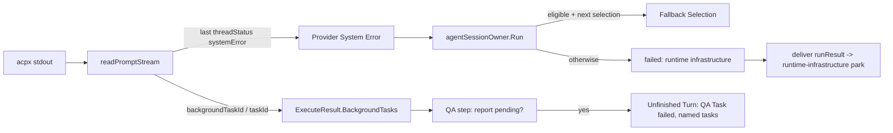

# A turn that did not finish is not accepted — Technical Spec

## Executive Summary

Two turn endings are accepted today as finished turns: a Codex turn that the
provider failed (`threadStatus` `systemError`, then `end_turn`), and a Claude
QA turn that ended while a background task it started was still running. The
ACPX Runner learns to read the turn's last `threadStatus` and returns a
Provider System Error as a failure. The Agent Session owner recovers it through
the rule ADR-0245 already gives a Lost Rollout, minus the same-selection retry.
Claude sessions in Runs get `CLAUDE_CODE_DISABLE_BACKGROUND_TASKS=1`, the
runner records each Agent Background Task a turn starts, and a QA turn that
ends with its report pending after starting one settles as an Unfinished Turn
that names it. The trade-off accepted: detection rests on adapter metadata that
is not a published contract (`_meta.codex.threadStatus`,
`_meta.claudeCode.toolResponse`), so a renamed field silently restores today's
behavior instead of failing loudly; the alternative, matching provider message
text, breaks on every new provider message and misses the 502 and stream
failures the same status carries.

## Project Constraints

- Identifier strategy: not applicable — no identifier scheme changes. The
  `daemon.task` Run Event gains the phases `provider_system_error` and
  `turn_unfinished`, and Agent Selection attempts gain the reason code
  `provider_system_error`, all snake-case like the existing values. Source:
  `docs/agents/domain.md`.
- Authentication and HTTP: not applicable — no request, credential or forge
  read is added. The one environment variable added to `claude` commands has a
  fixed value and carries no secret. Source: `docs/agents/cli.md`,
  `docs/agents/agent-instructions.md`.
- Active ADR obligations: applicable. ADR-0274 (this Spec) decides the
  Provider System Error, the background-task refusal and the Unfinished Turn.
  ADR-0245: "When the loss happens before the Task's First Handoff, or in a QA
  Task while its seeded report still says `verdict: pending`, the next
  selection in the profile's Fallback Chain takes the Task"; task_03 applies
  that rule to a Provider System Error and keeps the Lost Rollout path
  byte-for-byte. ADR-0114: "A Fallback Selection may switch ACP Runtime
  automatically only while Agent work has not begun", narrowed by ADR-0274 in
  the same place ADR-0245 narrowed it. ADR-0050: "once Agent work begins,
  Roundfix fails the Work Item instead of switching models over potentially
  modified state", kept for every failure that is neither a Lost Rollout nor a
  Provider System Error. ADR-0020: "Without a parsed result, a nonzero exit
  stays a Batch failure exactly as before"; the exit mapping is unchanged, and
  the status check runs only once a result was parsed and acpx exited zero.
  ADR-0057: "Genuine Agent execution, infrastructure, or unreadable-artifact
  failures may still be settled failed by the Daemon without a Verification
  command", which governs the unrecovered Provider System Error and the
  Unfinished Turn. ADR-0189 ties an owned skill's version to its content and
  ADR-0233 regenerates a raised version at merge; task_01 raises the Roundfix
  Skill's version with the record command. ADR-0256: a Behavior Surface is
  "the help of one command path", and its skills-Task rule needs task_01
  because `internal/cli/deliver_workflow.go` is a source of the `deliver`
  surfaces. ADR-0259: "Every top-level test in a Parallel Test Package calls
  `t.Parallel()` as its first statement", which the new `internal/daemon` and
  `internal/cli` tests follow. ADR-0271: "A test bounds by real time only what
  it asserts"; the new tests use fake runners and a fake acpx and give no
  child a real-time allowance. ADR-0244: "A Spec now carries a Glossary
  Declaration", answered by the Glossary sections. ADR-0184: "A TechSpec now
  declares numbered Surface Transcripts", answered below with the reason none
  applies. The PRD's Project Constraints account for the related ADRs that do
  not apply. Source: `docs/agents/domain.md`.
- Tooling authority: applicable — no lint, formatter, test-runner, Makefile or
  CI configuration changes. The Governed Paths, measured with
  `speccheck.GovernedPath` through a `go test -overlay` probe that wrote
  nothing, are granted by the cycle AG approval of 2026-10-13. Source:
  `docs/agents/agent-instructions.md`, `docs/agents/spec-routing.md`.
  Spec-contained authorization record:
  `docs/specs/0268-a-turn-that-did-not-finish-is-not-accepted/_authorization.md`.
  Bounded files: `.agents/skills/roundfix/SKILL.md`,
  `.agents/skills/roundfix/references/deliver.md`,
  `.agents/skills/roundfix/references/profiles.md`,
  `skills/roundfix/SKILL.md`.

## System Architecture

No new package or seam. The change extends four existing places:

- `internal/agent` — the ACPX Runner's prompt stream reader
  (`readPromptStream`, `handleStdoutLine` in `acpx_runner.go`) tracks the last
  `threadStatus` of the turn, the provider text after a `systemError`, and the
  Agent Background Tasks the turn starts. `RunPrompt` turns a Provider System
  Error into a failure. A new `provider_system_error.go` holds the marker and
  `DescribeProviderSystemError`, beside `lost_rollout.go`. The sealed prompt
  parser (`sealed.go`) refuses a Provider System Error. The per-runtime session
  environment (`codexEnvForSession`, used by every session command) returns
  `CLAUDE_CODE_DISABLE_BACKGROUND_TASKS=1` for a `claude` runtime. The QA prompt
  contract (`spec_prompt.go`) gains one rule.
- `internal/daemon` — the Agent Session owner (`agent_session_owner.go`)
  recovers a Provider System Error before its Selection Failure branch, with
  the eligibility test it already uses for a Lost Rollout. The QA step
  (`task_engine.go`) settles an exhausted Provider System Error and an
  Unfinished Turn as failed QA Tasks with a pending verdict, as it already does
  for an exhausted Lost Rollout. `engine.go`'s `agentFailureReason` names both.
- `internal/cli/deliver_workflow.go` — `runResult` reads an exhausted
  `provider_system_error` Run Event into `RuntimeInfrastructure`, beside the
  `rollout_lost` one, so the Delivery Queue's existing `runtime-infrastructure`
  park and uncounted retry apply unchanged.
- Docs — `CONTEXT.md`, three user-guide pages and two Roundfix Skill
  references.



Relation to Spec 0267, authored in the same cycle: it may add a sentence to the
same QA prompt contract and raise the same skill version. The two sentences are
independent; whichever Spec merges second rebases.

## Implementation Design

### Interfaces

```go
// internal/agent/provider_system_error.go
const ProviderSystemErrorStatus = "systemError"
const ProviderSystemErrorReason = "provider system error"

type ProviderSystemError struct {
	Runtime string // from a SelectionFailureError in the chain, else ""
	Detail  string // bounded adapter text after the status
}

func DescribeProviderSystemError(err error) (ProviderSystemError, bool)

// internal/agent/protocol_failure.go: ProtocolFailure gains
//	ProviderSystemError bool // Detail holds the bounded text
```

```go
// internal/agent/agent.go
type AgentBackgroundTask struct {
	ID          string // backgroundTaskId or taskId from the adapter
	Tool        string // _meta.claudeCode.toolName, e.g. "Bash", "Monitor"
	Description string // rawInput.description of the same toolCallId, or ""
}

// ExecuteResult gains
//	BackgroundTasks []AgentBackgroundTask // in start order, unique by ID
```

```go
// internal/daemon/agent_session_owner.go
type providerSystemErrorExhaustedError struct{ scopeKind, scopeID, detail string }

func (err *providerSystemErrorExhaustedError) Error() string
// "runtime infrastructure: <kind> <id> hit a provider system error: <detail>"
```

Invariants:

1. A turn is a Provider System Error when the last `session_info_update` of
   the turn that carries `_meta.codex.threadStatus.type` says `systemError`,
   whatever the `stopReason`. A later `active` or `idle` status in the same
   turn clears it.
2. The Provider System Error's detail is the text of the `agent_message_chunk`
   updates after that status and before the result, joined and bounded by
   `boundedProtocolMessage`; when there is none, it is
   `threadStatus systemError`.
3. The check runs only when acpx exited zero with a parsed result. Every other
   exit path, including ADR-0020's parsed-result anomaly and the read-only
   permission refusal, keeps its classification.
4. `RunPrompt` returns a `*BatchFailureError` with
   `Reason: "provider system error"` and
   `Protocol: &ProtocolFailure{Step: "session/prompt", PromptSent: true, ProviderSystemError: true, Detail: <detail>}`;
   when the stream had no Agent output, the existing `classifyNoOutputFailure`
   turns it into a `*SelectionFailureError` with the same protocol. The
   provider's text after the status is an `agent_message_chunk`, so a turn
   that streamed it stays a Batch failure; the owner recovers both shapes
   (Invariant 7). Result
   fields (`Output`, `Messages`, `StopReason`, `Usage`) are still returned.
5. `DescribeProviderSystemError` returns false for `StopError`,
   `context.Canceled` and `context.DeadlineExceeded`, traverses wrapped and
   joined errors, and takes `Runtime` from a `SelectionFailureError`.
6. The sealed parser returns
   `sealed acpx prompt ended with a provider system error: <detail>` and no
   output for a Provider System Error.
7. The owner checks `DescribeLostRollout` first, then
   `DescribeProviderSystemError`, then the Selection Failure branch. A Provider
   System Error in a scope other than `review` is recovered; a `review` scope
   returns the error unchanged.
8. Recovery takes the next Fallback Selection when one exists and either the
   scope is `task` before its First Handoff or the scope is `qa` with the
   seeded report at `verdict: pending`. Otherwise it is `exhausted`; there is
   no same-selection retry, and the recovery does not count toward the Lost
   Rollout budget.
9. Each recovery closes the failed session, persists the attempt `failed` with
   reason code `provider_system_error`, publishes one `daemon.task` event with
   `phase: provider_system_error`, `scope_kind`, `scope_id`, `selection`,
   `detail`, `recovery` (`fallback` or `exhausted`), `next_selection` for a
   fallback and `retry_spent: false`, and writes
   `roundfix: <kind> <id> hit a provider system error: <detail>; recovery: <recovery>`
   to progress. The fallback session gets the Task prompt plus
   `providerSystemErrorNotice`: "The previous Agent Session ended with a
   provider system error; the working tree holds its changes. Keep them and
   continue."
10. A QA fallback appends to the seeded report
    `## Agent runtime fallback` with
    `- provider_system_error: <selection>: <detail>`,
    `- fallback: <next selection>` and `- retry_spent: false`.
11. An exhausted recovery returns `providerSystemErrorExhaustedError`. The QA
    step settles the QA Task `failed` with its text and returns a pending
    verdict without halting; a Task settles `failed` with the same text
    through `agentFailureReason`.
12. Every acpx command the runner starts for a `claude` runtime carries
    `CLAUDE_CODE_DISABLE_BACKGROUND_TASKS=1`, overriding any inherited value;
    no other runtime's command gains it.
13. The runner records an Agent Background Task for each `tool_call_update`
    whose `_meta.claudeCode.toolResponse` carries a non-empty
    `backgroundTaskId` or `taskId`. A task id seen twice is recorded once.
14. After a QA turn returns without error, when `BackgroundTasks` is not empty
    and the seeded report says `verdict: pending`, the QA step publishes one
    `daemon.task` event with `phase: turn_unfinished`, `scope_kind: qa`,
    `scope_id` and `background_tasks` (each `id`, `tool`, `description`), and
    settles the QA Task `failed` with
    `unfinished turn: the QA turn ended with its report pending after starting background task <id> (<tool>: <description>)`,
    tasks joined by `; `. A finished report, or a pending report with no
    recorded task, keeps today's handling.
15. The QA prompt contract gains: "Run every command in the foreground and wait
    for it to exit; never end the turn while a command you started is still
    running. The end of the turn is the end of the gate."

### Data Models

No stored schema changes. Agent Selection attempts store the new reason code
string in the existing column. Run Events use the existing `daemon.task` kind.
`ExecuteResult` gains one in-memory field.

### API Contracts

1. API Contract 1: a Provider System Error from `RunPrompt` has the text
   `Agent Batch failed: provider system error at session/prompt: <detail>`, or
   `Agent Selection failed for runtime "<runtime>": provider system error at session/prompt: <detail>`
   when the turn produced no Agent output (Invariants 1-5).
2. API Contract 2: the `daemon.task` Run Event `phase: provider_system_error`
   payload and progress line of Invariant 9, and the QA report lines of
   Invariant 10.
3. API Contract 3: the Delivery Queue reads an exhausted
   `provider_system_error` event into
   `RuntimeInfrastructure = "<scope_id> hit a provider system error: <detail>"`,
   so the item parks as `runtime-infrastructure: <scope_id> hit a provider
   system error: <detail>` and its retry is not counted. An exhausted
   `rollout_lost` event keeps its text.
4. API Contract 4: the `turn_unfinished` Run Event and the QA Task failure
   reason of Invariant 14.
5. API Contract 5: the `claude` runtime environment of Invariant 12 and the QA
   prompt rule of Invariant 15.

### Surface Transcripts

None. No command's usage, help, standard output or exit code changes. The new
texts are a Run Event payload, a progress line inside a Run, a Task failure
reason and a park blocker detail, each asserted by its Task's tests.

## Coverage Map

- Goal 1, User Story 1, Core Feature 1, Success Metric 1 → `readPromptStream`
  status tracking, `RunPrompt`, `DescribeProviderSystemError`, sealed parser;
  API Contract 1; Invariants 1-6 (task_02).
- Goal 2, User Story 1, Core Feature 2, Success Metric 2 → owner recovery and
  the QA report lines; API Contract 2; Invariants 7-10 (task_03).
- Goal 3, User Story 2, Core Feature 2, Success Metric 3 →
  `providerSystemErrorExhaustedError`, `agentFailureReason`, `runResult`; API
  Contract 3; Invariant 11 (task_03).
- Goal 4, User Story 4, Core Feature 3, Success Metric 4 → the `claude`
  session environment and the QA prompt rule; API Contract 5; Invariants 12
  and 15 (task_04).
- Goal 5, User Story 3, Core Feature 3, Success Metric 4 →
  `ExecuteResult.BackgroundTasks` and the QA step's Unfinished Turn; API
  Contract 4; Invariants 13-14 (task_04).
- Core Feature 4 → `CONTEXT.md`, `docs/user-guide/configuration.md`,
  `docs/user-guide/usage.md`, `docs/user-guide/commands/deliver.md`, the
  Roundfix Skill's `profiles` and `deliver` references (task_01).

Deviations from the PRD: None.

## Absence Evidence

1. Provider System Error marker and `DescribeProviderSystemError` — command: `grep -rn 'threadStatus\|"systemError"\|ProviderSystemError\|provider_system_error\|provider system error' internal cmd --include='*.go'`; result: no match at `9963ffd3`; the runner reads only `stopReason` from the result and ignores `session_info_update`.
2. Agent Background Task record and the `claude` refusal variable — command: `grep -rn 'backgroundTaskId\|CLAUDE_CODE_DISABLE_BACKGROUND_TASKS\|BackgroundTask' internal cmd --include='*.go'`; result: no match at `9963ffd3`; `codexEnvForSession` returns no override for a `claude` runtime.
3. Unfinished Turn outcome — command: `grep -rni 'turn_unfinished\|unfinished turn' internal cmd --include='*.go'`; result: no match at `9963ffd3`; the QA step reads the report verdict after any successful turn.
4. New files — command: `ls internal/agent/provider_system_error.go internal/agent/provider_system_error_test.go internal/agent/background_task_test.go internal/daemon/provider_system_error_recovery_test.go internal/daemon/unfinished_turn_test.go internal/cli/deliver_provider_system_error_test.go internal/cli/review_provider_system_error_test.go`; result: no such file for each at `9963ffd3`.

## ADR Alternatives

- ADR-0274: this Spec's decision; its rejected alternatives (matching the capacity text, a same-selection retry, holding the turn open, prompt wording alone) are not taken.
- ADR-0245: its rejected "matching any `-32603`" is not revived, because the marker is a named status, not an error code; its rejected fallback after a First Handoff stays rejected.
- ADR-0114: its rejected "special-casing quota errors" is not taken; the marker covers every provider failure the status carries, not the capacity text alone.
- ADR-0050: no rejected alternative is taken; fallbacks still activate after notification and are proven before the Run.
- ADR-0020: no rejected alternative is taken; a parsed result still outranks the exit code, and the status check runs beside it.
- ADR-0057: no rejected alternative is taken; the Daemon remains the only writer of the Task status it settles `failed`.
- ADR-0189: no rejected alternative is taken; the skill version rises with its content.
- ADR-0233: no rejected alternative is taken; the version is written by the record command.
- ADR-0272: no rejected alternative is taken; a correction to a parked item is still proved by its Reviewed Head Record and declared paths.
- ADR-0256: its rejected model-judging alternative stays rejected; task_01 is the skills Task its rule requires.
- ADR-0259: no rejected alternative is taken; the new daemon and cli tests call `t.Parallel()` first.
- ADR-0271: no rejected alternative is taken; no new test waits on elapsed time.
- ADR-0244: no rejected alternative is taken; the Glossary Declaration lists every term.
- ADR-0184: no rejected alternative is taken; the Surface Transcripts section states why none applies.
- ADR-0242: no rejected alternative is taken; a review turn with a Provider System Error keeps the blocked-review classification, and the review code does not change.
- ADR-0238: does not apply; the light tier's escalation is untouched, so none of its alternatives is in play.
- ADR-0069: does not apply; Baseline semantic analysis does not change.
- ADR-0160: does not apply; no Task needs a red repository gate opened.
- ADR-0166: no rejected alternative is taken; every Task declares its paths, and recorded paths stay a disclosure.
- ADR-0170: does not apply; Task Carry-Forward of a completed Task does not change.
- ADR-0250: does not apply; no Baseline module version or coverage record changes.
- ADR-0176: does not apply; the citation check's input does not change.
- ADR-0180: does not apply; the built-in selections and the Recommended Profile do not change.
- ADR-0181: does not apply; no configuration is compared with the recommendation.
- ADR-0217: does not apply; no Cursor selection changes.
- ADR-0257: no rejected alternative is taken; the Daemon stays the only full gate inside a Run.
- ADR-0258: no rejected alternative is taken; QA rows name the tests they run, and byte identity is compared with the delivery base.

## Integration Points

- `codex-acp` (2.2.2 measured): `session_info_update` with
  `_meta.codex.threadStatus.type`. Read-only, behind the existing stream
  reader.
- `claude-agent-acp` (0.89.1 measured): `tool_call_update` with
  `_meta.claudeCode.toolResponse.backgroundTaskId` or `taskId`, and its
  inheritance of `process.env` into the Claude Agent SDK.
- acpx 0.19.4: spawns the adapter with its own environment, which Roundfix
  sets per command.

## Testing Approach

1. `internal/agent/provider_system_error_test.go` drives `RunPrompt` through
   `runFakeACPXPrompt` with synthetic stdout in the recorded shape: `active`,
   then `systemError`, then a capacity chunk, then `end_turn` with
   `usage: null`. Cases: with prior Agent output (Batch failure), without
   (Selection failure), `systemError` then `idle` (finished turn), no message
   after the status, a long multi-line detail, the sealed parser, and
   `DescribeProviderSystemError` over wrapped and joined chains. The existing
   Lost Rollout and protocol failure tests keep passing.
2. `internal/cli/review_provider_system_error_test.go` gives the review
   classifier a Provider System Error and asserts a review runtime failure
   naming the detail, never parsed review output.
3. `internal/daemon/provider_system_error_recovery_test.go` reuses the Lost
   Rollout fixture shape (`newTaskCycleFixture`, a scripted runner, a capture
   sink) for: fallback before the First Handoff, exhaustion after it,
   exhaustion without a fallback, the QA fallback and its report lines, and QA
   exhaustion that settles without halting. The existing
   `lost_rollout_recovery_test.go` cases keep passing.
4. `internal/cli/deliver_provider_system_error_test.go` follows
   `deliver_runtime_infrastructure_test.go`: an exhausted
   `provider_system_error` event becomes `RuntimeInfrastructure`, a `fallback`
   one does not, and the Lost Rollout case is unchanged.
5. `internal/agent/background_task_test.go` asserts the environment of a
   `claude` and a `codex` fake acpx command, the recorded tasks of a synthetic
   Claude stream (Bash `backgroundTaskId`, Monitor `taskId`, a repeated id),
   and the QA prompt rule.
6. `internal/daemon/unfinished_turn_test.go` gives the QA step a fake runner
   result with `BackgroundTasks` and a pending report, with a finished report,
   and without tasks.

New `internal/daemon` and `internal/cli` tests call `t.Parallel()` first
(ADR-0259). No test reads `~/.acpx`; fixtures are synthetic and minimal.

## Build Order

1. Docs, glossary and the Roundfix Skill's references with the recorded
   version raise (task_01).
2. The runner's Provider System Error, the sealed refusal and the review
   classification test (task_02).
3. The owner's recovery, the QA and Task settlement, and the Delivery Queue
   park (task_03) (depends on: 1, 2). It reads `DescribeProviderSystemError`
   from step 2 and changes the `deliver` surface whose skill reference step 1
   writes.
4. The `claude` refusal, the background task record, the QA prompt rule and
   the Unfinished Turn (task_04) (depends on: 3). It edits `acpx_runner.go`
   after step 2 and `task_engine.go` after step 3.
5. Final QA gate (task_05) (depends on: 4).

## Risks & Considerations

- Adapter metadata is not a published contract. A renamed field restores
  today's acceptance, visible as a pending report; the tests pin the measured
  shapes so a deliberate change is noticed in review.
- A user's Claude Code `settings.json` `env` applies after the process
  environment and could re-enable background tasks. The turn record and the
  Unfinished Turn still name what was left.
- A QA command longer than the Bash tool's timeout now stops instead of moving
  to the background; the prompt rule tells the Agent to split it.
- A QA fallback moves a gate from Codex to Claude mid-turn. ADR-0245 already
  accepted that for a Lost Rollout, and the report records it.
- An Unfinished Turn names a task the turn started and did not show finished;
  it does not prove the task still runs.

## Glossary

- adds: **Provider System Error**
- adds: **Agent Background Task**
- adds: **Unfinished Turn**
- changes: **Fallback Chain**
- changes: **Fallback Selection**
- changes: **Agent Work Started**

## Decisions

- Read the last `threadStatus` of the turn, not the capacity text. See
  ADR-0274.
- Reuse the Lost Rollout eligibility without its same-selection retry. See
  ADR-0274.
- Refuse background tasks for every `claude` command, not only QA, because in
  a Run nothing may outlive the turn; report only in QA, where a pending report
  is the observed harm. See ADR-0274.
- No change to `roundfix review`'s fallback: a review turn with a Provider
  System Error is a review runtime failure, which is not accepted.
- Research: the Secondbrain and Exa consultations are recorded in
  `_prd.md` → Research record.
