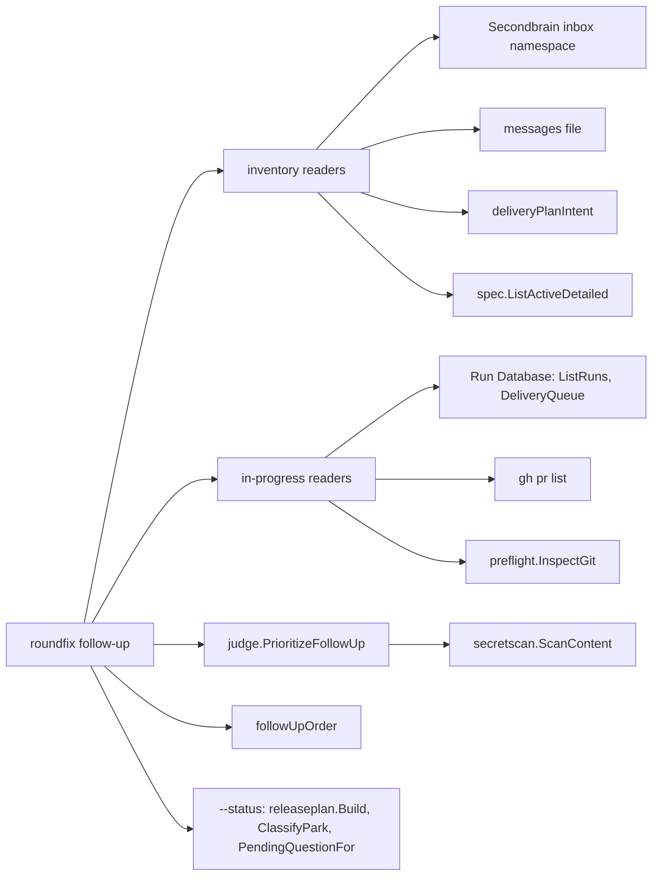

# The Follow-up Command lists a repository's pending work in priority order — Technical Spec

## Executive Summary

`roundfix follow-up` is a new read-only command in `internal/cli` that
composes readers the repository already has: `deliveryPlanIntent` for
`docs/backlog/`, `docs/findings/` and `docs/_inbox/`, `spec.ListActiveDetailed`
and `spec.Load` for Specs, the Run Database's `ListRuns` and `DeliveryQueue`
with `delivery.ClassifyPark` and `delivery.PendingQuestionFor`,
`preflight.InspectGit`, `releaseplan.Build`, and `gh pr list` through the
existing `preflight.GHRunner`. Two new readers are added: the Secondbrain
inbox namespace under the new User Config key `secondbrain.root`, and a
messages file the skill writes. A new judgment kind in `internal/judge` asks
four Noul questions per item in one request, after a secret scan, and the
command orders the items in code (ADR-0319). The primary trade-off: the
order rests on four unmeasured yes/no answers at TypeSafe's suggested
thresholds instead of a measured judgment, accepted because the order is
advisory, falls back to the declared type with a named reason, and every
answer is logged with its model for later measurement.

## Project Constraints

- Identifier strategy: not applicable — no persisted identifier, schema or
  table is minted; `roundfix/follow-up/v1` and
  `roundfix/follow-up-messages/v1` name output and input formats. Source:
  `docs/agents/domain.md`.
- Authentication and HTTP: applicable — requests to the judge use the
  existing transports, Judge Key Variables and Judge Log unchanged; the open
  Pull Requests come from `gh pr list` through `preflight.GHRunner`, whose
  authentication Roundfix never reads; no endpoint, credential or recipient
  is added, and tests use a fake `http.RoundTripper` and a fake
  `preflight.GHRunner`. Source: `docs/agents/cli.md`,
  `docs/agents/agent-instructions.md`.
- Active ADR obligations: applicable — the ADRs the PRD lists: ADR-0319,
  ADR-0209, ADR-0208, ADR-0095, ADR-0143 and ADR-0256, with the judge's
  earlier decisions applying as ADR-0319 records. Source:
  `docs/agents/domain.md`.
- Tooling authority: applicable — express maintainer authorization: the
  cycle AP approval of 2026-10-22, authorization "same as cycle AO", which
  carries the cycle AJ grant "Mexer em Governed Paths declarados". Source:
  `docs/agents/agent-instructions.md`, `docs/agents/spec-routing.md`;
  Spec-contained authorization record:
  `docs/specs/0306-the-follow-up-command-lists-pending-work-in-priority-order/_authorization.md`;
  bounded files: `.agents/skills/roundfix/references/follow-up.md`,
  `.agents/skills/roundfix/SKILL.md`, `skills/roundfix/SKILL.md`.

## Current behavior

Characterized at `42f523c2`:

- No command, config key or package mentions a follow-up or a Secondbrain
  path: `grep -rln -i -e follow-up -e followup -e follow_up internal/cli
  internal/judge internal/config cmd` and `grep -rln -i secondbrain
  internal/config internal/cli` match only `_test.go` files of `internal/cli`,
  where the words appear in fixture prose; no production file matches.
- `internal/judge` asks exactly one question per request. `client.ask`
  chooses the question from `PendingJudgment.Kind` (`citation-support`,
  `goal-mechanism`, `source-grouping`, `model-tier`, `archive-value`) and
  sends `{"state", "model", "questions": {<id>: <question>}}`; `evaluate`
  reads one answer. `AdviseArchive` is the closest model of a loop that asks
  one judgment per item with the ceiling, retry, log and redaction rules.
  The judge never calls `internal/secretscan`.
- `Questions` is decoded from the embedded `questions.json` into one typed
  field per judgment; `pinned_model` is `jev-1.13` and the accepted-model
  pattern admits `jev-1.13.<patch>` and `typesafe/jev-1.13[-YYYYMMDD]`.
- `deliveryPlanIntent(repoRoot)` (`internal/cli/deliver_plan.go`) lists
  `docs/backlog/*.md` and `docs/findings/*.md` with their `status`, and every
  regular file under `docs/_inbox/`, and fails on a record without
  frontmatter.
- `releaseplan.Build` with an empty `Request` plans from the last release tag
  to `HEAD` and fails with `releaseplan.ErrInvalidReleaseRange` when they are
  the same commit, and with `releaseplan.ErrDirtyWorktree` on a dirty tree.
- `gh pr list` runs only for one head branch (`delivery.GitHubCLI`,
  `daemon` task engine); no reader lists every open Pull Request.
- `internal/config` has no `secondbrain` key; `delivery.check_timeout` and
  `jev.monthly_ceiling_usd` show the User-Config-only pattern: Project Config
  values are removed with `warnIgnoredProjectSetting`.

## System Architecture



New components: the **Follow-up Command** (`internal/cli/follow_up.go`,
`follow_up_inventory.go`, `follow_up_status.go`), the judgment kind
`follow-up-priority` with `judge.PrioritizeFollowUp`
(`internal/judge/follow_up.go`), and the `Secondbrain` config section.
Everything else is an existing reader called as it is.

## Implementation Design

### Interfaces

```go
// internal/judge/follow_up.go
type FollowUpItem struct{ Ref, Kind, Type, Origin, Title, Text string }
type FollowUpRequest struct {
	RunID, RepoRoot, Project string
	Items                    []FollowUpItem
	Keys                     map[string]string
	HomeDir                  string
	Transport                http.RoundTripper
	Now                      func() time.Time
}
type FollowUpAnswer struct {
	Ref, Outcome string             // Outcome: "answered" | "skipped"
	Reason       *string
	Nouls        map[string]float64 // per question id
	Verdicts     map[string]string  // "yes" | "no" | "unsure"
	Model        *string
}
type FollowUpReport struct {
	Model                                  string
	Skipped, Stopped                       *string
	Answers                                []FollowUpAnswer // one per item, in order
	Calls                                  int
	CostUSD, MonthCostUSD, MonthCeilingUSD float64
}
func PrioritizeFollowUp(ctx context.Context, q Questions, req FollowUpRequest) (FollowUpReport, error)
```

```go
// internal/config
type Secondbrain struct{ Root, InboxNamespace string } // Config.Secondbrain
const SecondbrainRootKey = "secondbrain.root"
const SecondbrainInboxNamespaceKey = "secondbrain.inbox_namespace"

// internal/cli
func runFollowUpCommand(ctx context.Context, args []string, stdout, stderr io.Writer, environment commandEnvironment) int
func followUpOrder(items []followUpItem, answers map[string]judge.FollowUpAnswer) []followUpItem
// commandDependencies gains followUpGHRunner preflight.GHRunner (default preflight.ExecGHRunner{}).
```

### Data Models

No persisted model changes. The Judge Log gains rows of judgment
`follow-up-priority` in its existing schema `roundfix/judge-log/v1`: one row
per call, `question_id` `follow_up_priority`, `artifact` the item reference,
`target` the item kind, `spec` empty, `probabilities` the four Noul values
keyed by question id, `noul` null, and `model` the versioned model the
service reported. `questions.json` gains the judgment `follow-up-priority`:

```json
"follow-up-priority": {
  "question_id": "follow_up_priority",
  "questions": {"is_fix": {"type": "noul", "instructions": "..."},
                "blocks_other_project": {...}, "is_small": {...},
                "affects_production": {...}},
  "yes_at_least": 0.7, "no_at_most": 0.3,
  "item_max_chars": 4000, "max_items": 100
}
```

The four instructions, in English, each with `item` (kind, type, origin,
title, text) and `project` (the inbox namespace) in the state:

- `is_fix`: "`item` is one pending work item addressed to the software
  project `project`. Does `item` ask to correct a defect in behavior that
  already exists, rather than to add new behavior?"
- `blocks_other_project`: "`item` is one pending work item addressed to the
  software project `project`. Does `item` say that another project cannot
  proceed, or is working around a failure, until `project` changes?"
- `is_small`: "`item` is one pending work item addressed to the software
  project `project`. Could `item` be resolved by one small, local change,
  such as one bounded fix or one document edit?"
- `affects_production`: "`item` is one pending work item addressed to the
  software project `project`. Does `item` concern behavior that the released
  product's users or adopters meet, rather than only this project's own
  development process, documentation or tests?"

### API Contracts

1. API Contract: the command surface. `roundfix follow-up [--status]
   [--messages <path>] [--format <text|json>]` runs in a Git repository and
   reads; it never writes a file, commits, pushes, prompts or opens the Run
   Database for writing. Exit `0` for any report (with work or with nothing
   to do, whatever the judge did); exit `2` for an unknown flag or argument,
   a `--format` other than `text` or `json`, `--messages` together with
   `--status`, an invalid configuration, a working directory outside a Git
   repository, or a messages file that cannot be read or does not match its
   schema; exit `1` when the Run Database exists and cannot be read. Errors
   go to standard error as `roundfix: follow-up failed: <reason>` followed by
   `Run 'roundfix follow-up --help' for usage.`; warnings go to standard
   error; the report goes to standard output.
2. API Contract: configuration. `secondbrain.root` is read from User Config
   only: a Project Config value is removed with the warning `config:
   secondbrain.root in Project Config is ignored; set secondbrain.root in
   User Config`. Its value is an absolute path, or `~` or a path starting
   with `~/`, expanded against the home directory; anything else fails with
   `secondbrain.root must be an absolute path or start with ~/`. Unset means
   the inbox source is `missing`. `secondbrain.inbox_namespace` may be set in
   User Config or Project Config (Project over User); it must match
   `^[a-z0-9][a-z0-9._-]*$` and must not be `_triaged`, else it fails with
   `secondbrain.inbox_namespace must be one lowercase path segment of letters,
   digits, '.', '_' or '-', and not _triaged`. Unset, the namespace is the
   last path segment of the `origin` remote's repository path without `.git`
   (parsed with the existing `parseReadinessRemote`), or, without a usable
   `origin`, the base name of the main checkout root (`config.RepositoryRoot`).
3. API Contract: the inventory. Each source produces Follow-up Items
   `{kind, ref, type, date, title, requested_by}` and a source state:
   - `secondbrain-inbox`: the regular `*.md` files directly in
     `<Secondbrain Root>/inbox/<namespace>/` (never `_triaged/`, never a
     symbolic link); kind `inbox`, ref `inbox/<namespace>/<file>`, type the
     frontmatter `type-hint`, date its `created_at` (or the file name's
     leading `YYYY-MM-DD`), `requested_by` its `origin` when that differs
     from the namespace. Root unset: `missing` with detail `secondbrain.root
     is not set in User Config`; `<root>/inbox` not a directory:
     `unavailable`; namespace directory absent: `checked` with count 0.
   - `ai-memory-messages`: the file `--messages` names, at most 1 MiB, JSON
     `{"schema": "roundfix/follow-up-messages/v1", "messages": [{"id",
     "from", "created_at", "subject", "text", "type"}]}`; `id`, `created_at`
     (RFC 3339 or `YYYY-MM-DD`) and `text` are required, ids are unique,
     `type` is empty or one of `feat`, `fix`, `perf`, `refactor`. Kind
     `message`, ref `message:<id>`, type `type` or `message`, title `subject`
     or the first line of `text` cut to 80 characters, `requested_by`
     `from`. No flag: `missing` with detail `no --messages file`.
   - `backlog`, `findings`, `repository-inbox`: `deliveryPlanIntent` entries
     with status `open` (Backlog Entries, kind `backlog`, type the frontmatter
     `type`, date `created`), `pending` or `partial` (Findings, kind
     `finding`, type `finding`, date `created_at`), and every file of
     `docs/_inbox/` (kind `note`, type `note`, date the file name's
     `YYYY-MM-DD` or none). A `deliveryPlanIntent` error makes all three
     `unavailable` with that error.
   - `specs`: `spec.ListActiveDetailed` of the resolved Specs Root; kind
     `spec`, type `spec`, ref the repository-relative Spec folder, date the
     PRD `created`, title the PRD's first `# ` heading, judge text the PRD's
     first paragraph.
   The title of a Markdown item is its first `# ` heading after frontmatter,
   or its file name without `.md`. An item without a date sorts after dated
   ones.
4. API Contract: in progress. `runs`: `ListRuns` with this Git root and
   `StatesActive` (no Run Database: `checked` 0). `delivery-queue`: the
   items of `DeliveryQueue` for this Git root whose stage is not `merged`,
   each with its position, stage, blocker and, when parked, the
   `ClassifyPark` class and next action. `pull-requests`: `gh pr list
   --state open --limit 100 --json number,title,headRefName,url,isDraft` in
   the Git root through `followUpGHRunner`; any error is `unavailable` with
   its first line. `git`: `preflight.InspectGit` of the working directory:
   branch, short head, upstream, unpushed commits and changed paths; an
   error is `unavailable`. Work is in progress when there is an active Run,
   an unfinished queue item, an open Pull Request, a changed path or an
   unpushed commit.
5. API Contract: Follow-up Priority (ADR-0319). `PrioritizeFollowUp` asks the
   four questions in one request per item, in list order, up to `max_items`;
   later items are `skipped` with `item limit reached (100)`. Before a
   request, the state text (title, origin, type, kind and the item text cut
   to `item_max_chars` runes on a rune boundary) is scanned with
   `secretscan.ScanContent`; a match skips the item with `not sent: secret
   pattern <kind>`, naming the kind only. Inside a Run (`ROUNDFIX_RUN_ID`),
   without a key, at the ceiling, or with an unreadable Judge Log the whole
   report is `Skipped` and nothing is sent; a service failure `Stopped`s the
   rest, as in `AdviseArchive`. A Noul at or above `yes_at_least` is `yes`,
   at or below `no_at_most` is `no`, otherwise `unsure`; an answer from a
   model outside the pin is `skipped`. `followUpOrder` places an answered
   item in `unblocking` (1) when `blocks_other_project` and (`is_fix` or
   `is_small`) are `yes`, else `health` (2) when `is_fix` is `yes`, else
   `feature` (3) when `affects_production` is `yes`, else `other` (4). An
   item without an answer takes `health` for type `fix`, `perf` or kind
   `finding`, `feature` for type `feat`, and `other` for anything else. Inside
   a class: `is_small` `yes` first, then the oldest date, then the reference
   in byte order. `blocks` is the item's `requested_by` when
   `blocks_other_project` is `yes`, else empty.
6. API Contract: the JSON report of the list view (one object, `--format
   json`):

   ```json
   {"schema": "roundfix/follow-up/v1", "view": "follow-up",
    "state": "work_found | nothing_to_do",
    "repository": {"root": "<abs>", "namespace": "<ns>"},
    "sources": [{"name": "secondbrain-inbox", "state": "checked | missing | unavailable", "count": 0, "detail": "<text>"}],
    "judge": {"state": "answered | partial | unavailable | not_asked", "reason": null, "model": null, "calls": 0, "cost_usd": 0},
    "items": [{"rank": 1, "priority": 1, "priority_name": "unblocking", "kind": "inbox", "ref": "<ref>", "type": "fix", "date": "2026-10-21",
               "title": "<title>", "requested_by": "<project or null>", "blocks": "<project or null>",
               "basis": "judge | type", "answers": {"is_fix": "yes"} , "reason": null}],
    "in_progress": {"runs": [], "delivery_queue": [], "pull_requests": [], "git": {}}}
   ```

   `sources` always lists, in this order, `secondbrain-inbox`,
   `ai-memory-messages`, `backlog`, `findings`, `repository-inbox`, `specs`,
   `runs`, `delivery-queue`, `pull-requests`, `git`. `answers` is null when
   `basis` is `type`; `reason` then names why. `state` is `nothing_to_do`
   exactly when `items` is empty and nothing is in progress.
7. API Contract: the text report of the list view. Line 1 `Follow-up for
   <namespace> in <root>`. With nothing to do, line 2 is `Nothing to do: no
   pending item and nothing in progress.` and the `Sources:` block follows.
   Otherwise: `Items: <n>` and one line per item `  <rank>. <priority_name>
   <type> <date|-> <ref>: <title>`, followed by ` — from <requested_by>` and
   ` — blocks <blocks>` when set; `In progress: <n>` and one line per Run
   (`  run <id> <state> <spec|->`), queue item (`  queue <position> <spec>
   <stage> <blocker|->`), Pull Request (`  pull request #<n> <branch>:
   <title>`) and, when it has changes, git (`  git <branch> <head>: <n>
   changed path(s), <n> unpushed commit(s)`); then the judge line — `Judge:
   answered <n> of <m> item(s) with <model>`, `Judge: answered <n> of <m>
   item(s) with <model>; <k> ordered by type`, `Judge: unavailable:
   <reason>; ordered by type` or `Judge: not asked: no item`; then
   `Sources:` and one line per source `  <name>: <state> <count>[: <detail>]`
   for `checked`, `  <name>: <state>: <detail>` otherwise.
8. API Contract: the status view. `--status` reads only `runs`,
   `delivery-queue`, `pull-requests`, `git`, `specs` and the Release Plan,
   and never calls the judge. JSON adds to the shared fields (`schema`,
   `view: "status"`, `state`, `repository`, `sources`, `in_progress`):
   `pending_specs` (`[{"spec", "queue_position", "stage", "tasks_completed",
   "tasks_total"}]`, queue items in position order, then the active Specs not
   in the queue by slug, `queue_position` and `stage` null for those);
   `release` (`{"state", "base", "proposed_version", "changes": [{"commit",
   "subject"}], "reason"}`, where `state` is the Release Plan state,
   `no_unreleased_changes` for `ErrInvalidReleaseRange`, or `unavailable`
   with `reason` for any other error, such as a dirty tree); `blockers`
   (`[{"spec", "blocker", "park_class", "next"}]` for each parked item); and
   `maintainer` (`[{"kind": "pending_question", "spec", "detail", "answer"}]`
   from `PendingQuestionFor`, and `{"kind": "release_approval" |
   "release_classification", "detail"}` when the plan needs approval or a
   manual classification). Its `state` is `nothing_to_do` when nothing is in
   progress, `pending_specs`, `blockers` and `maintainer` are empty and the
   release state is `no_unreleased_changes` or `no_release`. Text: `Status
   for <namespace> in <root>`, then the sections `In progress: <n>`,
   `Pending Specs: <n>` (`  <position|-> <spec> <stage|not queued>
   <completed>/<total> Tasks`), `Next release: <proposed> from <base>
   (<state>)` with `  <short sha> <subject>` per change, or `Next release: no
   unreleased changes`, `Next release: none (no_release)` or `Next release:
   unavailable: <reason>`, `Blockers: <n>` (`  <spec> <park class>: <next>`),
   `Waiting on the maintainer: <n>` (`  question <spec> parked <blocker>:
   <answer>`, `  release <proposed>: <approval question or manual
   classification>`), and `Sources:`.
9. API Contract: documentation. A new guide
   `docs/user-guide/commands/follow-up.md`, its row in the command index and
   in the usage guide's command table, a configuration section and two key
   rows, a new Roundfix reference `references/follow-up.md` with its index
   row (family `follow-up`), the Skill Coverage Map entries, and the glossary
   terms **Follow-up Command**, **Follow-up Item**, **Follow-up Priority**
   and **Secondbrain Root**.

### Surface Transcripts

1. Surface Transcript: the help of the finished command.

   ```transcript
   $ roundfix follow-up --help
   stdout:
   Usage:
     roundfix follow-up [--status] [--messages <path>] [--format <text|json>]

   List this repository's pending work in Follow-up Priority order, or show its status.
   It is read-only: it never writes a file, commits, pushes or prompts.
   Options:
     --status    Show work in progress, pending Specs, the next release and blockers
     --messages  JSON file of ai-memory messages to list with the pending work
     --format    text (default) or json

   Exits 0 for a report, including one with nothing to do; 2 for invalid usage,
   configuration or messages file; 1 for an unreadable Run Database.
   stderr:
   exit: 0
   ```

2. Surface Transcript: an unknown format is refused before anything is read.

   ```transcript
   $ roundfix follow-up --format yaml
   stdout:
   stderr:
   roundfix: follow-up failed: unknown --format "yaml"; use text or json
   Run 'roundfix follow-up --help' for usage.
   exit: 2
   ```

3. Surface Transcript: the messages file belongs to the list view only.

   ```transcript
   $ roundfix follow-up --status --messages messages.json
   stdout:
   stderr:
   roundfix: follow-up failed: --messages applies only to the follow-up list; drop it with --status
   Run 'roundfix follow-up --help' for usage.
   exit: 2
   ```

### Invariants

```text
1. Neither view writes to the repository, the Secondbrain or the Run Database.
2. A source that is missing or unavailable never changes the exit code.
3. The judge never changes the exit code, and no request leaves the machine
   inside a Run, without a key, at the ceiling, or for an item that matches a
   secret pattern.
4. Every Judge Log row of the follow-up judgment names the model that answered.
5. An unsure or absent answer never places an item in the unblocking class.
6. state is nothing_to_do exactly when there is no item and nothing in progress.
7. A Project Config secondbrain.root never takes effect.
```

## Coverage Map

Deviations from the PRD: None.

- Goal 1, Story 1, Core Features 1-3, Success Metric 1 → inventory readers
  and in-progress readers (API Contracts 3, 4; Invariant 2)
- Goal 2, Story 2, Core Feature 4, Success Metrics 2-3 →
  `judge.PrioritizeFollowUp`, `followUpOrder` (API Contract 5; Invariants
  3-5)
- Goal 3, Story 3, Core Feature 5, Success Metric 4 → the report state and
  renderers (API Contracts 6-7; Invariant 6)
- Goal 4, Story 4, Core Feature 6, Success Metric 6 → the status view (API
  Contract 8)
- Core Feature 7, Success Metric 5 → the `Secondbrain` config section (API
  Contract 2; Invariant 7)
- Core Feature 8 → the guide, reference, map and glossary (API Contract 9)
- Success Metric 7 → API Contract 1; Invariant 1
- Success Metric 8 → the PRD's Unreachable Acceptance

## Absence Evidence

1. The Follow-up Command, its readers and `followUpOrder` — command: `grep -rln -i -e follow-up -e followup -e follow_up internal/cli internal/judge internal/config cmd`; result: five `_test.go` files of `internal/cli` match in fixture prose; no production file, command, flag or function of that name exists at `42f523c2`.
2. The `secondbrain` config section and the Secondbrain inbox reader — command: `grep -rln -i secondbrain internal/config internal/cli`; result: only Baseline `_test.go` files of `internal/cli` match; no config key, reader or path setting names the Secondbrain.
3. The `follow-up-priority` judgment and `PrioritizeFollowUp` — command: `grep -rn -e follow-up-priority -e follow_up_priority internal/judge`; result: no match; `client.ask` sends one question per request.
4. A reader of every open Pull Request — command: `grep -rn -e '"pr", "list"' internal`; result: `internal/delivery/github.go` and `internal/daemon/task_engine.go` list only the Pull Requests of one head branch.

## ADR Alternatives

- ADR-0095: no rejected alternative is taken; the inbox stays the single
  capture door and only the destination triages — the command reads pending
  entries positionally and writes nothing there.
- ADR-0143: no rejected alternative is taken; the status view calls the read-
  only Release Plan and performs no release mutation.
- ADR-0208: no rejected alternative is taken; the command adopts no source,
  suggests no grouping and extends no open item.
- ADR-0209: the data boundary it drew is widened, not abandoned: ADR-0319
  admits Follow-up Items through one reader, scanned for secrets, the way
  ADR-0209 admitted the Backlog and Finding reader, while the recipients,
  keys, log and ceiling stay; the English gate is not applied to this
  judgment, which ADR-0319 records with its reason.
- ADR-0256: no rejected alternative is taken; the new command and keys get a
  covering reference in the Skill Coverage Map, so a release plan sees the
  skill change with the surface.
- ADR-0319: no rejected alternative is taken; the order is code over four
  Nouls, the fallback is the type, the command never calls ai-memory, and
  the judge stays advisory and fails open with a named reason.

## Integration Points

- TypeSafe Jev through OpenRouter or TypeSafe, existing transports (judge).
- `gh` for open Pull Requests, through `preflight.GHRunner` (optional source).
- The Secondbrain inbox as a local directory, read only.
- The messages file the Roundfix skill writes (Spec 0307).

## Testing Approach

- `internal/judge/follow_up_test.go` with the existing `roundTripFunc`
  fakes: four questions in one request body; verdict thresholds at 0.7 and
  0.3 exactly; one Judge Log row per call carrying `model` and the four
  probabilities; a secret-shaped item (built at runtime by concatenation, no
  literal) is never in a request body; a Portuguese item whose text crosses
  `item_max_chars` inside a multi-byte rune yields valid UTF-8 state; Run
  Marker, missing key, ceiling, `max_items` and service failure.
- `internal/config/secondbrain_test.go`: User Config value, `~/` expansion,
  Project Config ignored with its warning, invalid values and namespace.
- `internal/cli/follow_up_test.go` through `runCLI` with temporary
  repository, home and Secondbrain, a seeded Run Database (the existing store
  helpers), a fake `followUpGHRunner` and a fake judge transport: Success
  Metrics 1-5 and 7, the class rule (a table whose answers put one item in
  each class, plus an `unsure` blocks answer that must not reach class 1),
  the stop rule, and Surface Transcript 2.
- `internal/cli/follow_up_status_test.go`: a temporary repository with a
  release tag and later commits, a queue with a parked item and a Pending
  Question, Success Metric 6, Surface Transcripts 1 and 3.
- Every test starts no process of the CLI test binary as `roundfix`, uses
  `t.TempDir()` homes, never touches `~/.roundfix`, and calls `t.Parallel()`
  or states why not.

## Build Order

1. Documentation: the guide, the index rows, the configuration section, the
   `follow-up` reference and its index row, the Skill Coverage Map guide
   entry, the glossary terms (API Contract 9).
2. The `follow-up-priority` judgment and `PrioritizeFollowUp` in
   `internal/judge` (API Contract 5).
3. The config section, the inventory and in-progress readers, the order, the
   list view and the `command follow-up` map entry (API Contracts 1-7)
   (depends on: 1, 2).
4. The status view, `--status` in the help, and Surface Transcripts 1 and 3
   (API Contract 8) (depends on: 3).
5. The QA gate (depends on: 4).

No other Spec is required; Spec 0307 builds its skill modes on this command
and delivers after it.

## Risks & Considerations

- Unmeasured judgment: the order may be wrong for Portuguese entries; it is
  advisory, the answers and model are logged for measurement, and the
  operator's first real run is declared unreachable acceptance.
- Cost grows with open items; `max_items` caps one run at 100 requests under
  the same monthly ceiling.
- A secret in an inbox entry: the scan runs before any request and names the
  kind only; the text report prints titles, never bodies.
- `gh` may be absent or unauthenticated; the source says why and nothing else
  changes. `gh` reaches the network, which the help names as a read.
- An older Roundfix binary refuses a User Config that holds the new
  `secondbrain` keys, as it does for every new key; the guide says so.

## Glossary

- adds: **Follow-up Command**
- adds: **Follow-up Item**
- adds: **Follow-up Priority**
- adds: **Secondbrain Root**

## Decisions

- One command with a `--status` view, not two commands, because both views
  share the in-progress readers and the skill calls one entry point.
- The judgment lives in `internal/judge` beside the other kinds, so the key,
  ceiling, log, pin and Run Marker rules apply unchanged. See ADR-0319.
- Thresholds and the class rule are fixed in code and `questions.json`, not
  in configuration, until a measurement exists.
- `secondbrain.root` is User Config only; the namespace may be per project.
