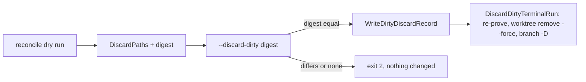

# Reconcile discards confirmed dirty leftovers and releases ignored-only worktrees — Technical Spec

## Executive Summary

The terminal Run inspection in `internal/worktree` marks a `dirty` Run as a
Dirty Discard candidate when the Run ended without delivering, its Spec is
archived on the default branch, its commit proof holds and only an
uncommitted path outside the archived Spec's scope keeps it; the candidate
carries its uncommitted path set and the inspection evidence a later
re-proof compares. `internal/cli/reconcile.go` drops a candidate that owns a
live process tree, prints the paths and one SHA-256 digest of the set, and
adds `--discard-dirty <digest>`, which writes a Branch Disposition record
through a new `daemon.WriteDirtyDiscardRecord` and then calls
`runworktree.DiscardDirtyTerminalRun`. The same inspection classifies an
unregistered recorded Run Worktree that holds only ignored files `safe`, and
`ApplyTerminalRun` removes it without the Run Database journal; a full-scan
`--apply` finally removes empty repository directories under the Worktree
Root. The trade-off this design accepts is that a discard removes the whole
Run Worktree rather than only the leftovers, so in-scope leftovers go with
it; ADR-0289 already proves those superseded, and the single step avoids a
second command re-proving what the first just proved (ADR-0379).

## Project Constraints

- Identifier strategy: not applicable — no identifier or slug is minted; the
  digest is computed, and the Branch Disposition record keeps its
  `roundfix-branch-disposition/v1` schema with two optional fields. Source:
  `docs/agents/domain.md`.
- Authentication and HTTP: not applicable — local Run Database and local Git
  only. Source: `docs/agents/cli.md`.
- Active ADR obligations: applicable — ADR-0379 (new) records the decision,
  ADR-0379: "A Dirty Discard is explicit, confirmed and recorded." It amends
  ADR-0053, ADR-0053: "Ambiguous, dirty, and unintegrated work stays intact",
  ADR-0289, whose rejected option it answers, ADR-0289: "A stray edit outside
  the Spec's scope is work only its author can judge", and ADR-0290, whose
  Run Worktree row gains the Dirty Discard as a reclaimer, ADR-0290:
  "Reclaiming Run Worktrees by age was rejected."; task_03 writes the three
  notices. ADR-0115 makes a disposal a separate act that writes its evidence
  first, ADR-0115: "The act writes what the branch held", which the Dirty
  Discard follows. ADR-0212, ADR-0161 and ADR-0232 supply the commit proof
  the discard requires, ADR-0212: "When the merged head holds the Spec
  archived", ADR-0161: "A terminal Run of a merged Spec is released when
  every commit its Run Branch holds and the merged head lacks is represented
  there", ADR-0232: "Merge evidence releases the Runs and item branches of a
  merged Spec". Not applicable, and marked `not applicable` in the TechSpec:
  the related-ADR candidates that the listed ADRs draw in, each on a part
  this Spec leaves alone (Task Carry-Forward, Stale Run Owner Records, the
  history cleanup and conversion, the pre-PR review, the Delivery Queue's
  merge records and the authoring checks they cite), ADR-0092, ADR-0120, ADR-0165, ADR-0169, ADR-0170, ADR-0196, ADR-0197, ADR-0227, ADR-0233, ADR-0237, ADR-0247, ADR-0248, ADR-0250, ADR-0251, ADR-0254, ADR-0256, ADR-0258, ADR-0260, ADR-0261, ADR-0262, ADR-0269, ADR-0272, ADR-0277, ADR-0278, ADR-0279, ADR-0281, ADR-0282, ADR-0284, ADR-0286, ADR-0295, ADR-0299, ADR-0306, ADR-0308, ADR-0313, ADR-0317, ADR-0345, ADR-0346, ADR-0348, ADR-0349, ADR-0352, ADR-0366, ADR-0368 and ADR-0373.
  Source: `docs/agents/domain.md`, `docs/agents/spec-routing.md`.
- Tooling authority: applicable — express maintainer authorization: the
  cycle BA batch 2 answers of 2026-11-09 quoted in the authorization record;
  no Makefile, workflow, Go module, lint or formatter change. Source:
  `docs/agents/agent-instructions.md`, `docs/agents/spec-routing.md`;
  Spec-contained authorization record:
  `docs/specs/0369-reconcile-discards-confirmed-dirty-leftovers-and-ignored-only-worktrees/_authorization.md`;
  bounded files: `.agents/skills/roundfix/SKILL.md`,
  `.agents/skills/roundfix/references/reconcile.md`,
  `internal/cli/cli_test.go`, `skills/roundfix/SKILL.md`.

## System Architecture

- `internal/worktree/worktree.go` (task_01, task_02):
  `inspectTerminalRunMerged` keeps every existing classification. In its
  dirty branch, when the Spec is archived at the default branch head, the
  outcome is one of `DirtyDiscardOutcomes()`, the path set parsed and the
  commit proof is `safe` or `superseded` but `dirtyPathsInArchivedSpec`
  named an outside path, the `dirty` result also carries `DiscardPaths` (the
  whole parsed set, in parse order) and evidence holding the proof head and
  the path set. `DiscardDirtyTerminalRun` re-inspects and removes. In its
  unregistered branch (task_02), `unregisteredIgnoredOnly` decides the new
  `safe` case before today's `unknown`; `revalidateTerminalRunApply`,
  `applyTerminalRunWithStore` and `cleanupTerminalRun` learn that case.
  `EmptyRepositoryDirectories` and `RemoveEmptyRepositoryDirectory` serve the
  full-scan sweep.
- `internal/daemon/reconcile.go` (task_01): `BranchDisposition` gains
  `DiscardedPaths` and `DiscardDigest`, both `omitempty`, and
  `WriteDirtyDiscardRecord` shares the atomic file write with
  `WriteBranchDispositionRecord`.
- `internal/cli/reconcile.go` (task_01, task_02): option parsing, the
  candidate filter against process candidates, the digest, the
  `discard-dirty` mode, the text and JSON fields, and the full-scan empty
  directory sweep after `applyReconcileWorktrees`.
- `internal/cli/cli.go` (task_01): the global synopsis line and the
  `reconcile` usage text.
- Documentation: ADR-0379 (in the tree with this plan); the user guide
  (task_01, task_02); `CONTEXT.md` (task_01, task_02); the three ADR notices
  and the Roundfix skill's `reconcile` reference (task_03).



## Implementation Design

### Interfaces

```go
// internal/worktree
type RunWorktreeReconciliation struct {
	// ...existing fields...
	DiscardPaths []string // non-empty only for a Dirty Discard candidate
}

func DirtyDiscardOutcomes() []string // Failed, Unresolved, Stopped, BudgetExceeded, TimedOut
func DiscardDirtyTerminalRun(ctx context.Context, result RunWorktreeReconciliation) error
func EmptyRepositoryDirectories(location string) ([]string, error)
func RemoveEmptyRepositoryDirectory(location, path string) error

// internal/daemon
func WriteDirtyDiscardRecord(path string, disposition BranchDisposition, recordedAt time.Time) error

// internal/cli
func withholdDirtyDiscardFromLiveRuns(report *reconcileReport)
func dirtyDiscardDigest(results []reconcileResult) string
```

### Data Models

- `daemon.BranchDisposition` gains `DiscardedPaths []string` (JSON
  `discardedPaths`) and `DiscardDigest string` (JSON `discardDigest`), both
  `omitempty`. A Dirty
  Discard record has `superseded: false`, the Run's branch, target, Run head,
  target head, worktree, empty `commits` and `changedFiles`,
  the Run's dirty reason in `refusalReason`, and `reason`
  `dirty leftovers discarded by a confirmed Dirty Discard`.
- `reconcileResult` gains `DiscardPaths []string` (JSON `discardPaths`,
  `omitempty`);
  `reconcileReport` gains `DiscardDirtyDigest` and `DiscardDirtyCommand`
  (`discardDirtyDigest`, `discardDirtyCommand`, both `omitempty`) and
  `EmptyDirectoryCandidates []reconcileDebrisResult`
  (`emptyDirectoryCandidates`, `omitempty`, kind `emptyRepositoryDirectory`,
  the path in `worktree`); `reconcileDebrisSummary` gains
  `EmptyDirectoriesRemoved int` (JSON `emptyDirectoriesRemoved`,
  `omitempty`).
  A report without candidates keeps its bytes.
- The digest is the lowercase hex SHA-256 of, for each candidate in Run ID
  byte order, its Run ID, Run head, worktree path and each discard path in
  byte order, each followed by one NUL byte, and one more NUL byte closing
  the candidate.

### API Contracts

1. API Contract: `roundfix reconcile [run-id] --discard-dirty <digest>`.
   Input: a 64-character lowercase hex digest; mutually exclusive with
   `--apply`, `--discard-superseded` and `--carry-forward`. Output on success:
   the report in mode `discard-dirty`, each candidate's action `discarded`
   and evidence ending with `; branch record: <record path>`, exit 0.
   Failures: a missing or malformed digest, a combined switch, no candidate,
   or a digest that differs from the recomputed one exit 2 with nothing on
   stdout and nothing changed; a record or removal failure marks that Run
   `preserve` with the error, counts an operational failure and exits 1.
2. API Contract: the dry run and every mode report `discardPaths` on each
   candidate and `discardDirtyDigest` and `discardDirtyCommand` when one
   exists; the text report prints `  discard-path: <path>` lines and, in a
   dry run, `Discard dirty leftovers with: <command>` after `Apply with:`.
3. API Contract: an unregistered ignored-only Run Worktree reads
   `classification: safe` with evidence
   `recorded Run Worktree is not registered in the Git root and holds only files the repository ignores`;
   `--apply` releases it and the next scan reads `released`.
4. API Contract: a full scan lists each empty repository directory as
   `Empty repository directory: <path>` with `  action: would remove with --apply`
   (or `removed`, or `preserve` with its refusal), in `emptyDirectoryCandidates`,
   and counts removals in `debrisSummary.emptyDirectoriesRemoved`.

### Surface Transcripts

1. Surface Transcript: a Dirty Discard needs its digest.

   ```transcript
   $ roundfix reconcile --discard-dirty
   stdout:
   stderr:
   roundfix: reconcile failed: flag needs an argument: --discard-dirty
   Run 'roundfix reconcile --help' for usage.
   exit: 2
   ```

2. Surface Transcript: a malformed digest is refused before any inspection.

   ```transcript
   $ roundfix reconcile --discard-dirty abc
   stdout:
   stderr:
   roundfix: reconcile failed: --discard-dirty needs the 64-character digest that roundfix reconcile prints
   Run 'roundfix reconcile --help' for usage.
   exit: 2
   ```

3. Surface Transcript: the four mutation switches exclude each other.

   ```transcript
   $ roundfix reconcile --apply --discard-dirty 0000000000000000000000000000000000000000000000000000000000000000
   stdout:
   stderr:
   roundfix: reconcile failed: --apply, --discard-superseded, --discard-dirty, and --carry-forward are mutually exclusive
   Run 'roundfix reconcile --help' for usage.
   exit: 2
   ```

## Coverage Map

- Goal 1, User Stories 1–2, Core Features 1–2, Success Metrics 1–2 →
  `inspectTerminalRunMerged` candidate marking, `DiscardDirtyTerminalRun`,
  `WriteDirtyDiscardRecord`, `--discard-dirty` in `internal/cli/reconcile.go`
  (task_01).
- Goal 2, User Story 3, Core Feature 3, Success Metric 3 →
  `unregisteredIgnoredOnly` and the apply path in `internal/worktree`
  (task_02).
- Goal 3, User Story 3, Core Feature 4, Success Metric 4 →
  `EmptyRepositoryDirectories`, `RemoveEmptyRepositoryDirectory` and the
  full-scan sweep (task_02).
- Goal 4, Core Feature 5 → `CONTEXT.md` and the user guide (task_01,
  task_02), the ADR notices and the skill reference (task_03).

Deviations from the PRD: None.

## Absence Evidence

1. The `--discard-dirty` switch and its digest — command:
   `grep -rn 'discard-dirty\|DiscardDirty\|discardDirty' internal`; result:
   no match at `cfc08683`.
2. A Branch Disposition record for discarded paths — command:
   `grep -rln 'WriteDirtyDiscard\|DiscardedPaths' internal`; result: no match;
   `WriteBranchDispositionRecord` refuses a disposition that is not
   superseded.
3. The ignored-only release of an unregistered Run Worktree — command:
   `grep -rn 'check-ignore' internal --include=*.go`; result: one call, the
   Delivery Queue's declared-path check in `internal/cli/deliver_workflow.go`;
   nothing in `internal/worktree`, where the unregistered state returns
   `unknown`.
4. The empty repository directory sweep — command:
   `grep -rn 'os.Remove(' internal/worktree/*.go internal/cli/reconcile.go`;
   result: no match; reconcile removes directories only through Git or the
   item worktree removal.

## ADR Alternatives

- ADR-0379: this design is the decision; it takes none of the options
  ADR-0379 rejects (no unconfirmed discard, no Run-ID-only confirmation, no
  clean-then-apply, no discard under a failed commit proof, no `--no-index`,
  no sweep of every empty directory).
- ADR-0053: it rejected releasing dirty work by default; the discard is not
  a default, it is a separate confirmed switch, and `--apply` still releases
  only `safe` and `superseded` work. ADR-0379 amends it.
- ADR-0289: it rejected releasing every dirty Run of a merged Spec and
  reading each Run's own plan revision; both stay rejected for every
  automatic path, and the operator's confirmation is the judgement its
  rejected option asked for. ADR-0379 amends it.
- ADR-0290: it rejected reclaiming Run Worktrees by age; the Dirty Discard
  and the ignored-only release reclaim by confirmation and proof, never by
  age. ADR-0379 amends its Run Worktree row.
- ADR-0115: the Dirty Discard is a separate named switch that writes its
  record before it removes anything; it takes neither rejected option: the
  read-only report stays read-only, and nothing is discarded automatically on
  a refusal.
- ADR-0212: the discard reuses its commit proof unchanged and takes none of
  its rejected options.
- ADR-0161: the discard requires its merged-head commit proof and takes none
  of its rejected options.
- ADR-0232: the discard accepts the merge-evidence commit proof unchanged and
  takes none of its rejected options.
- ADR-0092: not applicable; a related-ADR candidate on a part this Spec leaves alone.
- ADR-0120: not applicable; a related-ADR candidate on a part this Spec leaves alone.
- ADR-0165: not applicable; a related-ADR candidate on a part this Spec leaves alone.
- ADR-0169: not applicable; a related-ADR candidate on a part this Spec leaves alone.
- ADR-0170: not applicable; a related-ADR candidate on a part this Spec leaves alone.
- ADR-0196: not applicable; a related-ADR candidate on a part this Spec leaves alone.
- ADR-0197: not applicable; a related-ADR candidate on a part this Spec leaves alone.
- ADR-0227: not applicable; a related-ADR candidate on a part this Spec leaves alone.
- ADR-0233: not applicable; a related-ADR candidate on a part this Spec leaves alone.
- ADR-0237: not applicable; a related-ADR candidate on a part this Spec leaves alone.
- ADR-0247: not applicable; a related-ADR candidate on a part this Spec leaves alone.
- ADR-0248: not applicable; a related-ADR candidate on a part this Spec leaves alone.
- ADR-0250: not applicable; a related-ADR candidate on a part this Spec leaves alone.
- ADR-0251: not applicable; a related-ADR candidate on a part this Spec leaves alone.
- ADR-0254: not applicable; a related-ADR candidate on a part this Spec leaves alone.
- ADR-0256: not applicable; a related-ADR candidate on a part this Spec leaves alone.
- ADR-0258: not applicable; a related-ADR candidate on a part this Spec leaves alone.
- ADR-0260: not applicable; a related-ADR candidate on a part this Spec leaves alone.
- ADR-0261: not applicable; a related-ADR candidate on a part this Spec leaves alone.
- ADR-0262: not applicable; a related-ADR candidate on a part this Spec leaves alone.
- ADR-0269: not applicable; a related-ADR candidate on a part this Spec leaves alone.
- ADR-0272: not applicable; a related-ADR candidate on a part this Spec leaves alone.
- ADR-0277: not applicable; a related-ADR candidate on a part this Spec leaves alone.
- ADR-0278: not applicable; a related-ADR candidate on a part this Spec leaves alone.
- ADR-0279: not applicable; a related-ADR candidate on a part this Spec leaves alone.
- ADR-0281: not applicable; a related-ADR candidate on a part this Spec leaves alone.
- ADR-0282: not applicable; a related-ADR candidate on a part this Spec leaves alone.
- ADR-0284: not applicable; a related-ADR candidate on a part this Spec leaves alone.
- ADR-0286: not applicable; a related-ADR candidate on a part this Spec leaves alone.
- ADR-0295: not applicable; a related-ADR candidate on a part this Spec leaves alone.
- ADR-0299: not applicable; a related-ADR candidate on a part this Spec leaves alone.
- ADR-0306: not applicable; a related-ADR candidate on a part this Spec leaves alone.
- ADR-0308: not applicable; a related-ADR candidate on a part this Spec leaves alone.
- ADR-0313: not applicable; a related-ADR candidate on a part this Spec leaves alone.
- ADR-0317: not applicable; a related-ADR candidate on a part this Spec leaves alone.
- ADR-0345: not applicable; a related-ADR candidate on a part this Spec leaves alone.
- ADR-0346: not applicable; a related-ADR candidate on a part this Spec leaves alone.
- ADR-0348: not applicable; a related-ADR candidate on a part this Spec leaves alone.
- ADR-0349: not applicable; a related-ADR candidate on a part this Spec leaves alone.
- ADR-0352: not applicable; a related-ADR candidate on a part this Spec leaves alone.
- ADR-0366: not applicable; a related-ADR candidate on a part this Spec leaves alone.
- ADR-0368: not applicable; a related-ADR candidate on a part this Spec leaves alone.
- ADR-0373: not applicable; a related-ADR candidate on a part this Spec leaves alone.

## Integration Points

- Git, through the existing `gitRunner`: `worktree list --porcelain -z`,
  `status --porcelain=v1 -z --untracked-files=all`, `worktree remove --force`,
  `branch -D`, and the new `check-ignore -z --stdin` run in the Git root with
  the relative paths on stdin (exit 1 means none is ignored, 128 a failure).
- The Artifact Root resolved as `--discard-superseded` resolves it
  (`roundconfig.ResolveArtifactDirectory`), for
  `<artifact root>/runs/<run-id>/branch-disposition.json`.
- The Delivery Queue's release after a merge (`internal/cli/deliver_release.go`)
  calls `InspectTerminalRunMerged` and `ApplyTerminalRun`, so it releases an
  ignored-only directory too; it never discards.

## Testing Approach

- `internal/worktree`: new test files over the existing archived-leftover
  fixtures (`newArchivedLeftoverFixture`, `addDeclaredLeftovers`,
  `inspectMergedHeadTestRun`) and plain temporary repositories, for the
  candidate marking, the re-proof and removal, the unregistered ignored-only
  case and the empty directory helpers.
- `internal/daemon`: a test of `WriteDirtyDiscardRecord` in a temporary
  directory.
- `internal/cli`: new test files over `newReconcileMergedFixture` and
  `newReconcileWorkspace`, driving `runCLIContext` with temporary homes, for
  the dry run, the confirmed discard, every refusal and the full-scan sweep;
  the three Surface Transcripts in one named test each.
- No test reads the real `~/.roundfix`, reaches the network or starts an
  Agent; every test that starts Git runs in `t.TempDir()`.

## Build Order

1. Dirty Discard: candidate marking and `DiscardDirtyTerminalRun` in
   `internal/worktree`, `WriteDirtyDiscardRecord` in `internal/daemon`, the
   switch, digest and report fields in `internal/cli/reconcile.go`, the
   usage text, the user guide and the **Dirty Discard**, **Branch
   Disposition** and **Reconcile Command** entries (task_01).
2. Ignored-only release and empty repository directories, with the user
   guide and the **Run Worktree Reconciliation** and **Reconcile Command**
   entries (task_02) (depends on: 1, which changes the same files).
3. The ADR-0053, ADR-0289 and ADR-0290 notices and the Roundfix skill's
   `reconcile` reference (task_03) (depends on: 1, 2, whose behavior they
   describe).
4. QA gate (task_04) (depends on: 1, 2, 3).

## Risks & Considerations

- A file written into a candidate's worktree between the re-proof and
  `git worktree remove --force` is lost; the window is one Git command on a
  Run that ended for a Spec already delivered, and the record names the set
  that was confirmed.
- A Run start that creates its repository directory while the sweep runs:
  the sweep removes only a directory that is empty at `os.Remove`, and
  `git worktree add` creates missing leading directories, so the next
  worktree is still created.
- A large ignored tree (a database volume) is listed in full and sent to one
  `git check-ignore` process on stdin; the list is the evidence the re-proof
  compares, so it is not shortened.
- The dirty reason is unchanged for every Run, candidate or not, so the
  existing tests that pin it keep passing.

## Glossary

- adds: **Dirty Discard** — the Reconcile Command's confirmed removal of an ended Run's dirty leftovers.
- changes: **Branch Disposition** — it also records the paths a Dirty Discard removed.
- changes: **Reconcile Command** — it gains `--discard-dirty <digest>`, and `--apply` removes empty repository directories.
- changes: **Run Worktree Reconciliation** — an unregistered Run Worktree that holds only ignored files is `safe`.

## Decisions

- The digest binds the candidate set; see ADR-0379.
- The discard requires the commit proof and removes the whole Run Worktree
  and Run Branch after the record; see ADR-0379.
- The ignored-only proof is `git check-ignore -z --stdin` without
  `--no-index`, run in the Git root; see ADR-0379.
- The ignored-only release writes no Run Database journal, because
  `ReconcileIntegration` requires a Run head and none exists.
- A refused `--discard-dirty` prints nothing on stdout, so the operator
  reruns the dry run rather than reading a report that was not acted on.
- Empty repository directories are swept only on a full-scan `--apply`,
  after the Run releases, by name shape and emptiness.
