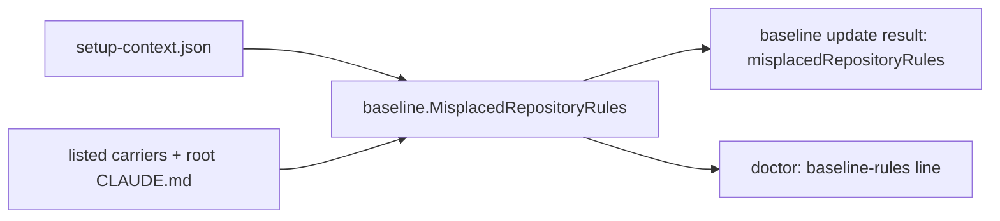

# Adopters keep their own rules in the specific-repository guide — Technical Spec

## Executive Summary

The fix has two halves. The first changes text: three existing Normative Clauses, three templates and the starter of `docs/agents/specific-repository.md` state where a repository's own rules go, with an example. The second adds detection: a read-only detector in `internal/baseline` lists each Misplaced Repository Rule from the Setup Manifest's carriers. `roundfix baseline update` reports the list in its result, outside the Plan Document. `roundfix doctor` reports it as one `baseline-rules` line that never fails.

The primary trade-off is that Roundfix names passages and never moves them, as the operator's brief requires. Adopters keep their misplaced bytes until a person or a supervised Agent moves them. In return, no update is blocked, no Plan Digest moves, and no rule changes meaning by losing its heading or its neighbours. The second trade-off is that every passage outside a Managed Region is named, whether or not it reads as a rule. Judging the content would need a semantic analyzer, which a managed refresh never invokes. A block another tool delimits with its own `BEGIN:`/`END:` comment pair is the one exception.

## Project Constraints

- Identifier strategy: not applicable — no persistent identifier is minted. The new names are a JSON field (`misplacedRepositoryRules`), a Doctor check name (`baseline-rules`) and two `DR-` codes, all public CLI contract under `docs/agents/cli.md`. Source: `docs/agents/domain.md`.
- Authentication and HTTP: not applicable — no endpoint, credential or network read. The Doctor line reads local files only and joins the offline checks. Source: `docs/agents/cli.md`, `docs/agents/agent-instructions.md`.
- Active ADR obligations: applicable — ADR-0411 (new), ADR-0145, ADR-0203, ADR-0220, ADR-0186 and ADR-0257 bind the design; ADR-0222, ADR-0071, ADR-0258 and ADR-0342 are listed only to record why they do not apply. ADR Alternatives relates each one. Source: `docs/agents/domain.md`, `docs/agents/specific-repository.md`.
- Tooling authority: applicable — express maintainer authorization: "Mesmas do BE (Recommended)" (2026-11-16), quoted in the record. It covers the Baseline modules, templates, profile pin and formatter goldens, this repository's managed guides and Setup Manifest, and the Roundfix and `setup-context-driven` skill files listed below. It grants no Makefile, workflow, Go module, lint or formatter change. Source: `docs/agents/agent-instructions.md`, `docs/agents/spec-routing.md`; Spec-contained authorization record: `docs/specs/0399-adopters-keep-their-own-rules-in-the-specific-repository-guide/_authorization.md`; bounded files: `.agents/skills/roundfix/SKILL.md`, `.agents/skills/roundfix/references/baseline.md`, `.agents/skills/roundfix/references/setup.md`, `.agents/skills/setup-context-driven/SKILL.md`, `docs/agents/agent-instructions.md`, `docs/agents/docs-layout.md`, `docs/agents/setup-context.json`, `docs/agents/skill-dispatch.md`, `internal/baseline/assets/formatter-fixtures/standard-typescript-monorepo/golden/docs/agents/agent-instructions.md`, `internal/baseline/assets/formatter-fixtures/standard-typescript-monorepo/golden/docs/agents/docs-layout.md`, `internal/baseline/assets/formatter-fixtures/standard-typescript-monorepo/golden/docs/agents/skill-dispatch.md`, `internal/baseline/assets/modules/context-workflow.json`, `internal/baseline/assets/modules/core.json`, `internal/baseline/assets/modules/repository-extension.json`, `internal/baseline/assets/profiles/standard-typescript-monorepo.json`, `internal/baseline/assets/templates/extensions/specific-repository.md`, `internal/baseline/assets/templates/guides/agent-instructions.md`, `internal/baseline/assets/templates/guides/skill-dispatch.md`, `internal/baseline/assets/templates/index.json`, `internal/baseline/assets/templates/root/repository-extension.md`, `skills/roundfix/SKILL.md`, `skills/setup-context-driven/SKILL.md`.

## System Architecture

No package, layer or directory is new. The fix extends three seams.

### Catalog text

In `internal/baseline/assets/`, `core.json` carries `clause.core.keep-root-compact` (rule `rule.core.compact-root`) and `clause.core.activate-matching-skills` (rule `rule.core.skill-dispatch`). `context-workflow.json` carries `clause.context.docs-one-job-per-directory`. `repository-extension.json` owns the root block `root.repository-extension` and the extension `extension.repository-rules`. The guide templates `guides/agent-instructions.md` and `guides/skill-dispatch.md` carry the intro prose, `root/repository-extension.md` the root pointer, and `extensions/specific-repository.md` the starter. `templates/index.json` versions each template.

### Misplaced Repository Rule detector

A new file `internal/baseline/misplaced_rules.go` reads the Setup Manifest with the parser `classifyManagedRegions` already uses. It splits each listed Markdown carrier with `partitionRootSource` and keeps its `unmarked-span` entries. It takes the digest-mismatch regions that `classifyManagedRegions` returns. It converts byte offsets to 1-based line numbers. Foreign `BEGIN:`/`END:` blocks are cut out of an unmarked span before trimming.

### Command surfaces

In `internal/cli`, `runBaselineUpdateCommand` sets `baselineUpdateResult.MisplacedRepositoryRules` after the plan, current or apply step. The text writer prints the section after `Unrecorded managed regions` and before `Retention evidence`. `runDoctorCommand` appends `doctorBaselineRulesResult(repositoryRoot)` after the `skills` line.



## Implementation Design

### Interfaces

```go
// internal/baseline/misplaced_rules.go
const SpecificRepositoryPath = "docs/agents/specific-repository.md"

type MisplacedRepositoryRule struct {
	Path      string `json:"path"`
	StartLine int    `json:"startLine"`
	EndLine   int    `json:"endLine"`
	FirstLine string `json:"firstLine"`
	ManagedID string `json:"managedId,omitempty"` // set only for an Unrecorded Managed Region
	MoveTo    string `json:"moveTo"`
}

type MisplacedRepositoryRuleReport struct {
	ManifestFound    bool
	ExtensionEnabled bool // decision repository.extension.enabled
	Rules            []MisplacedRepositoryRule
}

func MisplacedRepositoryRules(root string) (MisplacedRepositoryRuleReport, error)
```

```go
// internal/cli
const HealthCheckBaselineRules = "baseline-rules"
func doctorBaselineRulesResult(repositoryRoot string) CheckResult
```

Numbered invariants:

1. The detector reads only. It never writes, never invokes semantic classification, and never inspects `docs/agents/specific-repository.md`, a nested carrier, or a file the Setup Manifest does not list. The one exception is a root `CLAUDE.md` that is a regular file. A symbolic link is skipped, so `AGENTS.md` is reported once.
2. A passage is an `unmarked-span` of a listed `.md` carrier after foreign blocks are cut out, trimmed of leading and trailing blank lines. Blank lines inside it stay part of it. An empty span is not a passage.
3. A foreign block runs from a line that matches `^\s*<!--\s*BEGIN:<name>\s*-->\s*$` to the first later line that matches the same name with `END:`. An unclosed `BEGIN:` is not foreign, and its lines stay in the passage.
4. An Unrecorded Managed Region with reason `digest-mismatch` is one entry. It carries `ManagedID`, the marker pair's line range, and the first non-blank line after the begin marker. A region with reason `marker-absent` has no lines, so it is not an entry.
5. `FirstLine` is the passage's first line with surrounding whitespace removed, cut at 120 bytes on a rune boundary, with `...` appended when cut. `MoveTo` is always `SpecificRepositoryPath`.
6. Entries are sorted by path, then by start line. Line numbers refer to the bytes on disk when the result is computed, which is after the apply for an applied result.
7. Without a Setup Manifest, `ManifestFound` is false and there is no error. An invalid manifest returns an error that wraps the manifest code `baseline.preservation.managed-refresh.manifest.invalid`.
8. Neither command changes its exit code, the Plan Document, the Plan Digest, or any repository byte because of an entry.

### Data Models

No stored data changes. The Setup Manifest's schema is unchanged and is only read. The result type `baselineUpdateResult` gains one field:

- `MisplacedRepositoryRules *[]baseline.MisplacedRepositoryRule` with tag `json:"misplacedRepositoryRules,omitempty"`.
- It is set, as `[]` when empty, whenever the command read a valid Setup Manifest.
- It is nil on every earlier failure, so a result without a manifest is byte-identical to today's.

### API Contracts

1. API Contract: `roundfix baseline update` (any flags) — whenever it reads a valid Setup Manifest, the JSON result carries `misplacedRepositoryRules`, an array of `{path, startLine, endLine, firstLine, managedId?, moveTo}`. The text prints `Misplaced repository rules: <n>`, then for each entry either `- <path>:<start>-<end>: <firstLine>` or `- <path>:<start>-<end> (managed identity <id>): <firstLine>`, followed by `  Move to: docs/agents/specific-repository.md`. When `repository.extension.enabled` is not `true` and `n > 0`, one more line follows: `Next for misplaced rules: roundfix baseline update --decision repository.extension.enabled=true, then move each passage`. Failure modes are unchanged. A read error of a listed carrier is already a refresh failure. Exit codes are unchanged.
2. API Contract: `roundfix doctor` — one line after `skills:`, with exit codes unchanged. It is one of:
   - `baseline-rules: ok (no repository rule outside docs/agents/specific-repository.md)`
   - `baseline-rules: warn (DR-BASELINE-RULE-MISPLACED: <n> passage[s] belong[s] in docs/agents/specific-repository.md: <path>:<start>-<end>[, ...]; next: move each passage into docs/agents/specific-repository.md; roundfix baseline update lists them)`. With the extension decision off, the next action reads instead: `roundfix baseline update --decision repository.extension.enabled=true, then move each passage`.
   - `baseline-rules: warn (DR-BASELINE-RULES-UNREAD: <error>; next: re-run roundfix doctor after fixing the Setup Manifest)` on an invalid manifest or an unreadable carrier.
   - `baseline-rules: skipped (no Setup Manifest at docs/agents/setup-context.json)` outside an adopted repository.
3. API Contract: Baseline text. These texts keep their identities and `mandatory` force:
   - `clause.core.keep-root-compact` gains the placement rule and the example: "write each rule or variation of this repository only in `docs/agents/specific-repository.md`, never in a root instruction file or in a Baseline guide, inside or outside its setup markers". The example is a bullet `- **mandatory**: <rule>` under its own heading, with the decision's date when it has one.
   - `clause.core.activate-matching-skills` gains: "Write a stricter trigger, the model or effort a skill runs with, or any other dispatch rule of this repository in `docs/agents/specific-repository.md`, never in this guide."
   - In `clause.context.docs-one-job-per-directory`, "Preserve repository-authored extensions outside setup markers." becomes "Preserve repository-authored bytes outside setup markers, and add a repository rule only to `docs/agents/specific-repository.md`."
   - The `agent-instructions.md` template intro names `docs/agents/specific-repository.md` as the repository authors' file.
   - The `skill-dispatch.md` template intro sends stricter triggers there.
   - The root pointer reads: "Read {{reference.repository-extension}} for project-specific hard rules, and write every rule or variation of this repository there, never in this file or in a Baseline guide."
   - The starter adds one paragraph after its heading, with an inline example.
   - Every changed module and template takes its next version through the record command and `templates/index.json`.

### Surface Transcripts

1. Surface Transcript: in this repository, after Task 1's managed refresh, the update is current and reports no misplaced rule.

   ```transcript
   $ roundfix baseline update --repo . --no-skills --no-history --format text
   stdout:
   Baseline update: current
   Result: the repository already matches the current Baseline catalog
   Prior catalog: sha256:<digest>
   Current catalog: sha256:<digest>
   File changes: 0
   Misplaced repository rules: 0
   Retention evidence: 0
   Declared decisions: 0
   ...
   stderr:
   exit: 0
   ```

No transcript is given for `roundfix doctor`. Its other lines depend on the host's runtimes, forge access and disk. On the authoring host it ran for more than two minutes. Its new line is asserted through the `doctorDependencies` seam instead.

## Coverage Map

- Goal 1 (an Agent learns the placement) → Catalog text, API Contract 3, Task 1.
- Goal 2 (`baseline update` names every passage) → Misplaced Repository Rule detector and Command surfaces, API Contract 1, Tasks 2 and 3.
- Goal 3 (`doctor` line) → Command surfaces (`doctorBaselineRulesResult`), API Contract 2, Task 3.
- Goal 4 (the inventory's answer) → Misplaced Repository Rule detector, with fixtures built from the inventory (Task 2) and the QA outside-evidence row.
- Core Feature 1 → Task 1. Core Feature 2 → Task 2. Core Features 3 and 4 → Task 3. Core Feature 5 → Task 3, with the glossary term in Task 2.
- Success Metric 1 → Task 1 tests on the rendered guides and the clause records. Success Metric 2 → Task 2 table test. Success Metrics 3 and 4 → Task 3 CLI tests. Success Metric 5 → QA gate.

Deviations from the PRD: None.

## Absence Evidence

1. `baseline.MisplacedRepositoryRules` and its report type — command: `rtk proxy grep -rnE "MisplacedRepositoryRule|misplacedRepositoryRules|Misplaced repository rules" internal cmd CONTEXT.md docs/user-guide .agents/skills`; result: no match. `unmarkedSourceEntries` and `partitionRootSource` in `internal/baseline/preservation.go` produce the unmarked spans, but only Readoption source inventory reads them. The managed-refresh path in `internal/cli/baseline_update.go` prints `File changes` and `Unrecorded managed regions` and nothing for unmarked bytes.
2. Doctor check `baseline-rules` with codes `DR-BASELINE-RULE-MISPLACED` and `DR-BASELINE-RULES-UNREAD` — command: `rtk proxy grep -rnE "baseline-rules|DR-BASELINE-RULE" internal cmd docs/user-guide .agents/skills`; result: no match. `runDoctorCommand` in `internal/cli/doctor.go` reads the Setup Manifest only for skill readiness and the recorded version.
3. Foreign-block recognition — command: `rtk proxy grep -rnE "BEGIN:[A-Za-z]|END:[A-Za-z]" internal --include=*.go`; result: no match. Nothing in the Baseline recognises another tool's block.
4. Glossary term **Misplaced Repository Rule** — command: `rtk proxy grep -n "Misplaced Repository Rule" CONTEXT.md`; result: no match. The nearest entries, **Unrecorded Managed Region** and **Repository-Specific Normative Rules**, do not name a passage outside the markers.

## ADR Alternatives

- ADR-0411: the design is that ADR's decision. It rejects the automatic move, the refusal with exit `3`, carrying the passages in the Plan Document, a managed block inside `docs/agents/specific-repository.md`, and a new clause.
- ADR-0145: kept. An Unrecorded Managed Region is still refreshed, never blocked. The design only adds a destination for its lines, and does not take the rejected alternative of treating the region as damaged. ADR-0145: "an unrecorded one is refreshed and named".
- ADR-0203: kept. The repository owns its rules file, and the design writes no Managed Region there, which ADR-0411 rejects. ADR-0203: "Adopters write rules by hand in their Repository-Specific Normative Rules".
- ADR-0220: kept. The new line warns and never fails, because a passage is not a fact that stops delivery. ADR-0220: "A definite answer fails; an unanswered question warns".
- ADR-0186: kept. The new clause text is adopter-neutral, names only Roundfix commands and cites no Spec or ADR number. ADR-0186: "Every clause keeps its enforcement level when its wording changes".
- ADR-0257: kept. The three reworded clauses keep their identities, so no Source Baseline row is needed. This repeats the narrowing ADR-0257 made of ADR-0222's rename rule. ADR-0257: "A clause whose wording changes keeps its identity".
- ADR-0071: not applicable — the Plan Document and its preimage binding are untouched, because the passages travel only in the command's result. Binding them, which ADR-0411 rejects, would have widened the approval scope ADR-0071 bounds. ADR-0071: "every bounded preimage that influenced or can be changed by the plan".
- ADR-0222: not applicable — its rename rule for a reworded clause is the one ADR-0257 narrowed, and this design follows ADR-0257. Its workspace-path and person-only-skill rules are untouched.
- ADR-0258: not applicable — it cites ADR-0257 for authoring against the QA rerun classes and for reduced retirement history, and this design changes neither.
- ADR-0342: not applicable — it cites ADR-0257 for Task settlement on the repository Verification, and this design changes no settlement.

## Integration Points

- Adopted repositories, read on disk through the Setup Manifest. There is no network and no Git call.
- The release reaches adopters through the binary, which carries the catalog, the detector and the commands, and through `roundfix skills install`, which carries the Roundfix and `setup-context-driven` skills. Their next `roundfix baseline update` renders the new guide text and lists their passages.

## Testing Approach

- **Task 1, catalog text.** Tests on the embedded catalog cover these points:
  - The three clauses carry the new sentences with `mandatory` force. `vendored_skill_clauses_test.go` already pins `clause.core.activate-matching-skills` literally and changes with it.
  - The rendered guides of this repository and the Standard TypeScript formatter golden carry the placement sentence.
  - A Readoption fixture that writes `docs/agents/specific-repository.md` starts with the new starter paragraph.
  - Module and template version records match.
  - `make baseline-digests` reproduces every derived file. This repository's managed refresh is applied with the sanctioned `baseline update` command and then reports current.
  - Sabotage: each assertion fails when the old sentence is restored.
- **Task 2, detector.** One table test in `internal/baseline/misplaced_rules_test.go`. It builds fixture repositories in `t.TempDir()`, each with a Setup Manifest and its carriers, and covers the inventory's shapes:
  - after a guide's Managed Region;
  - before it;
  - between two root Managed Regions with a foreign block next to it;
  - two sections after one Managed Region;
  - a digest-mismatch region;
  - an unclosed `BEGIN:`;
  - a clean carrier;
  - a symbolic-link `CLAUDE.md`;
  - a regular `CLAUDE.md`;
  - no manifest;
  - an invalid manifest;
  - the extension decision off.

  Each case asserts the exact `[]MisplacedRepositoryRule` values and never a substring. Sabotage: dropping the foreign-block cut, the trim, or the symbolic-link skip each fails a named case. The test also asserts that the fixture's bytes and modes are unchanged afterwards.
- **Task 3, surfaces.** In `internal/cli`:
  - The text and JSON tests of `baseline update` cover a fixture with one outside passage and one digest-mismatch region. They assert the section lines and the JSON array in plan, current and applied results. They also assert that the plan's `planDigest` equals the digest that `baseline` planning computes for the same fixture, and that the exit code is unchanged.
  - Doctor tests drive `runDoctorCommand` with stubbed dependencies on temporary repositories for the `ok`, `warn`, off-decision, `skipped` and unread cases, and assert each line and the exit code.
  - The doctor characterization fixture gains the new line.
  - The docs contract tests and the Behavior Surface Record cover the user guide and the skills.
  - The Surface Transcript runs whole in one named test.

## Build Order

1. Catalog text: reword the three clauses and four templates, record the module and template versions, run `make baseline-digests`, and apply the managed refresh of this repository with the sanctioned command.
2. Detector `baseline.MisplacedRepositoryRules` and its table test, plus the glossary term **Misplaced Repository Rule** in `CONTEXT.md` through `domain-modeling` (no dependency; independent of 1).
3. Surfaces and their documentation:
   - the `baseline update` result field and text section;
   - the Doctor line;
   - the `baseline` and `doctor` usage text in `internal/cli/cli.go`;
   - `docs/user-guide/commands/baseline.md` and `doctor.md`;
   - the Roundfix skill's `baseline` and `setup` references;
   - the `setup-context-driven` skill, whose managed-refresh paragraph says to report each named passage and move it only with the person's approval;
   - the owned-skill version records and the Behavior Surface Record.

   Depends on: 1, 2. It needs 1 because the transcript requires this repository to be current, and 2 for the detector.
4. QA gate: the PRD's metrics, the transcript, and the read-only re-read of the adopters on the host (depends on: 1, 2, 3).

## Risks & Considerations

- **Fixture churn in Task 1.** The derived set of a module edit is measured, not guessed. `write-tasks` measures on a scratch copy which goldens, `plan_test.go` fixtures and profile pins `make baseline-digests` and the starter change rewrite. If a governed path outside the record appears, the operator amends `_authorization.md` before the Run.
- **Line numbers move after an apply.** Invariant 6 computes them on the bytes on disk at print time, so an applied result's numbers match the file the reader opens.
- **A passage that is not a rule,** such as a stray heading or notes, is still named. The text says "passage", not "rule", in the per-entry line, and the next action is to move or delete it by hand.
- **Fleet noise.** fiscus will show six passages. That is the intended signal, and Doctor stays `warn`.
- **Performance.** Doctor reads at most the dozen carriers the manifest lists, a few kilobytes each, offline.
- **Declared break.** Since its first adoption, the Baseline's own text allowed repository-authored extensions outside setup markers. After this Spec the same bytes are reported as misplaced. Nothing refuses them, and the bytes stay preserved.

## Glossary

- adds: **Misplaced Repository Rule**

## Decisions

- No automatic move. Report in `baseline update` and `doctor` only. See ADR-0411.
- Detection lives outside the Plan Document, as a field of the command result. See ADR-0411.
- A foreign `BEGIN:`/`END:` block is not reported. A passage is a whole unmarked span, not one block per heading. See ADR-0411.
- The Doctor line is `warn`, never `failed`. See ADR-0411 and ADR-0220.
- Reword three existing clauses instead of adding one, so no Source Baseline row is needed (ADR-0257).
- An Unrecorded Managed Region with a digest mismatch is also listed, because a hand edit inside the markers is the other half of the maintainer's "edição local num arquivo do Baseline".
- The Release Ceiling is `minor`: the JSON result gains a field and Doctor gains a line.
