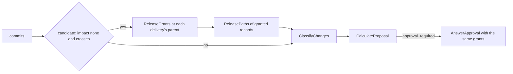

# Planning references and release preparation need no manual classification — Technical Spec

## Executive Summary

The fix changes the Release Plan's classification at two points and rewrites one paragraph of the release guide. `docs/references/` joins the planning-evidence prefixes in `internal/releaseplan/classifier.go`. `Build` reads the delivered Specs' release grants before classifying, whenever a commit with no impact crosses the boundary, and a commit with no impact whose every path is a `release_paths` entry of a granted record becomes a Release-Preparation Commit inside the boundary. The command's JSON change evidence gains `releasePreparation`. The release reference stops assuming a tag-triggered workflow.

The primary trade-off is that a Release-Preparation Commit is recognised only through the records of the Specs the range delivers. A range that delivers no Spec with a ceiling, or a preparation commit that changes a path no record lists, still asks for a classification by hand. In return, the plan never guesses from a commit subject, the maintainer's own declaration decides which files a release may change, and a Release Ceiling's authority does not grow (ADR-0412). The second trade-off is that `docs/references/` counts as planning evidence on its path alone, without reading which Spec cites the file, so the classifier stays a pure function of paths.

## Project Constraints

- Identifier strategy: not applicable — no persistent identifier is minted. The new name is a JSON field (`releasePreparation`), public CLI contract under `docs/agents/cli.md`. Source: `docs/agents/domain.md`.
- Authentication and HTTP: not applicable — the plan stays local and read-only and reads committed Git objects with the existing `releasePlanGitSource`. Source: `docs/agents/cli.md`, `docs/agents/agent-instructions.md`.
- Active ADR obligations: applicable — ADR-0412 (new), ADR-0349, ADR-0143 and ADR-0256 bind the design. ADR Alternatives relates each one. Source: `docs/agents/domain.md`.
- Tooling authority: applicable — express maintainer authorization: "Mesmas do BE (Recommended)" (2026-11-16), quoted in the record. It covers the Roundfix skill's release reference and its `SKILL.md` pair. It grants no Makefile, workflow, Go module, lint or formatter change. Source: `docs/agents/agent-instructions.md`, `docs/agents/spec-routing.md`; Spec-contained authorization record: `docs/specs/0400-planning-references-and-release-preparation-need-no-manual-classification/_authorization.md`; bounded files: `.agents/skills/roundfix/SKILL.md`, `.agents/skills/roundfix/references/release.md`, `skills/roundfix/SKILL.md`.

## System Architecture

No package, layer or directory is new. The fix extends three seams.

### Classifier

`internal/releaseplan/classifier.go` owns the maintenance boundary. `isPlanningEvidencePath` gains the prefix `docs/references/`. `ClassifyChanges` gains the Release-Preparation Commit rule: after `ClassifyCommit`, a commit whose `AutomaticImpact` is `none`, which crosses the boundary, changes at least one path, and whose every cleaned path is in `ClassifyRequest.ReleasePaths`, gets `ReleasePreparation = true` and `CrossesMaintenanceOnlyBoundary = false`. Every later step, the `blockingCommits` list, the classification source and `AnswerApproval`, then treats it as it treats any maintenance-only commit.

### Build

`internal/releaseplan/build.go` loads the grants once. When the source implements `ReleaseGrantSource` and the range holds a preparation candidate, a commit with no automatic impact that crosses the boundary, it calls `ReleaseGrants` before `ClassifyChanges` and passes the `Paths` of every `Granted` grant as `ReleasePaths`. When the proposal is `approval_required`, `AnswerApproval` uses the same grants, and `ReleaseGrants` is called only if they were not loaded yet. `ReleaseGrants` itself, in `internal/cli/releaseplan_git_source.go`, is unchanged.

### Command surface

`internal/cli/releaseplan_command.go` adds `ReleasePreparation bool` with tag `json:"releasePreparation,omitempty"` to `releasePlanChangeJSON`. The text output needs no change: it lists only blocking or determining commits, and a Release-Preparation Commit is neither. A `no_release` listing, the one text listing of every change, cannot hold one, because a delivery commit adds an Archive Record outside the planning paths and so is never maintenance-only, and a range with a delivery is never `no_release` without `--impact`. The release plan usage text in `internal/cli/cli.go` gains one sentence naming both rules.



## Implementation Design

### Interfaces

```go
// internal/releaseplan/model.go
type ChangeEvidence struct {
	// existing fields unchanged
	ReleasePreparation bool // set only with CrossesMaintenanceOnlyBoundary == false
}

// internal/releaseplan/classifier.go
type ClassifyRequest struct {
	Commits      []Commit
	ManualImpact Impact
	ManualReason string
	ReleasePaths []string // release_paths of the granted records the range delivers
}
```

Numbered invariants:

1. `MaintenanceOnly(p)` is true for every cleaned path with the prefix `docs/references/` and keeps every earlier answer for every other path.
2. A commit is a Release-Preparation Commit only when all hold: its `AutomaticImpact` is `none`; it changes at least one path; each changed path, cleaned with `cleanChangedPath`, equals one entry of `ReleasePaths`. A commit with `feat`, `fix`, `perf` or a breaking marker is never one.
3. A Release-Preparation Commit has `CrossesMaintenanceOnlyBoundary == false` and `ReleasePreparation == true`. No other commit has `ReleasePreparation == true`.
4. With `ReleasePaths` empty, `ClassifyChanges` returns the same result as before this Spec for every input whose paths are outside `docs/references/`.
5. `Build` calls `ReleaseGrants` at most once per plan. It calls it when a candidate exists or the proposal is `approval_required`, and never otherwise. Only grants with `Granted == true` contribute paths.
6. `AnswerApproval` is unchanged and still returns `the plan was classified by hand` for any plan with a manual reason. No plan whose classification needed `--impact` before this Spec is answered by a ceiling unless the two rules above removed every blocking commit.
7. The command stays read-only: no file, ref, tag or remote changes, and the plan still refuses a dirty worktree.

### Data Models

No stored data changes. The authorization record schema, its `release_paths` validation and the Archive Record are unchanged and only read. The JSON change item gains `releasePreparation`, present only when true, so a plan without a Release-Preparation Commit encodes the same bytes as before for every commit outside `docs/references/`.

### API Contracts

1. API Contract: `roundfix release plan` classification — a commit whose every path is planning evidence, now including `docs/references/`, or that is a Release-Preparation Commit, is maintenance-only. It never appears under `Blocking commits:`. Decision states, exit codes, `--impact` and `--reason` validation and the Release Ceiling's conditions are unchanged.
2. API Contract: `roundfix release plan --format json` — each item of `changes` carries `"releasePreparation": true` after `crossesMaintenanceOnlyBoundary` when the commit is a Release-Preparation Commit, and omits the field otherwise.
3. API Contract: `roundfix release plan` text — unchanged in shape. A Release-Preparation Commit is never listed under `Blocking commits:` or `Determining commits:`; a change with no impact that crosses the boundary keeps its `manual` label.
4. API Contract: `roundfix release plan --help` — after the paragraph that says when `approval_required` is answered, one paragraph: `Planning evidence (docs/specs, docs/backlog, docs/adr, docs/findings, docs/handoffs and docs/references) needs no release. So does a release-preparation commit: one with no impact whose every changed path is in the release_paths of a Spec the range delivers with a Release Ceiling.`
5. API Contract: the Roundfix skill's release reference — the last paragraph of `## Release planning` tells the session to follow the repository's release runbook and keep the publication trigger the repository already uses: a pushed tag that a workflow publishes, or the merge of the version change to the default branch, after which a workflow writes the tag and the release. It drops "Preserve the existing tag-triggered workflow". The planning-evidence paragraph names `docs/references/` and the Release-Preparation Commit, and the record paragraph says `release_paths` lists every file the preparation commit changes, a regenerated lockfile or generated file included.

### Surface Transcripts

1. Surface Transcript: in a clean checkout of this repository, the range of `v0.143.4` with its release-preparation commit is ready.

   ```transcript
   $ roundfix release plan --from v0.143.3 --to v0.143.4
   stdout:
   Decision: ready
   Base: v0.143.3 (251ed81e8193)
   Target: v0.143.4 (4f8a5b7db838)
   Impact: patch
   Breaking: false
   Proposed version: v0.143.4
   Approval required: no
   Next action: release may proceed for v0.143.4 after independent release verification.
   ...
   Determining commits:
   - 3bc58f41a3ad fix: deliver 0391-the-grouping-bound-becomes-a-criterion (#872) [impact=patch, type=fix]
   stderr:
   exit: 0
   ```

The `...` line stands for the `skills:`, `baseline:` and `skill-coverage:` check lines, which depend on the checkout's installed skills and Baseline.

## Coverage Map

- Goal 1 (planning references) → Classifier (`isPlanningEvidencePath`), API Contract 1, Task 1.
- Goal 2 (Release-Preparation Commit) → Classifier and Build, API Contracts 1–3, Tasks 1 and 3.
- Goal 3 (a rerun after the preparation reaches the same decision) → Build, Task 3 fixture ranges, QA outside evidence.
- Goal 4 (the ceiling's authority unchanged) → invariant 6, Task 1 `AnswerApproval` cases and Task 3 `--impact` case.
- Goal 5 (both publication triggers) → API Contract 5, Task 2.
- Core Feature 1 → Task 1. Core Feature 2 → Task 1. Core Feature 3 → Task 3. Core Feature 4 → Task 2.
- Success Metric 1 → Task 1. Success Metrics 2 and 3 → Task 3. Success Metric 4 → Task 2. Success Metric 5 → QA gate.

Deviations from the PRD: None.

## Absence Evidence

1. Release-Preparation Commit recognition — command: `rtk proxy grep -rniE "release.?preparation|ReleasePaths" internal/releaseplan internal/cli/releaseplan_command.go CONTEXT.md`; result: no match. `ReleaseGrant.Paths` exists in `internal/releaseplan/release_grant.go`, but only `printReleasePlanText` and `releasePlanJSONFromPlan` read it, to report the paths; nothing classifies with them.
2. `docs/references/` as planning evidence — command: `rtk proxy grep -n "docs/references" internal/releaseplan/classifier.go`; result: no match. `isPlanningEvidencePath` lists `docs/specs/`, `docs/backlog/`, `docs/adr/`, `docs/findings/` and `docs/handoffs/` only.
3. Glossary term **Release-Preparation Commit** — command: `rtk proxy grep -niE "release-preparation|release preparation" CONTEXT.md`; result: no match. **Release Plan** and **Release Ceiling** do not name the commit.
4. Publication on the merge of the version change in the release guide — command: `rtk proxy grep -niE "merge of the version|version change" .agents/skills/roundfix/references/release.md`; result: no match. The guide says only "Preserve the existing tag-triggered workflow".

## ADR Alternatives

- ADR-0412: the design is that ADR's decision. It rejects letting a ceiling answer a classification by hand, a citation check on `docs/references/`, a type condition, recognition by subject, and a separate list of derived files.
- ADR-0349: kept and extended. The ceiling still answers only under its five conditions and never a classification by hand, the alternative it rejected by the maintainer's decision; the design widens the planning-evidence list ADR-0349 began with `docs/backlog/`, and reads the records with the same reader at each delivery's first parent. ADR-0349: "a classification by hand is a new decision".
- ADR-0143: kept. The plan reads committed objects only, and no new mode or mutation path is added; the rejected alternative of a release action inside the plan stays rejected.
- ADR-0256: kept. The usage text and the runbook change a Behavior Surface, and Task 2 changes the covering Roundfix skill in the same change, so the release does not lag.

## Integration Points

- Git, through the existing `releasePlanGitSource` (`diff-tree` at each commit and `spec.ReadAuthorization` at its first parent). No new Git command.
- Adopters receive the classification with the binary and the release reference with `roundfix skills install`.

## Testing Approach

- **Task 1, domain.** In `internal/releaseplan`, table tests with no Git:
  - `TestMaintenanceOnly` gains `docs/references/x.md` true, and keeps `docs/user-guide/commands.md`, `README.md` and `.github/workflows/release.yml` false.
  - A new `release_preparation_test.go` drives `ClassifyChanges` with `ReleasePaths` for: preparation inside the paths; one extra path; no paths; an empty commit; a `fix:` and a `feat!:` commit touching only release paths; empty `ReleasePaths`. It asserts exact `ChangeEvidence` values, state, source and `BlockingCommits`.
  - `TestBuildLooksForGrantsOnlyWhenApprovalIsRequired` is renamed and extended: the patch and maintenance cases still call `ReleaseGrants` zero times, the refactor case now once, a candidate in an `approval_required` range once and never twice. This is a declared change of that test's expectation.
  - Sabotage: removing the prefix, the impact condition or the at-least-one-path condition each fails a named case.
- **Task 3, command.** A new `internal/cli/releaseplan_release_preparation_test.go` builds committed temporary repositories with the existing helpers (`newReleasePlanCommandRepo`, `writeReleasePlanFile`, `commitReleasePlan`):
  - a planning commit with `docs/references/evidence.md`, then a `feat:` delivery with a `minor` ceiling: `ready`, answered; the same range without the reference: same decision and version;
  - then a `chore: release` commit changing only `VERSION` and `CHANGELOG.md`: the same decision, version and answer; JSON `releasePreparation: true`; `--format text` lists no blocking commit;
  - the preparation plus `README.md`, a record without a ceiling, and a `fix:` commit on `CHANGELOG.md` only: today's decision each;
  - `--impact minor --reason x` on the answered range: still `the plan was classified by hand`;
    Each case asserts the repository is unchanged afterwards with `snapshotReleasePlanRepo`.
- **Task 2, documentation.** The docs contract tests and the Behavior Surface Record cover the usage text, the runbook, the usage page and the skill. A new test in `skills/` asserts the release reference names both triggers and no longer carries the sentence it drops, in the canonical copy and the mirror.
- The Surface Transcript runs in the QA gate on a clean checkout, because the plan refuses a dirty tree.

## Build Order

1. Classifier and Build in `internal/releaseplan`: the `docs/references/` prefix, `ClassifyRequest.ReleasePaths`, `ChangeEvidence.ReleasePreparation`, the candidate-driven grant load, and their tests.
2. Documentation and records: the usage paragraph in `internal/cli/cli.go`, the Roundfix skill's release reference and `SKILL.md`, `docs/user-guide/release-runbook.md`, `docs/user-guide/usage.md`, the glossary term **Release-Preparation Commit** through `domain-modeling`, the skill mirror, the owned-skill version record and the Behavior Surface Record (depends on: 1 — the text describes the rules it builds and the JSON field of step 3, whose name API Contract 2 fixes).
3. Command surface in `internal/cli/releaseplan_command.go`: the JSON field and the fixture-repository tests (depends on: 1, 2 — the release reference that names the field is step 2, and a Task that changes a command names its guide through a Task it needs).
4. QA gate: the PRD's metrics, the transcript and the outside-evidence rerun over this repository's tags (depends on: 1, 2, 3).

## Risks & Considerations

- **A reference that ships.** A repository whose product reads a file under `docs/references/` would now release a change to it without a version. The documentation layout gives that directory reference documents only, and a commit that also changes any released path still crosses the boundary.
- **More Git reads.** A range with a candidate now reads each delivery's record even when the plan is a patch. That is one `diff-tree` per commit and one record read per delivery, the cost the approval answer already pays.
- **Spec 0399 shares the Roundfix skill's version.** Both Specs raise `.agents/skills/roundfix/SKILL.md`. The version record command runs on the delivery's merge base, so the second Spec records the next version.
- **The preparation commit lists unlisted files.** Adopters such as the Oraculum whose preparation commit rewrites a lockfile or a generated catalog must list those in `release_paths`. The release reference and the record paragraph say so.

## Glossary

- adds: **Release-Preparation Commit**

## Decisions

- `docs/references/` is planning evidence on its path. See ADR-0412.
- A Release-Preparation Commit is recognised from the `release_paths` of the granted records the range delivers, only for a commit with no impact. See ADR-0412.
- A Release Ceiling never answers a classification by hand. See ADR-0412 and ADR-0349.
- The grant load moves before classification only when a candidate exists, so a plan without one reads no record it did not read before.
- The release reference keeps the repository's own trigger and names both kinds; Roundfix's runbook keeps its tag-triggered workflow.
- The Release Ceiling is `minor`: the JSON change evidence gains a field.
