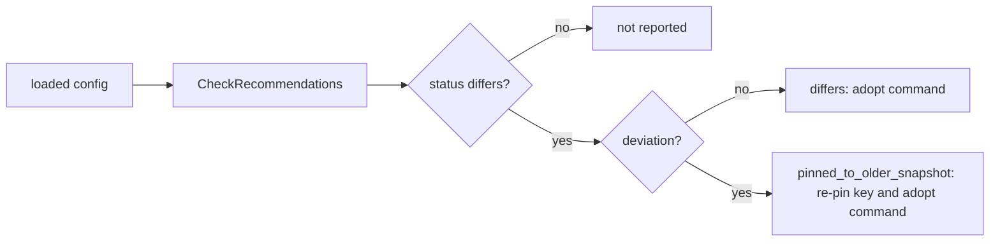

# The Update Check names each profile that differs from a refreshed recommendation — Technical Spec

## Executive Summary

The fix has three parts. The Model Catalog in `internal/agent/catalog.go`
follows the installed adapters: it gains `gpt-6.1-terra`, offers `fable` in
place of `claude-fable-5-1`, and describes Haiku 5.5. The Recommended Profile
in `internal/config/recommendations.go` becomes the 2026-11-17 snapshot the
maintainer approved, with `docs/references/model-selection.md`, the guides and
this repository's `.roundfixrc.yml` following it. The Update Check runs the
existing `config.CheckRecommendations` and reports, in a new `recommendations`
JSON member and one `Profiles:` line each, every configured category that
differs, naming a Profile Deviation declared against an older snapshot as
pinned to an older snapshot, with the key that re-pins it and the command that
adopts the recommendation (ADR-0416).

The primary trade-off is that the Update Check derives "pinned to an older
snapshot" from the deviation the comparison already returns, instead of adding
a status to `roundfix/profiles-check/v1`. `profiles check`, `--apply`, the
Doctor and the upgrade notice keep their bytes, and only the Update Check
speaks the new wording. The second is that the re-pin is named as a
configuration key, not written by a command, so a decision a person wrote is
re-dated only by a person.

## Project Constraints

- Identifier strategy: not applicable — no persistent identifier is minted. The new names are the JSON member `recommendations` and its fields, public CLI contract under `docs/agents/cli.md`. Source: `docs/agents/domain.md`.
- Authentication and HTTP: not applicable — the comparison reads the loaded configuration and the binary's snapshot, offline; the release lookup is unchanged. Source: `docs/agents/cli.md`, `docs/agents/agent-instructions.md`.
- Active ADR obligations: applicable — ADR-0416 (new) amends ADR-0181; ADR-0180, ADR-0235, ADR-0371 and ADR-0256 bind the design; ADR-0217, ADR-0231, ADR-0238 and ADR-0349 do not apply. ADR Alternatives relates each one. Source: `docs/agents/domain.md`.
- Tooling authority: applicable — express maintainer authorization: "Mesmas do BE (Recommended)" (2026-11-17), quoted in the record. It covers the governed files the record lists: `.roundfixrc.yml`, the Roundfix skill's `SKILL.md` pair and its `profiles`, `setup` and `modes` references, and `internal/docscontract/publicdocs_test.go`. It grants no Makefile, workflow, Go module, lint or formatter change. Source: `docs/agents/agent-instructions.md`, `docs/agents/spec-routing.md`; Spec-contained authorization record: `docs/specs/0403-the-update-check-names-each-profile-that-differs-from-a-refreshed-recommendation/_authorization.md`; bounded files: `.roundfixrc.yml`, `.agents/skills/roundfix/SKILL.md`, `skills/roundfix/SKILL.md`, `.agents/skills/roundfix/references/profiles.md`, `.agents/skills/roundfix/references/setup.md`, `.agents/skills/roundfix/references/modes.md`, `internal/docscontract/publicdocs_test.go`.

## System Architecture

No package, layer or directory is new. The fix changes two tables and adds one
report to an existing command.

### Model Catalog

`internal/agent/catalog.go` holds the picker data of ADR-0180. The Codex list
takes the order of the Codex 0.169.0 listing for the models it keeps:
`gpt-6.1-sol`, `gpt-6-astra`, `gpt-6.1-terra`, `gpt-6-sol`, `gpt-6-luna`,
`gpt-5.6-sol`, `gpt-5.6-terra`, `gpt-5.6-luna`. The Claude list becomes `opus`,
`sonnet`, `fable`, `haiku`, `default`. Descriptions name the current models
and move "built-in review default" from `gpt-5.6-luna` to `gpt-6-luna`. The
picker's reasoning efforts in `internal/cli/cli.go` are unchanged: no selection
uses `ultra`, and Roundfix validates a configured effort by exact proof
against what the adapter advertises, not by the picker list.

### Recommended Profile

`internal/config/recommendations.go` sets `ModelRecommendationSnapshotVersion`
to `2026-11-17`. `review` becomes `codex / gpt-6-luna / max` then
`codex / gpt-6.1-sol / high`; `docs` becomes `codex / gpt-6.1-terra / high`
then `claude / sonnet / high`; `chore` becomes `codex / gpt-6-luna / max` then
`claude / sonnet / high`. The implementation categories and `frontend` keep
their selections. Every rationale states its reason in one sentence, with no
benchmark figure (ADR-0180). The built-in `review` profile follows, because
built-ins are the Recommended Profile.

### Update Check report

A new file `internal/cli/update_check_recommendations.go` builds the report
from `config.CheckRecommendations(loaded.Config)` and prints it. `runUpdateCommand`
sets `report.Recommendations` after `report.AuthoringModels`, and
`printUpdateCheckReport` prints the `Profiles:` lines after the
`Authoring models:` line and before `Next:`. The member is `nil`, so omitted,
when `loaded.RepositoryVersionErr` is set, when the comparison returns an
error, or when no category is `differs`. A category is reported when its
status is `differs`; its state is `pinned_to_older_snapshot` when it carries a
deviation and `differs` otherwise. `pinned` and `current` categories are never
reported.



## Implementation Design

### Interfaces

```go
// internal/cli/update_check_recommendations.go
type updateCheckRecommendations struct {
	Snapshot   string                          `json:"snapshot"`
	Categories []updateCheckRecommendationItem `json:"categories"`
}
type updateCheckRecommendationItem struct {
	Category    roundconfig.WorkCategory      `json:"category"`
	State       string                        `json:"state"` // differs | pinned_to_older_snapshot
	Source      roundconfig.ProfileSource     `json:"source"`
	Configured  profilesCheckProfile          `json:"configured"`
	Recommended profilesCheckProfile          `json:"recommended"`
	Deviation   *roundconfig.ProfileDeviation `json:"deviation,omitempty"`
	Repin       string                        `json:"repin,omitempty"`
	Adopt       string                        `json:"adopt"`
}
func updateCheckProfileRecommendations(loaded roundconfig.Loaded) *updateCheckRecommendations
func printUpdateCheckRecommendations(stdout io.Writer, report *updateCheckRecommendations)
```

Numbered invariants:

1. `RecommendedProfile(c)` equals the approved table for every Agent Work Category, `ModelRecommendationSnapshotVersion` is `2026-11-17`, and no recommended selection has the effort `ultra`.
2. Every recommended selection's model is a `Value` of `agent.ModelCatalog(runtime)`; the catalog offers no retired model (`gpt-5.4`, `gpt-5.4-mini`, `gpt-5.3-codex-spark`, `gpt-5.5`, `claude-fable-5-1`).
3. The Update Check reports a category exactly when `CheckRecommendations` gives it the status `differs`, in that function's order. `Adopt` is `roundfix profiles check --apply --scope <source>` with the category's source, `user` or `project`.
4. `State` is `pinned_to_older_snapshot` exactly when the reported category carries a deviation, and only then are `Deviation` and `Repin` (`profiles.<category>.deviation.from: <snapshot>`) set.
5. With no reported category, the member is omitted and no `Profiles:` line is printed, so the report's bytes equal the bytes before this Spec.
6. The comparison changes neither `next` nor the exit code, writes no file, opens no Agent Session and reads no network.
7. `roundfix profiles check`, its JSON, `--apply`, the Doctor line and the upgrade notice keep their bytes for the same configuration and snapshot.

### Data Models

No stored data changes. The Project Config profile schema, including
`deviation`, is unchanged. The Update Check's JSON gains the optional member
`recommendations`.

### API Contracts

1. API Contract: `roundfix update check` text — for each reported category, in `CheckRecommendations` order, after the `Authoring models:` line and before `Next:`, one line. A `differs` category: `Profiles: <category> (<source>) differs from the Recommended Profile of <snapshot>: configured <profile>; recommended <profile>; adopt with roundfix profiles check --apply --scope <source>.` A `pinned_to_older_snapshot` category: `Profiles: <category> (<source>) is pinned to an older snapshot (<from>: <reason>); recommended <profile> as of <snapshot>; re-pin with profiles.<category>.deviation.from: <snapshot> in <Project|User> Config, or adopt with roundfix profiles check --apply --scope <source>.` `<profile>` is the existing `formatRecommendationProfile` form (`codex / gpt-6-luna / max, then codex / gpt-6.1-sol / high`); `<reason>` has whitespace collapsed and is limited to 300 characters; `Project Config` goes with source `project`, `User Config` with `user`.
2. API Contract: `roundfix update check --format json` — the optional member `recommendations` after `authoringModels` and before `next`: `snapshot`, and `categories`, each with `category`, `state`, `source`, `configured` and `recommended` (each with `preferred` and `fallbacks`, as `roundfix/profiles-check/v1`), `deviation` and `repin` only for `pinned_to_older_snapshot`, and `adopt`. The schema stays `roundfix/update-check/v1`, because the member is optional.
3. API Contract: `roundfix update check --help` — the paragraph gains, after "and this repository's Baseline plan with the installed binary.", the sentence `It also names each configured Agent Selection Profile that differs from the Recommended Profile, with the command that adopts it.`
4. API Contract: the Roundfix skill's `--update` Skill Mode — step 1 shows the `recommendations` categories; after an upgrade the mode runs `roundfix update check --format json` again with the installed binary; before its report it asks once, recommended option first, among adopting every reported category with `roundfix profiles check --apply --scope <scope> --yes` for each scope, re-pinning the categories pinned to an older snapshot and adopting the rest, and keeping the configuration; it runs only what the user chooses, and at session start under `update.mode: auto` it only reports them.
5. API Contract: the Recommended Profile — `roundfix profiles show` and `roundfix profiles check` report the 2026-11-17 snapshot; the built-in `review` profile is `codex / gpt-6-luna / max` then `codex / gpt-6.1-sol / high`.

### Surface Transcripts

1. Surface Transcript: in a repository whose Project Config defines `docs` as `codex / gpt-5.6-luna / max` then `claude / sonnet / high`, and `review` as `codex / gpt-5.6-luna / max` then `codex / gpt-6.1-sol / high` with `deviation: {from: 2026-09-30, reason: Keep the validated model}`, and no other profile:

   ```transcript
   $ roundfix update check
   stdout:
   ...
   Profiles: docs (project) differs from the Recommended Profile of 2026-11-17: configured codex / gpt-5.6-luna / max, then claude / sonnet / high; recommended codex / gpt-6.1-terra / high, then claude / sonnet / high; adopt with roundfix profiles check --apply --scope project.
   Profiles: review (project) is pinned to an older snapshot (2026-09-30: Keep the validated model); recommended codex / gpt-6-luna / max, then codex / gpt-6.1-sol / high as of 2026-11-17; re-pin with profiles.review.deviation.from: 2026-11-17 in Project Config, or adopt with roundfix profiles check --apply --scope project.
   stderr:
   exit: 0
   ```

The `...` line stands for the release line and the Baseline line, which depend
on the installed version, the release lookup and the repository's Baseline.
The controlled variations are the snapshot date and the recommended profiles,
which the test reads from `config.ModelRecommendationSnapshotVersion` and
`config.RecommendedProfile`, so a later snapshot changes them without a
fixed clock.

## Coverage Map

- Goal 1 (approved table) → Recommended Profile, invariant 1, API Contract 5, Task 2.
- Goal 2 (catalog) → Model Catalog, invariant 2, Task 1.
- Goal 3 (Update Check names each difference) → Update Check report, API Contracts 1–3, invariants 3–7, Tasks 3 and 4.
- Goal 4 (`--update` Skill Mode) → API Contract 4, Task 3.
- Goal 5 (this repository's Project Config) → Task 2.
- Core Feature 1 → Task 2. Core Feature 2 → Task 1. Core Feature 3 → Task 4. Core Feature 4 → Tasks 1–3. Core Feature 5 → Task 2.
- Success Metric 1 → Task 2. Success Metric 2 → Task 1. Success Metrics 3 and 4 → Task 4. Success Metric 5 → QA gate.

Deviations from the PRD: None.

## Absence Evidence

1. Recommendations in the Update Check — command: `rtk proxy grep -n "CheckRecommendations\|recommendation" internal/cli/update_check.go internal/cli/authoring_reports.go`; result: no match. Only `profiles check`, `profiles check --apply`, `profiles show`, `doctor` and `upgrade` call `CheckRecommendations`.
2. "Pinned to an older snapshot" wording — command: `rtk proxy grep -rn "older snapshot\|pinned_to_older" internal docs/user-guide .agents/skills/roundfix`; result: no match. `printRecommendationCheckText` prints "differs from snapshot … (its deviation was declared against …)".
3. `gpt-6.1-terra` and `fable` in the catalog — command: `rtk proxy grep -n "gpt-6.1-terra\|\"fable\"" internal/agent/catalog.go`; result: no match. The Claude list holds `claude-fable-5-1` and describes `haiku` as Haiku 4.5.
4. `update_check_recommendations.go` — command: `ls internal/cli/update_check_recommendations.go`; result: no such file.

## ADR Alternatives

- ADR-0416: the design is that ADR's decision. It rejects a `stale_pin` status in `roundfix/profiles-check/v1`, a re-pin command, comparing at Run start, and the `ultra` effort.
- ADR-0181: amended, not superseded. Its "Where" list gains the Update Check; the comparison stays read-only, offline and decisionless, a pin to the shipped snapshot still raises nothing, and the rejected alternative of comparing when a Run starts or in Preflight stays rejected. Task 3 adds the "Amended by" line.
- ADR-0180: kept. The snapshot changes in one place and the built-ins, the reference date test and the catalog test follow it; the recommendation still carries a rationale, not a benchmark figure, and the rejected numeric ranking stays retired.
- ADR-0235: kept. Every selection runs on the `codex` or `claude` runtime; no OpenAI or Anthropic model is routed through OpenRouter, the alternative it rejected.
- ADR-0371: extended. The Update Check stays read-only and exits `0`, and the `--update` Skill Mode still asks before a step a person must decide; the rejected harness hook stays rejected.
- ADR-0256: kept. Each Task that changes a Behavior Surface changes its covering skill reference in the same Task.
- ADR-0349: not applicable — the design changes no release planning; the authorization record's `minor` Release Ceiling follows that ADR unchanged.
- ADR-0217: not applicable — no Cursor selection or login changes; the snapshot names no Cursor model.
- ADR-0231: not applicable — the Jev ceiling and its User Config key are untouched.
- ADR-0238: not applicable — the light tier and its open model are unchanged; the Spec changes only the subscription runtimes' selections.

## Integration Points

- `config.CheckRecommendations`, `config.ResolveProfile` and `formatRecommendationProfile`, unchanged.
- Adopters receive the snapshot, the catalog and the report with the binary, and the skill text with `roundfix skills install`.
- Spec 0402, a prerequisite, adds Authoring Model Declaration output to the same Update Check; this report goes after it.

## Testing Approach

- **Task 1, catalog.** `internal/agent`: `TestModelCatalogOpensWithTheCurrentModels` and `TestModelCatalogsExposeOrderedPickerData` take the new lists, and the retired list gains `gpt-5.5` and `claude-fable-5-1`. `internal/docscontract`: `TestProfilesDocumentationContractMatchesPublicGuidance` requires `fable` where it required `claude-fable-5-1`. Declared changes of those tests' expectations.
- **Task 2, snapshot.** `internal/config`: `TestRecommendedProfileCoversEveryWorkCategory` takes the approved table, and a new `TestRecommendedProfileUsesNoUltraEffort` checks invariant 1's last clause. `internal/cli`: `TestProfilesShowPrintsTheRecommendedProfile`'s `docs` rows take `gpt-6.1-terra`. `TestModelSelectionReferenceStatesTheShippedSnapshot` and `TestRecommendedModelsAreInTheModelCatalog` run unchanged and fail until the reference and the catalog follow. A test parses `.roundfixrc.yml` and requires its `review`, `docs` and `chore` profiles to equal the Recommended Profile.
- **Task 3, guides.** A new `skills/roundfix_update_mode_recommendations_test.go` requires, in both copies of the Roundfix skill, that the `--update` section of `modes` names the `recommendations` member, the adopt command with `--yes` and the re-pin key, and that `setup` names the `Profiles:` lines; the docs contract and the Behavior Surface Record cover the update command guide.
- **Task 4, Update Check.** A new `internal/cli/update_check_recommendations_test.go`, with the existing fixture helpers, covers: the Surface Transcript; the JSON member for the same fixture; a pin to the shipped snapshot and a current profile, which add nothing; User Config as the source; no configuration, whose bytes equal the existing transcripts; and a repository whose Baseline a newer Roundfix wrote, which reports no member. `TestUpdateCheckUsage` takes the new sentence. Every test calls `t.Parallel()` and none reads the clock.
- **Sabotage.** Reporting `pinned` categories, dropping the deviation test, or printing with no reported category each fails a named case.

## Build Order

1. Model Catalog: `internal/agent/catalog.go` and its tests, the catalog sentences of `docs/user-guide/usage.md`, `docs/user-guide/configuration.md`, the Roundfix skill's `profiles` reference and `docs/references/model-selection.md`, the docs contract test, the skill mirror, the owned-skill version record and the Behavior Surface Record.
2. Recommended Profile: `internal/config/recommendations.go` and its tests, the `profiles show` test, the reference's snapshot section, the built-in lists and examples of the two guides and the `profiles` reference, and `.roundfixrc.yml` (depends on: 1 — every recommended model must be in the catalog, and both change the same guides and skill files).
3. Update Check guides: the update command guide, the `setup` and `modes` references, the glossary entry **Update Check**, ADR-0181's amendment line, the skill test and the regenerated records (depends on: 2 — both change the skill's version and the Behavior Surface Record).
4. Update Check report: `internal/cli/update_check_recommendations.go`, `update_check.go`, the usage text and the tests (depends on: 3 — a Task that changes a command names its guide through a Task it needs, and the guide fixes the member's field names of API Contract 2).
5. QA gate (depends on: 1, 2, 3, 4).

## Risks & Considerations

- **Adopters see lines at every session start** until they adopt or re-pin. That is the purpose; the lines change nothing and cost no network.
- **`--apply` adopts every differing category of a scope**, pinned-to-older ones included. The skill re-pins first when the user keeps a pin.
- **Spec 0402 changes the same files.** `requires` orders it first; Task 4 places its output after 0402's.
- **A built-in `review` change reaches every repository without profiles** on upgrade, as ADR-0180 intends.

## Glossary

- changes: **Update Check**

## Decisions

- The approved 2026-11-17 table, with no `ultra` effort. See ADR-0416 and `references/2026-11-17-maintainer-answers.md`.
- The Update Check compares and names each differing category with its command. See ADR-0416, amending ADR-0181.
- An older pin is derived from the deviation, not a new status; the re-pin is named as a key. See ADR-0416.
- The catalog follows Codex 0.169.0 and the Claude adapter 0.107.3. See `references/2026-11-17-model-evidence.md`.
- The Release Ceiling is `minor`: the Update Check's JSON gains a member.
