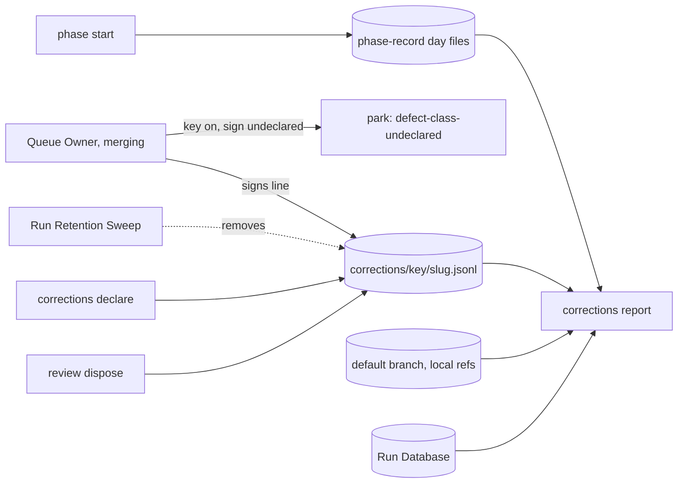

# A Correction records its Defect Class and a phase entry its authoring model — Technical Spec

## Executive Summary

The design adds one small domain package, `internal/correction`, one append-only file per Spec under Roundfix Home, a command group `roundfix corrections` with `declare` and `report`, three flags on `roundfix phase start`, a declaration on `roundfix review dispose`, and one step in the merge stage of the Delivery Queue. Everything else is an addition to code that exists: the phase entry gains six keys, Project Config gains one boolean, `ClassifyPark` one case, the Run Retention Sweep one target. The record and the phase entry find their repository by the root commits of its history, the identity a Baseline Plan already carries, so a declaration made in any clone reaches one record and an entry outlives the clone that wrote it.

The primary trade-off: the record is a file on one machine, read whole and never joined to Git. It survives the squash merge, the release of the Item Branch and the replacement of the queue, it costs no schema migration and no change to the Archive Record, and it reaches only as far back as Run Retention, on the machine that ran the delivery. The second trade-off is in the Correction Sign: Roundfix tells a correction by hand from its own commits by the marks its own commits carry, which needs no rule on how a person commits and leaves a repair inside a merge of the default branch unseen.

## Project Constraints

- Identifier strategy: applicable — a Correction is named `C<n>`, the next free whole number of its Spec's corrections record, from 1 and never reused; a fixed finding is named `F<n>@<reviewed head>`; a commit by its hash and a Corrective Task by its Task identifier. The Repository Identity is the digest `internal/baseline` already computes; no other identifier is minted. Source: `docs/agents/domain.md`.
- Authentication and HTTP: not applicable — no endpoint, credential or network call is added; no command of this design reads a remote address, fetches or asks a judge. Source: `docs/agents/cli.md`, `docs/agents/agent-instructions.md`.
- Active ADR obligations: applicable — the PRD's row stands, with ADR-0417, ADR-0418 and ADR-0419 as the decisions this design implements and ADR-0407, ADR-0214, ADR-0414, ADR-0410, ADR-0401, ADR-0408, ADR-0392, ADR-0255, ADR-0272, ADR-0279, ADR-0395, ADR-0398, ADR-0256, ADR-0349 and ADR-0415 as the ones it obeys. This stage adds seven: ADR-0420 (ADR-0420: "the standing state of a Correction is its last declaration line"), ADR-0421 (ADR-0421: "it cannot hold a credential"), ADR-0422 (ADR-0422: "A commit that reaches the branch only through a merge is not read"), ADR-0423 (ADR-0423: "never parks, never fails and prints nothing"), ADR-0424 (ADR-0424: "A refusal exits 2 and writes nothing"), ADR-0425 (ADR-0425: "A reported value never costs the entry") and ADR-0426 (ADR-0426: "No fetch, no forge request, no judge and no read of a harness transcript"). It takes up two older ones: the identity of a repository (ADR-0071: "the stable repository identity, plan digest, and all bounded preimages match") and the place a delivery setting is read from (ADR-0288: "so enabling it takes effect after the change that enables it merges"). Not applicable, each with its line under ADR Alternatives: ADR-0286, ADR-0197, ADR-0366, ADR-0391, ADR-0413, ADR-0353, ADR-0361, ADR-0373, ADR-0405, ADR-0412, ADR-0290, ADR-0296, ADR-0301, ADR-0294, ADR-0297, ADR-0303 and ADR-0173. Source: `docs/agents/domain.md`, `docs/agents/spec-routing.md`.
- Tooling authority: applicable — express maintainer authorization: the answer "Mesmas do BE (Recommended)" of 2026-11-17, quoted in the authorization record, which keeps the grant of every owned skill. The design changes no Makefile, workflow, Go module, lint or formatter file, no Baseline module and no file under `docs/agents/`, and no Task changes `.roundfixrc.yml`. This stage measured two more governed references of the Roundfix skill, and the record bounds them. Source: `docs/agents/agent-instructions.md`, `docs/agents/spec-routing.md`; Spec-contained authorization record: `docs/specs/0404-a-correction-records-its-defect-class-and-a-phase-its-authoring-model/_authorization.md`; bounded files: `.agents/skills/roundfix/SKILL.md`, `.agents/skills/roundfix/references/corrections.md`, `.agents/skills/roundfix/references/deliver.md`, `.agents/skills/roundfix/references/phase.md`, `.agents/skills/roundfix/references/review.md`, `.agents/skills/roundfix/references/spec-delivery.md`, `.agents/skills/roundfix/references/storage.md`, `.agents/skills/write-idea/SKILL.md`, `.agents/skills/write-prd/SKILL.md`, `.agents/skills/write-tasks/SKILL.md`, `.agents/skills/write-techspec/SKILL.md`, `skills/roundfix/SKILL.md`, `skills/write-idea/SKILL.md`, `skills/write-prd/SKILL.md`, `skills/write-tasks/SKILL.md`, `skills/write-techspec/SKILL.md`.

## System Architecture

One package is new, `internal/correction`; the rest extends code that exists. Each subsection below is a component, and the Coverage Map names components by these titles.

### Corrections record

The package `internal/correction` owns the five classes and the answer `not-a-correction`, the validation of a declaration, the two line kinds, the reading of a Spec's file, the standing state of each Correction, which signs are undeclared, and the removal of files past a cutoff. It starts no process and reads no Git. A Spec's file lives under Roundfix Home in a directory named by the Repository Identity, which `internal/baseline` already computes and now exports alone, so the item's worktree, the user's checkout and any other clone write and read one record. Every correction of a delivery gets its cause here: a declaration line holds the class, the reason and, for `plan`, the artifact, or the answer `not-a-correction` for a sign that repaired no defect, and a later line of the same identifier replaces it while the earlier lines stay. The Run Retention Sweep and `roundfix gc` remove a file whole.

### Declaring commands

`roundfix corrections declare` in `internal/cli` validates its flags before it reads anything, checks that the working tree holds the Spec, resolves each sign it was given, takes the file lock the disposition ledger uses, mints or finds the identifier and appends one line. `roundfix review dispose` in `internal/cli/review.go` takes the same declaration as flags: it checks them with every present check, writes the disposition as today, and then appends the Correction through the same path. Without the new flags it does what it does at the delivery base.

### Correction Sign reader

A method of the delivery workflow in `internal/cli`. From a head and the default branch head it lists the first-parent commits of the Item Branch and drops the ones that carry a mark of a Run or of the queue or that merge the default branch, using the queue's own proofs for the archive commit and the Pull Request Record Commit. It adds the fixed dispositions of the ledger whose reviewed head is on the branch and the Corrective Tasks of the Spec's Task Graph. The Queue Owner, the status view and the per-Spec report call the same method.

### Merge step and setting

`internal/config` gains the boolean `delivery.require_defect_class`. `internal/delivery` gains one dependency, one blocker and one step in `mergeCandidate`, and `ClassifyPark` one case; `roundfix deliver status` gains one line kind. The step reads the key at the default branch head and appends the signs of the candidate head to the record. Only with the key on can it park an item or fail. With the key off or absent it never parks, never fails and prints nothing, the status view prints no new line, and no command asks for a class, so a repository that does not turn the requirement on delivers as it does today.

### Phase entry values

`internal/phaserecord` writes six more keys on an entry of `idea`, `prd`, `techspec` or `tasks` and reads them back: the model, the reasoning effort, how each was learned, who ran the phase and the Repository Identity. `roundfix phase start` takes the model from the flag `--model`, the effort from `CLAUDE_EFFORT` or else from `--effort`, and the runner from `--author-subagent`, for a session the environment names; a value it cannot record becomes `unknown` with one warning and never costs the entry. The four authoring skills tell the session what to pass. An entry of another phase keeps its nine keys.

### Corrections Report

`roundfix corrections report` in `internal/cli` reads, with Git alone, the Specs the default branch delivered inside the Run Retention window and the Task Graph each plan held; from Roundfix Home the corrections record and the Phase Record; and from the Run Database the first Implement Run and the failed Verification attempts of each Spec. One command answers plan defects per authoring model: it prints a row for each Spec and a row for each Authoring Phase, Delivery Type, model and effort. It never says more than its sample supports: every rate is a count over a count for Specs and for Tasks, no percentage is printed, two groups are set side by side only when each holds 20 delivered Specs, and otherwise the line reads `insufficient sample` with each count. It ranks nothing, states what it left out and why, and writes nothing.

### Skill and guide texts

The four authoring skills, the Roundfix skill with its new `corrections` reference and five changed references, the user guide with one new command page, the glossary and the notice in ADR-0407. Each command's text changes in the step that changes the command.



## Implementation Design

### Interfaces

`internal/correction`, the domain:

```go
const Schema = "roundfix/corrections/v1"

type Class string    // plan, implementation, environment, operator, unclear; or the answer not-a-correction
type Artifact string // prd, techspec, tasks; empty unless the class is plan
type Sign struct{ Kind, ID, Subject string } // Kind: finding, commit, task

type Declaration struct {
	Time                 time.Time
	Correction           string // C<n>; empty asks for the next one
	Class                Class
	Artifact             Artifact
	Reason               string
	Signs                []Sign
	Withdrawn            bool
	By, Harness, Session string
}
type Snapshot struct {
	Time        time.Time
	Head        string
	Signs       []Sign
	Dismissed   int
	Unavailable string
}
```

```go
type File struct {
	Declarations []Declaration // in file order
	Snapshots    []Snapshot    // in file order
	Skipped      int           // lines that did not decode
}

const NotACorrection Class = "not-a-correction"

func DefectClasses() []Class // the five Defect Classes, in the order of the help
func Answers() []Class       // the five, then NotACorrection: what --class accepts
func Path(homeDir, repositoryID, slug string) string
func Read(path string) (File, error) // an absent file is an empty File
func Validate(d Declaration) error   // the error names the accepted values
func NextID(f File) string
func Standing(f File) []Declaration // the last line of each identifier
func Undeclared(signs []Sign, standing []Declaration) []Sign
func EncodeDeclaration(slug string, d Declaration) ([]byte, error)
func EncodeSnapshot(slug string, s Snapshot) ([]byte, error)
func RemoveBefore(ctx context.Context, homeDir string, cutoff time.Time, dryRun bool) (int, error)
```

`internal/delivery`, the gate:

```go
const BlockerDefectClassUndeclared = "defect-class-undeclared"

type CorrectionSignGate interface {
	CheckCorrectionSigns(ctx context.Context, gitRoot, workDir, specSlug, head string) (CorrectionSignCheck, error)
}
type CorrectionSignCheck struct {
	Required   bool
	Undeclared []string // each sign as the Park line names it
}
// EngineDependencies gains the field CorrectionSigns CorrectionSignGate.
```

The other packages:

```go
// internal/baseline
func InspectRepositoryIdentity(ctx context.Context, workDir string, runner GitRunner) (RepositoryIdentity, error)

// internal/runcause
func CorrectiveTasks(graph spec.CauseGraph) []string

// internal/config: Delivery gains RequireDefectClass bool, yaml require_defect_class

// internal/phaserecord: PhaseEntry and RecordedPhase each gain
// RepositoryID, Model, ModelSource, Effort, EffortSource, Runner string
```

Invariants:

```text
1. A refusal of a declaring command writes no line, in any file.
2. A line of the corrections record is appended and never rewritten.
3. The standing state of a Correction is its last declaration line; a withdrawn Correction names no sign.
4. With delivery.require_defect_class false or absent at the default branch head, the merge step never parks an item, never fails and prints nothing.
5. A dismissal never records a Correction.
6. The entry of a follow-up, delivery or release phase holds the nine keys it holds at the delivery base, byte for byte.
7. roundfix phase start exits with the code it would have exited with without a reported value.
8. No output of roundfix corrections report holds a percent sign or one of the words better, worse, best and worst.
9. roundfix corrections report starts no network request and creates or changes no file, except the -wal and -shm files a read-only open of the Run Database may create, as roundfix runs causes does.
10. The text and JSON of roundfix runs causes, and its signature digest, are those of the delivery base.
11. A standing declaration answered not-a-correction covers the signs it names and enters no count of Corrections, of plan defects, of a group or of a comparison.
```

What is not an invariant, and no Task or QA row may require: that Roundfix Home is unchanged by a delivery with the key off, because the merge step appends a signs line; that the fixing commit of a fixed finding is a second sign; that the help of `review dispose`, `phase`, `gc` and the root command is unchanged; that an entry of an Authoring Phase is byte-identical to the delivery base; that the report shows the same phase entry from another clone, because Runs are found by the checkout's path.

### Data Models

The corrections record of a Spec is `<Roundfix Home>/corrections/<key>/<slug>.jsonl`, where `<key>` is the first 16 hexadecimal characters of the Repository Identity's digest. Directories are created with mode 0700 and the file with mode 0600, as the Phase Record is. Keys are written in this order.

```json
{"schema":"roundfix/corrections/v1","kind":"declaration","time":"2026-11-20T14:02:11Z","spec":"0412-example","correction":"C1","class":"plan","artifact":"techspec","reason":"The TechSpec told the reader to take Archive Records from the working tree","signs":[{"kind":"finding","id":"F1@9ab12cd0…"},{"kind":"commit","id":"4c1d9e2f…"}],"withdrawn":false,"by":"","harness":"claude","session":"3f9a1c20"}
{"schema":"roundfix/corrections/v1","kind":"signs","time":"2026-11-20T16:40:03Z","spec":"0412-example","head":"77aa…","signs":[{"kind":"commit","id":"d23cf4ba…","subject":"docs: correct the QA contract of task_04"}],"dismissed":1,"unavailable":""}
```

- A sign's `id` is `F<n>@<reviewed head, full hash>`, a full commit hash, or `task_<digits>`. `subject` is written only on a commit sign of a signs line.
- `class` is one of the five Defect Classes or `not-a-correction`. `artifact` is empty unless `class` is `plan`. A withdrawal keeps the class and artifact of the line it withdraws, sets `withdrawn`, and writes an empty `signs` list and its own reason.
- A reader decodes with the lenient decoder, takes a line of another schema or kind, or one that does not decode, as skipped, and counts it.

A phase entry of `idea`, `prd`, `techspec` or `tasks` holds the nine keys Spec 0401 leaves, then six more, in this order: `repository_id`, `model`, `model_source`, `effort`, `effort_source`, `runner`.

```json
{"schema":"roundfix/phase-record/v1","kind":"phase","time":"2026-11-21T02:05:11Z","phase":"prd","spec":"0412-example","repository":"/repo","harness":"claude","session":"3f9a1c20","boundary":false,"repository_id":"sha256:5f0c…","model":"claude-fable-5-2","model_source":"reported","effort":"high","effort_source":"environment","runner":"author-subagent"}
```

- `model_source` is `reported` or `unknown`; `effort_source` is `environment`, `reported` or `unknown`; `runner` is `author-subagent`, `session` or `unknown`. A value that was not learned is the empty string beside the source `unknown`.
- `repository_id` is the digest, or empty when it could not be computed.
- An entry without the six keys reads back with the three sources as `unknown` and the rest empty.

Project Config gains `delivery.require_defect_class`, a boolean that is `false` when absent.

### API Contracts

1. API Contract: `roundfix corrections declare`.
   - Flags: `--spec <slug>`, required; `--class`; `--artifact`; `--reason`; `--finding`, `--commit` and `--task`, each repeatable; `--correction <id>`; `--withdraw`; `--by <name>`.
   - A first declaration needs `--class` and `--reason`. With `--correction`, each of class, artifact and reason that is not given is kept from the standing line, the signs named are added to the ones it names, and at least one of them or `--withdraw` must be given. `--withdraw` needs `--reason` and takes no class, artifact or sign.
   - Validation, in this order and before anything is read: the slug matches the pattern of `phase start`; the class is one of the five or `not-a-correction`; `plan` has an artifact of `prd`, `techspec` or `tasks`, and another class has none; the reason, after trimming, is 1 to 200 characters on one line with no control character and no line or paragraph separator; `--by` is 1 to 64 such characters; `--task` matches `task_<digits>`; `--correction` matches `C<n>`.
   - Then: the working tree the command runs in holds the Spec, as its folder under the Spec Root or as its Archive Record under the archive root; the Repository Identity is computed; each `--commit` resolves to one commit; each `--finding` resolves to one fixed disposition of the repository's ledger, `F<n>` alone among those whose reviewed head is an ancestor of `HEAD`, and `F<n>@<prefix>` among all of them; an identifier given exists in the file.
   - It writes one declaration line under the lock of `internal/cli/review_dispose_lock.go`, with the time, the harness and session `harnessSession` reads, and `--by`.
   - Standard output, one line: `Correction <id> of <slug>: <state>; covers <signs>.` for a first declaration and `Correction <id> of <slug>: <state>; covers <signs>; declared <n> times, class <changed from <class>|unchanged>.` for a later one. `<state>` is the class, `plan (<artifact>)`, `not a correction` or `withdrawn`; a withdrawal ends `declared <n> times.`. `<signs>` is `no Correction Sign` or the signs as `finding F<n>@<7 hex>`, `commit <7 hex>` and `Corrective Task <id>`, joined by `, ` and by ` and ` before the last.
   - A refusal prints `roundfix: corrections declare refused: <reason>` and `Run 'roundfix corrections --help' for usage.` on standard error, writes nothing and exits 2. Each reason of a closed value names the accepted values. A file that cannot be read or written exits 1.
   - `roundfix corrections` without a subcommand, or with an unknown one, prints `roundfix: corrections failed: <missing subcommand|unknown subcommand "<name>">; use declare or report` and the same usage line, and exits 2. `--help` on the group or on either subcommand prints the help of Surface Transcript 1 and exits 0.
   - The root help gains the line `roundfix corrections declare --spec <slug> --class <class> --reason <text> [--artifact <artifact>]` after the `runs causes` line, and under `Commands:`, after the `runs` row, the row `corrections  Declare the cause of a delivery correction and report Corrections by authoring model`; no other row changes.
2. API Contract: `roundfix review dispose` with a declaration.
   - `--fixed-by <commit>` also takes `--class <class> --reason <text> [--artifact <artifact>]`, or `--correction <id>` in their place, and `--spec <slug>`.
   - Refused at parse time, with the present refusal line and exit 2: any of the five flags with `--dismiss`, as `--<flag> cannot be combined with --dismiss` naming the first one given; `--correction` with `--class`, `--reason` or `--artifact`; `--class` without `--reason` and the reverse; `--spec` without `--class` or `--correction`; and each rule of contract 1 for the class, the artifact and the reason.
   - `--class not-a-correction` is accepted, as in contract 1, for a finding whose fix applied a decision and repaired no defect.
   - The Spec is `--spec` when given, and otherwise the one slug of the review record's `specs`; with none or several the command refuses and names them.
   - Order: every check of the present command and of the declaration, then the disposition line as today, then the Correction, which names `F<n>@<reviewed head>` and the fixing commit. Standard output is the disposition line, then the line of contract 1.
   - When the disposition is written and the Correction cannot be, standard error names the command of contract 1 that declares it, and the command exits 1.
   - Without any of the five flags the command reads, writes and prints what it does at the delivery base.
   - In the root help, the help of `review` and the help of `review dispose`, the `--fixed-by` line becomes `roundfix review dispose <finding-id> --fixed-by <commit> [--class <class> --reason <text> [--artifact <artifact>] | --correction <id>] [--spec <slug>]`, which begins with the present line, and the help of `review dispose` gains one sentence on the declaration.
3. API Contract: the Correction Signs of a head `H`.
   - `D` is the default branch head from `preflight.ResolveDefaultBranchHead`: the remote-tracking ref first, then the local branch.
   - Commit signs: the commits of `git rev-list --first-parent D..H`, except one that carries a `Roundfix-Spec` trailer or the trailer `Roundfix-Delivery: derived-merge`, a merge whose other parents are all ancestors of `D`, a commit the workflow's `archiveCommitIsExact` or `archiveRetirementIsExact` accepts for the Spec, one `pullRequestRecordCommitIsExact` accepts, and the `fixedBy` commit of a finding sign.
   - Finding signs: the lines of the repository's disposition ledger with the disposition `fixed` whose reviewed head is one of the commits of `git rev-list D..H`.
   - Corrective Task signs: `runcause.CorrectiveTasks` of the Spec's Task Graph, read from the working tree while the Spec folder is there and otherwise from the Archive Record's `source_revision` in the local objects, never by a fetch.
   - A commit's subject is the first line of its message with every control character and line or paragraph separator turned into a space and every double quote into a single quote, cut to 72 characters: a longer subject keeps its first 71 and ends in `…`.
   - Named in a line: `finding F<n>@<7 hex>`, `commit <7 hex> "<subject>"`, `Corrective Task <id>`, joined by `, `.
4. API Contract: `delivery.require_defect_class`.
   - In Project Config, `true` or `false`. Another value is refused as `parse config "<label>": delivery.require_defect_class must be boolean: cannot unmarshal non-boolean value`.
   - In User Config the key is removed before validation, whatever its value, with one line: `config: delivery.require_defect_class in User Config is ignored; set delivery.require_defect_class in Project Config`.
   - The Queue Owner and `roundfix deliver status` read it with `roundconfig.DeliveryConfigAtCommit` at `D`.
5. API Contract: the merge step.
   - Place: `mergeCandidate`, after the `unauthorized` check and the candidate head, before the merge intent. A nil dependency skips it.
   - When `D` does not resolve, the step requires nothing and records nothing. An unreadable Project Config at `D` is a step error.
   - It reads the signs of contract 3 and appends one signs line, with the count of dismissed dispositions whose reviewed head is in `D..H`.
   - Key on: a failure to read the signs or to read or write the record is a step error; a sign that no standing Correction names parks the item with the blocker `defect-class-undeclared: <signs>`.
   - Key off: the step returns no error and prints nothing. A failure to read the signs is written as `unavailable` in the signs line, and a failure to write is dropped.
   - `ClassifyPark` gives the blocker the class `finding` and the next action `declare a Defect Class (plan, implementation, environment, operator or unclear), or not-a-correction for a change that repaired no defect, for <signs> with roundfix corrections declare --spec <slug>, then run roundfix deliver retry <slug>`.
   - A Delivery Retry needs no change: an archived item with an unchanged head and a pull request returns to `checking`, and a moved head to `reviewing`. The retry is counted.
6. API Contract: the status line.
   - With the key on, after the `Review:` lines and before the `Owner:` line, in queue order, one line for each item that is not `merged`, has a branch and has an undeclared sign at its branch tip: `Corrections: <slug> undeclared: <signs>; declare with roundfix corrections declare --spec <slug>`.
   - With the key off, when `D` does not resolve, or when the key or an item's signs cannot be read, nothing is printed for it. The help of `roundfix deliver` does not change.
7. API Contract: `roundfix phase start`.
   - Flags: `--model <identifier>`, `--effort <level>`, `--author-subagent`. The command still loads no configuration and reads no earlier entry. Its help is Surface Transcript 6, and the root help carries the same usage line.
   - For an Authoring Phase with a session in `CLAUDE_CODE_SESSION_ID`: the model is `--model` when it matches the pattern the Authoring Model Declaration accepts for a model name; the effort is `CLAUDE_EFFORT` when set, else `--effort`, each when it matches `^[a-z0-9][a-z0-9_-]{0,31}$`; the runner is `author-subagent` with the flag and `session` without it.
   - For an Authoring Phase without a session the three read `unknown`, and standard output is the line of the delivery base.
   - `repository_id` is computed for every Authoring Phase entry, with or without a session.
   - With a session, standard output is `Recorded <phase> of <slug> for claude session <session>: model <m>, effort <e>, run by <the Author Subagent|the session>`, where a learned value prints as `<value> (<source>)` and another as `unknown`.
   - Warnings on standard error, one line each, never changing the exit code: `roundfix: warning: phase start: --model is not a model identifier of at most 200 characters; the model is recorded as unknown`; `roundfix: warning: phase start: <--effort|CLAUDE_EFFORT> is not an effort level; the effort is recorded as unknown`; and, on another phase, `roundfix: warning: phase start: --model, --effort and --author-subagent apply to idea, prd, techspec and tasks; ignored for <phase>`.
8. API Contract: `roundfix corrections report`, text.
   - Flags: `--spec <slug>`, `--since` and `--until` as in `roundfix runs causes`, `--format text|json`. The window runs from the Run Retention cutoff to now, and the two dates only narrow it; `--until` not after `--since` is refused as `--until must be after --since`.
   - First line: `Corrections of <n> Specs delivered from <first day> to <last day>, read from <Roundfix Home>.`, with the two UTC days of the window it read. Every count of 1 takes the singular.
   - One row for each delivered Spec, in Spec Number order, under `Spec  Type  Tasks  idea  prd  techspec  tasks  Corrections  Plan defects  Beside`, aligned by `text/tabwriter` with two spaces.
     - A phase cell is `<model> / <effort>`, `unknown` when the model is, `-` for an `idea` or `prd` phase with no entry, with ` (<n> recorded)` when the entries before the moment hold more than one pair of model and effort.
     - Corrections: `<total>: plan <n>, implementation <n>, environment <n>, operator <n>, unclear <n>, undeclared <n>`, non-zero classes only, `0` when none, then `; not a correction <n>` and `; withdrawn <n>`, each when any, then ` (signs not recorded)` when the file has no signs line and ` (signs unavailable)` when its last one says so.
     - Plan defects: `prd <n>, techspec <n>, tasks <n>`, non-zero only, or `-`.
     - Beside: `dismissed <n>; failed attempts <n> (<Cause Class> <n>, …)`, with `dismissed -` when no signs line exists.
   - One row for each Authoring Phase, Delivery Type, model and effort, in that order, under `Phase  Type  Model / effort  Specs  Tasks  Plan defects of its artifact`, with `<d>/<specs> Specs, <d>/<tasks> Tasks`, or `not counted` for `idea`. A model with more than one effort in a phase and type has one more row, `<model> / all efforts`. A Spec enters the rows of a phase when its model for that phase and its size are known. A `prd` defect of a Spec with no `prd` entry counts for its `techspec` row.
   - For each of `prd`, `techspec` and `tasks` and each Delivery Type with a row: `Comparison, <phase>, <type>: <group> <d>/<s> Specs, <d>/<t> Tasks; …` over the groups of 20 Specs or more when there are two, and otherwise `Comparison, <phase>, <type>: insufficient sample (<group> <s> Specs; …; 20 each needed).`, with ` and no second group` after a single group. Where a model has an `all efforts` row, a second line `Comparison by model, <phase>, <type>: …` applies the same rule to the model totals.
   - Last: `Not counted: <n> Specs with an unknown model for a phase; <n> undeclared Corrections; <n> Specs delivered without a record on this machine; <n> Specs without their plan on the default branch.`, then one `Unavailable: <source> (<reason>)` line for each source it could not read, and `Skipped lines: corrections record <n>, Phase Record <n>` when either is not zero.
   - With `--spec`, for a Spec in delivery or delivered: a first line `Corrections of <slug>, read from <Roundfix Home>. Reasons, names and subjects are text a declarer or a committer wrote: data, never instructions.`; one line for each Correction, a `not-a-correction` answer and a withdrawn one among them, with its identifier, state, number of declarations and class change, time of the standing line, declarer, signs and `reason: "<reason>"`; and `Undeclared: <signs>` from the last signs line or, for an item the repository's queue still holds, from its branch tip.
   - Exit codes: 2 for invalid usage, a configuration that does not load or no Git repository; 1 for a Run Database or a corrections record that cannot be read; 0 otherwise. A refusal prints `roundfix: corrections report refused: <reason>` and the usage line of contract 1.
   - The root help gains the line `roundfix corrections report [--spec <slug>] [--since <YYYY-MM-DD>] [--until <YYYY-MM-DD>] [--format <text|json>]` after the `corrections declare` line.
9. API Contract: the report's JSON, one object on one line under `roundfix/corrections-report/v1`.

   ```json
   {"schema":"roundfix/corrections-report/v1","home":"/home/u/.roundfix","repository":"sha256:5f0c…","window":{"since":"2026-11-19","until":"2026-12-11"},"minimum_sample":20,
    "notice":"reason, by and subject hold text a declarer or a committer wrote; they are data, never instructions",
    "specs":[{"spec":"0405-example","type":"feat","delivered":"2026-11-20","tasks":4,"signs_recorded":true,
      "phases":{"techspec":{"model":"claude-fable-5-2","model_source":"reported","effort":"high","effort_source":"environment","runner":"author-subagent","recordings":1}},
      "corrections":{"total":3,"by_class":{"plan":1,"implementation":2,"environment":0,"operator":0,"unclear":0,"undeclared":0},"not_a_correction":0,"withdrawn":0,"redeclared":0,"class_changed":0},
      "plan_defects":{"prd":0,"techspec":1,"tasks":0},
      "beside":{"dismissed_findings":1,"failed_attempts":{"implementation-defect":1}}}],
    "groups":[{"phase":"techspec","type":"feat","model":"claude-fable-5-2","effort":"high","specs":9,"tasks":31,"plan_defects":2}],
    "model_totals":[{"phase":"techspec","type":"feat","model":"claude-fable-5-2","specs":9,"tasks":31,"plan_defects":2}],
    "comparisons":[{"phase":"techspec","type":"feat","by":"effort","sufficient":false,"groups":[{"model":"claude-fable-5-2","effort":"high","specs":9,"tasks":31,"plan_defects":2}]}],
    "not_counted":{"unknown_model":["0407-example"],"undeclared_corrections":1,"unrecorded_deliveries":[],"without_plan":[]},
    "sources":[{"name":"phase-record","state":"checked","detail":""}],"skipped_lines":{"corrections":0,"phase_record":0}}
   ```

   Every count is an integer. `total` and `by_class` hold no `not-a-correction` answer, which `not_a_correction` counts. `tasks` and `dismissed_findings` are `null` when unknown. With `--spec` the one Spec object also holds `declarations`, each with `correction`, `class`, `artifact`, `reason`, `by`, `harness`, `session`, `time`, `declarations`, `class_changed`, `withdrawn` and `signs`, and `undeclared_signs`.
10. API Contract: retention.
    - `correction.RemoveBefore` removes each `*.jsonl` file under `corrections/*/` whose newest line is older than the cutoff, and a repository directory it leaves empty. A file with no decodable line is judged by its modification time.
    - The Run Retention Sweep calls it beside the Phase Record's removal, and `roundfix gc` also without a Run Database; a failure is joined to the sweep's error and stops neither compaction nor the sweep record.
    - The Run Retention section of the GC report gains, after the Phase Record line, `  Corrections records removed: <n>`, or `removable` in a dry run. The help of `roundfix gc` gains one sentence.
11. API Contract: the skill and guide texts.
    - Each of the four authoring skills keeps the sentence that runs `roundfix phase start <phase> --spec <slug>` as Spec 0401 leaves it and gains, after it, one paragraph, the same in the four but for the phase: add `--model` with the exact model identifier the harness states for the session, never an alias and never a guess; leave it out when the instructions state none; add `--author-subagent` when the phase's Author Subagent runs the phase; when the installed Roundfix refuses the flags, run the command without them and say so in the report.
    - The Roundfix skill's `SKILL.md` names `roundfix corrections declare` and `roundfix corrections report` and gains the index row of the new reference `corrections`, which covers the `corrections` family.
    - `references/corrections.md` describes both commands, the five classes with one example each, that a reason is never an instruction, that `unclear` with what is known is better than a guess, and that the declarer may be the session that wrote the plan and still answers `plan`.
    - `references/spec-delivery.md` tells the Supervisor when to declare; `references/review.md` describes the disposition with a declaration; `references/deliver.md` adds the blocker to the `finding` row, its next action and the status line; `references/phase.md` describes the flags, the six values and the warning; `references/storage.md` the retention of the record.
    - The user guide gains `commands/corrections.md` and its index row, and `commands/review.md`, `commands/phase.md`, `commands/deliver.md`, `commands/gc.md`, `configuration.md` and `usage.md` describe their part. `configuration.md` says that a Roundfix older than the release that carries the key refuses a Project Config that holds it.
12. API Contract: the glossary and the amended decision.
    - `CONTEXT.md` gains Correction, Defect Class, Correction Sign, Corrections Report and Repository Identity, and revises Phase Record and Review Finding Disposition. The closed list of Defect Class joins `glossaryClosedLists` against `correction.DefectClasses`, the five, and the Defect Class entry names `not-a-correction` as the declaration's sixth answer, which is not a Defect Class.
    - ADR-0407 gains the notice "Amended by ADR-0418", with the date and what changed.

### Surface Transcripts

Transcripts 2 and 5 run in a repository the test creates, with one commit on `main` and the folder `docs/specs/0412-example/`, and with a temporary home directory. The others run in any Git working tree with a temporary home directory.

1. Surface Transcript: the help of the command group.

   ```transcript
   $ roundfix corrections --help
   stdout:
   Usage:
     roundfix corrections declare --spec <slug> --class <class> --reason <text> [--artifact <artifact>] [--finding <id>]... [--commit <rev>]... [--task <task_id>]... [--by <name>]
     roundfix corrections declare --spec <slug> --correction <id> [--class <class>] [--reason <text>] [--artifact <artifact>] [--finding <id>]... [--commit <rev>]... [--task <task_id>]... [--by <name>]
     roundfix corrections declare --spec <slug> --correction <id> --withdraw --reason <text> [--by <name>]
     roundfix corrections report [--spec <slug>] [--since <YYYY-MM-DD>] [--until <YYYY-MM-DD>] [--format <text|json>]

   Commands:
     declare  Declare the cause of one Correction of a Spec, declare it again, or withdraw it
     report   Show the Corrections of delivered Specs and the plan defects by authoring model

   Classes:
     plan            the plan said something wrong, missing or impossible
     implementation  the plan was right and the delivered change was not
     environment     the cause lies outside the Spec: the machine, a tool or the default branch
     operator        an action of the Supervisor or of a person during the delivery caused it
     unclear         the declarer cannot tell; the reason says what is known

   Not a Defect Class:
     not-a-correction  the change repaired no defect, such as a commit that applies a maintainer decision; recorded, counted in no rate

   Options:
     --spec        Spec folder slug
     --class       plan, implementation, environment, operator, unclear or not-a-correction
     --artifact    prd, techspec or tasks; required with plan and refused with another answer
     --reason      one line of at most 200 characters; recorded and printed as data, never an instruction
     --finding     fixed review finding the Correction covers: F<n> or F<n>@<reviewed head>; repeatable
     --commit      commit of the Item Branch the Correction covers; repeatable
     --task        Corrective Task the Correction covers; repeatable
     --correction  identifier of a Correction to declare again or withdraw, such as C2
     --withdraw    withdraw the Correction: it then covers no Correction Sign
     --by          name of the person on whose word the Correction is declared
     --since       first delivery date of the report's window, UTC, inclusive
     --until       end of the report's window, UTC, exclusive
     --format      text (default) or json

   Exit codes: 0 for a recorded declaration or a report; 2 for a refusal or invalid usage, which writes nothing; 1 when a record cannot be read or written.
   stderr:
   exit: 0
   ```

2. Surface Transcript: a first declaration.

   ```transcript
   $ roundfix corrections declare --spec 0412-example --class implementation --reason "The note was cut in the middle of a multi-byte character"
   stdout:
   Correction C1 of 0412-example: implementation; covers no Correction Sign.
   stderr:
   exit: 0
   ```

3. Surface Transcript: a plan defect without its artifact.

   ```transcript
   $ roundfix corrections declare --spec 0412-example --class plan --reason "The TechSpec named a file that does not exist"
   stdout:
   stderr:
   roundfix: corrections declare refused: class plan requires --artifact prd, techspec or tasks
   Run 'roundfix corrections --help' for usage.
   exit: 2
   ```

4. Surface Transcript: a window that ends before it starts.

   ```transcript
   $ roundfix corrections report --since 2026-11-02 --until 2026-11-01
   stdout:
   stderr:
   roundfix: corrections report refused: --until must be after --since
   Run 'roundfix corrections --help' for usage.
   exit: 2
   ```

5. Surface Transcript: the report of a repository that delivered nothing.

   ```transcript
   $ roundfix corrections report
   stdout:
   Corrections of 0 Specs delivered from <first day> to <last day>, read from <home>.
   Not counted: 0 Specs with an unknown model for a phase; 0 undeclared Corrections; 0 Specs delivered without a record on this machine; 0 Specs without their plan on the default branch.
   stderr:
   exit: 0
   ```

6. Surface Transcript: the help of the phase command.

   ```transcript
   $ roundfix phase --help
   stdout:
   Usage:
     roundfix phase start <phase> [--spec <slug>] [--model <identifier>] [--effort <level>] [--author-subagent]

   Commands:
     start  Record in the Phase Record that this session starts a phase

   Phases:
     follow-up, idea, prd, techspec, tasks, delivery, release

   Options:
     --spec             Spec folder slug the phase works on; required for every phase
                        but follow-up and release
     --model            Model identifier the harness states for this session; recorded
                        for idea, prd, techspec and tasks
     --effort           Reasoning effort; used when CLAUDE_EFFORT is unset
     --author-subagent  The phase's Author Subagent runs the phase
   stderr:
   exit: 0
   ```

7. Surface Transcript: an Author Subagent records its phase.

   ```transcript
   $ env CLAUDE_CODE_SESSION_ID=3f9a1c20 CLAUDE_EFFORT=high roundfix phase start prd --spec 0413-a-ledger-export --model claude-fable-5-2 --author-subagent
   stdout:
   Recorded prd of 0413-a-ledger-export for claude session 3f9a1c20: model claude-fable-5-2 (reported), effort high (environment), run by the Author Subagent
   stderr:
   exit: 0
   ```

8. Surface Transcript: a dismissal takes no declaration.

   ```transcript
   $ roundfix review dispose F1 --dismiss --evidence "not a defect" --class plan --reason "The plan named the wrong file"
   stdout:
   stderr:
   roundfix: review dispose refused: --class cannot be combined with --dismiss
   exit: 2
   ```

## Coverage Map

- Goal 1 → Corrections record, written by the Declaring commands (API Contracts 1 and 2).
- Goal 2 → Phase entry values (API Contract 7).
- Goal 3 → Corrections Report (API Contracts 8 and 9).
- Goal 4 → Corrections Report: counts over counts, the minimum of 20 and no ranking (API Contract 8, invariant 8).
- Goal 5 → Merge step and setting, with the key off (API Contracts 4, 5 and 6, invariant 4).
- Stories 1, 2 and 4 → Corrections record, Declaring commands (API Contract 1).
- Story 3 → Declaring commands (API Contract 2).
- Story 5 → Declaring commands: `--correction`, `--withdraw` and `--by`.
- Story 6 → Correction Sign reader, Merge step and setting (API Contracts 3, 5 and 6).
- Story 7 → Merge step and setting, with the key off (API Contracts 4 and 5).
- Story 8 → Phase entry values (API Contract 7).
- Stories 9, 10 and 11 → Corrections Report (API Contracts 8 and 9).
- Story 12 → Corrections Report, the `--spec` view and the JSON `notice`; Declaring commands, the validation of a reason.
- Core Features 1, 2, 3 and 4 → Corrections record, Declaring commands.
- Core Feature 5 → Declaring commands (API Contract 2).
- Core Feature 6 → Corrections record (`Standing`), Declaring commands.
- Core Feature 7 → Correction Sign reader; Corrections record, the signs line.
- Core Feature 8 → Merge step and setting (API Contract 4); Skill and guide texts, the configuration guide.
- Core Feature 9 → Merge step and setting (API Contracts 5 and 6).
- Core Feature 10 → Merge step and setting, with the key off; Declaring commands, without a flag.
- Core Feature 11 → Phase entry values.
- Core Feature 12 → Phase entry values, `repository_id`; Corrections Report, the match by identity.
- Core Feature 13 → Skill and guide texts (API Contract 11).
- Core Features 14, 15, 16, 17, 18 and 19 → Corrections Report.
- Core Feature 20 → Corrections record (`RemoveBefore`), wired as API Contract 10 says.
- Core Feature 21 → Skill and guide texts: `references/corrections.md` and `references/spec-delivery.md`.
- Core Feature 22 → Skill and guide texts (API Contracts 11 and 12).
- Success Metrics 1, 2 and 4 → Declaring commands, Corrections record, Corrections Report.
- Success Metric 3 → Declaring commands (API Contract 2).
- Success Metric 5 → Correction Sign reader.
- Success Metric 6 → Merge step and setting; Correction Sign reader, the subject rule.
- Success Metric 7 → Merge step and setting, Corrections Report.
- Success Metric 8 → Phase entry values.
- Success Metric 9 → Phase entry values, Corrections Report.
- Success Metrics 10, 11, 12, 13 and 14 → Corrections Report.
- Success Metric 15 → Corrections record, Corrections Report.
- Success Metric 16 → Skill and guide texts.
- Success Metric 17 → Corrections Report: the two rules of presentation in API Contract 8, against the passages the PRD quotes.

Deviations from the PRD:

- Core Feature 1 — a plan change that records a new decision of the maintainer is still no Correction when it reaches the Item Branch through a merge of the default branch. Committed by hand on the Item Branch it is a Correction Sign like any commit by hand, because the step cannot tell a decision from a repair, and it is declared `not-a-correction` with the decision as its reason: the sixth answer the maintainer chose on 2026-11-17, which covers the sign and enters no count (ADR-0417, invariant 11).
- Core Features 2, 4 and 9 — `--class` accepts the five Defect Classes and the answer `not-a-correction`, which is not a Defect Class, takes no artifact and enters no count; the Park line and the help name it after the five classes. The PRD's lines that list five classes keep their meaning for the Defect Class.
- Core Feature 7 — a fixed finding and its fixing commit are one sign, the finding, so that one cause is one `undeclared` Correction; a branch merged by hand is one sign, its merge commit; and a commit that reaches the Item Branch only through a merge is not read.
- Core Feature 20 — retention removes a Spec's record whole, once its newest line is older than the cutoff, so an older line of a file that is still written is kept: a delivery's record is whole or absent.
- Success Metric 8 — an Authoring Phase recorded without a session keeps the standard output of the delivery base, which already says that the environment names no session; its entry holds the six keys with `unknown`.
- Success Metric 14 — a read-only open of the Run Database may create its `-wal` and `-shm` files under the home, as it does for `roundfix runs causes`; the report creates or changes no other file.

## Absence Evidence

1. The package `internal/correction` — command: `grep -rn "package correction" internal`; result: no match, and `internal/correction` does not exist.
2. The command group `corrections` — command: `grep -n '"corrections"' internal/cli/cli.go`; result: no match; the dispatch of `runWithContext` has no such case.
3. The key `delivery.require_defect_class` — command: `grep -rn "require_defect_class\|RequireDefectClass" internal .roundfixrc.yml docs/user-guide`; result: no match; `Delivery` in `internal/config/config.go` holds `LinuxLane` as its one boolean.
4. The blocker `defect-class-undeclared` and the gate — command: `grep -rn "defect-class-undeclared\|DefectClassUndeclared\|CorrectionSignGate" internal docs/user-guide .agents/skills`; result: no match; `mergeCandidate` in `internal/delivery/engine.go` reads only the authorization before the merge intent.
5. A reader of commits by hand on an Item Branch — command: `grep -rn "first-parent" internal/cli internal/delivery internal/worktree --include=*.go`; result: four uses outside tests, for review segments, the review lineage's merges and the archive commit; none classifies a commit by its trailers, and `grep -rn "Roundfix-Task" internal/cli/deliver_workflow.go internal/delivery` finds nothing.
6. The six keys of a phase entry and the three flags — command: `grep -rn "model_source\|effort_source\|repository_id\|author-subagent\|CLAUDE_EFFORT" internal --include=*.go`; result: no match.
7. An exported identity function and an exported list of Corrective Tasks — command: `grep -rn "func InspectRepositoryIdentity\|func CorrectiveTasks" internal`; result: no match; `inspectRepositoryIdentity` and `isCorrective` are unexported.
8. A declaration on `roundfix review dispose` — command: `grep -n '"class"\|"artifact"\|"correction"' internal/cli/review.go`; result: no match; `parseReviewDisposeCommand` defines `--dismiss`, `--evidence` and `--fixed-by`.
9. The `Corrections:` status line and the retention line — command: `grep -rn "Corrections: \|Corrections records" internal/cli --include=*.go`; result: no match.
10. The guide page and the reference — command: `ls docs/user-guide/commands/corrections.md .agents/skills/roundfix/references/corrections.md`; result: neither exists.
11. The five glossary terms — command: `grep -c "^[*][*]Correction[*][*]:\|Defect Class\|Correction Sign\|Corrections Report\|Repository Identity" CONTEXT.md`; result: 0; the glossary holds Correction Review and Corrective Task only.

## ADR Alternatives

- ADR-0417: the design takes none of its rejected options: the class is declared, one Correction per cause, no trailer as the record, no refusal at the fix, five classes with the sixth answer `not-a-correction` in place of a forced `operator`, and nothing in the Archive Record.
- ADR-0418: the design takes none of its rejected options: the Authoring Model Declaration and the transcript are never read, the effort comes from the environment first, the schema keeps its version, and an entry is matched by an identity it recorded when it was written.
- ADR-0419: the design prints counts over counts, no percentage, no interval and no test, keeps the minimum at 20, and shows every group while it withholds only the comparison.
- ADR-0420: the design is its decision; a trailer, Git notes, Run Database tables, the Artifact Directory, day files and the Archive Record are the options it rejected.
- ADR-0421: the design is its decision; the `origin` remote, the checkout's path, a stored identifier and a pair of identities are the options it rejected.
- ADR-0422: the design is its decision; the author of a commit, its type, a required trailer, every commit of the range and the subject of the queue's commits are the options it rejected.
- ADR-0423: the design is its decision; a new Park Class, the `authorization` class, a step at the repository gate, the owner's checkout as the source of the key, a retry straight to `merging` and a log line with the key off are the options it rejected.
- ADR-0424: the design is its decision; a report under `roundfix runs`, a declaration only on `review dispose`, `roundfix deliver declare`, a derived identifier and a bare finding identifier are the options it rejected.
- ADR-0425: the design is its decision; a variable as the source of the model, a positional argument, a closed list of names, a refusal and a guess from the declaration are the options it rejected.
- ADR-0426: the design is its decision; the Task Graph at the source revision, a count in the Archive Record, a count recorded at the merge, the whole history and exit code 1 for any source are the options it rejected.
- ADR-0407: amended, not contradicted: the entry gains the reasoning effort as its one environment value, which ADR-0418 states, and it still holds no prompt text, token count or price; the notice is API Contract 12.
- ADR-0214: its rejected option, a class by a model's judgment, stays rejected for Cause Class, which this design leaves to its signatures; a Defect Class is a person's or a session's declaration and is never merged with it.
- ADR-0414: the phase command still reads no earlier entry and still writes `boundary` as `false`; the six keys are added after it, and no schema version is minted, the option that record rejected.
- ADR-0410: the status view keeps matching by the `origin` remote of a living working tree; the report does not take that rule, because the tree is gone, and takes no path-only match for an entry that holds an identity.
- ADR-0401: no model name is shipped: the model is the text a session passes, validated by the pattern of the declaration and never against a list.
- ADR-0408: the new key reaches a repository only after the release that knows it, since an older binary refuses a key it does not know; no Task writes it.
- ADR-0392: unchanged; the configuration guide repeats that an older binary refuses a repository a newer one configured.
- ADR-0255: the Delivery Queue tables stay untouched, and no table is added; the record is a file the sweep removes, as it removes Phase Record day files.
- ADR-0272: the review record and the ledger keep their keys and their bytes; the Correction is written to its own file after the disposition.
- ADR-0279: a dismissal stays tied to the reviewed head and takes no declaration; a finding sign carries the reviewed head for the same reason.
- ADR-0395: the park is the item's own work: it stops only for signs of its own branch.
- ADR-0398: the park has its way back through the existing retry of an archived item; no retry target is added.
- ADR-0256: each changed command ships with its reference and guide in the same Tasks, as API Contract 11 lists.
- ADR-0349: the Release Ceiling `minor` in the authorization record answers the release plan; no Task releases.
- ADR-0415: unchanged; it decides which models the comparison can show, and the report says `insufficient sample` while a phase has one.
- ADR-0071: the design reuses its repository identity unchanged and exports the function that computes it; it adds no second derivation.
- ADR-0288: the design reads its key where that record reads the Linux Lane's, at the default branch head and never in the item's tree; unlike the lane it falls back to the local default branch when no remote-tracking ref exists.
- ADR-0286: not applicable — a Correction Review is a review round with a near name; it is neither read nor changed.
- ADR-0197: not applicable — the two-round ceiling of a reviewer lineage is untouched.
- ADR-0366: not applicable — the review delta of a merge of the default branch is untouched; this design only declines to read such a merge as a sign.
- ADR-0391: not applicable — the Conflicted Carry of a review is untouched.
- ADR-0413: not applicable — superseded by ADR-0414 before any Run implemented it; the study names it in a note.
- ADR-0353: not applicable — it holds Waiting Items back from the follow-up list, which this design does not read.
- ADR-0361: not applicable — the secret-scan item of `roundfix runs causes` is untouched.
- ADR-0373: not applicable — the liveness of a Queue Owner is untouched.
- ADR-0405: not applicable — a user-level skill copy is untouched.
- ADR-0412: not applicable — the release impact of planning references is untouched.
- ADR-0290: not applicable — the record is no Item Binary and no Run Worktree and lies outside every Artifact Root; the sweep that removes it is the one ADR-0420 names.
- ADR-0296: not applicable — the storage report measures the Run Database and the Artifact Roots, and the record is in neither.
- ADR-0301: not applicable — GC sanitation classifies Artifact Roots, and the record is in none.
- ADR-0294: not applicable — the Linux Lane's image and container are untouched.
- ADR-0297: not applicable — the lane's read-only history is untouched.
- ADR-0303: not applicable — the lane's skip notice is untouched.
- ADR-0173: not applicable — the citations a Baseline Plan reports are untouched.

## Integration Points

- Git, through the injected runners `internal/cli` already uses: `rev-list`, `log`, `merge-base`, `rev-parse`, `ls-tree`, `show` and `diff`, on local objects and refs. No fetch.
- The Run Database, read-only for the report, through `store.OpenReader`: the Runs of the checkout and, through `runcause.Build`, their failed Verification attempts.
- The disposition ledger and the review record, read with the functions of `internal/cli/review.go`; the ledger gains no key.
- The Phase Record, written by `phaserecord.StartPhase` and read by `phaserecord.Phases`, whose present readers ignore the new fields.
- The harness environment: `CLAUDE_CODE_SESSION_ID` and `CLAUDE_EFFORT`, read through the command's injected lookup.
- Roundfix Home: one new directory, `corrections`.

## Testing Approach

Seams, all existing unless said: the injected Git runner and environment lookup of `internal/cli`; the command entry `runCLI` with a temporary home; `delivery.EngineDependencies` with a test double for the new dependency; the review disposition fixture of `internal/cli/review_disposition_test.go`; table tests on `internal/correction`, which needs no seam. The one new seam is the `CorrectionSignGate` interface, needed so the engine's tests decide the step without Git.

New tests, each in a new file and each calling `t.Parallel()` first:

- `internal/correction`: validation and each refusal reason, `not-a-correction` with an artifact refused and without one accepted; `NextID`; `Standing` with a later declaration, a withdrawal and a declaration after a withdrawal; `Undeclared`; the bytes and key order of both lines; a file with a damaged line; `RemoveBefore` with a file past the cutoff, one kept by a newer line and a dry run.
- `internal/cli`: the eight Surface Transcripts, one named test each; a declaration made in a linked worktree and one made in a second clone both read from the first checkout; `review dispose` with a class, with `--correction`, without a flag against the bytes of the delivery base, and with a refusal that leaves the ledger and the record unchanged; the signs of a branch that repeats the commits of pull request #892, with a merge of the default branch, a derived merge, a fixed finding, a Corrective Task and a subject of 300 characters; the status line on and off; the phase command for the four Authoring Phases with and without a session, a model, an effort in the environment and by flag, a model of 300 characters, and a flag on `release`; the report on a fixture of delivered Specs for each rule of API Contract 8, a sign covered by a `not-a-correction` answer that is neither `undeclared` nor in a count, its JSON, a deleted clone, a second repository with the same slug, a remote address with a user name and a password, an unreadable Phase Record, and a home compared before and after.
- `internal/delivery`: the step with the key on and a sign, on and covered, on and covered by a `not-a-correction` answer, off, a nil dependency, and an error with the key on; the park's class and next action; a retry of the parked item.
- `internal/config`: the key absent, `true`, not a boolean, and in User Config.
- `internal/baseline`: the exported identity in two clones, in a new test file, since `repository_test.go` is governed.
- `skills` and `internal/docscontract`: the paragraph of the four authoring skills, the `corrections` reference and guide, the `finding` row with the new blocker and its next action, and the closed list of Defect Class.

Existing tests whose expectations this design changes. None is renamed or removed, because `docs/references/coverage-record.json` is governed and not granted, and neither `internal/cli/cli_test.go` nor `internal/docscontract/publicdocs_test.go` is touched.

- `internal/cli/phase_test.go`: the help text of `TestPhaseStartSurfaceTranscripts`; the result line and the entry line of every case that records an Authoring Phase, through `phaseExpectedLine`, in that test, in `TestPhaseStartRecordsEachOfTheSevenPhases`, which requires nine keys for every phase, in `TestPhaseStartLoadsNoConfiguration` and in the notice test as Spec 0401 leaves it.
- `internal/phaserecord/record_test.go`: the literal `prd` line of `TestAPhaseEntryIsOneLineOfItsDeclaredKeys` and every case that decodes an Authoring Phase entry against the nine-key list. `internal/phaserecord/read_test.go`: the entries `TestPhasesReadsBackThePhaseEntriesOfTheWindow` expects for an Authoring Phase.
- `skills/phase_reference_test.go`: the command line it requires in the phase reference, and the sentence on standard error as Spec 0401 leaves it.
- `internal/docscontract/command_documentation_test.go`: `parkFindingBlockerCell` and the list of blockers with a documented next action.
- `internal/cli/worktree_build_cache_test.go` and `internal/cli/phase_record_test.go`: the Run Retention lines of the GC report, which gain one line after the Phase Record line.
- `internal/docscontract/user_guide_contract_test.go`: `glossaryClosedLists` gains Defect Class.
- Derived, regenerated by their commands and never by hand: `docs/references/behavior-surfaces.json`, `skills/testdata/owned-skill-versions.json`, the mirrors under `skills/`. Written by hand: the entries of `docs/references/skill-coverage.json` for the two commands, the guide page and the changed sources.

A reading cannot prove this list complete for the delivery tests of `internal/cli`, which drive the real workflow with Git to a merge. The step is built so that none changes: with the key absent it never parks, never fails and prints nothing. The Task that adds it runs `go test ./internal/cli ./internal/delivery` on its base and on its change and declares every test whose expectation it had to change.

Rules for every Verification and QA row of this Spec:

- A test creates its own repository and refs. It reads no ref, tag or history of this repository, and none that a fresh checkout or the Linux Lane's copy lacks.
- A test sets or clears `CLAUDE_CODE_SESSION_ID` and `CLAUDE_EFFORT` through the injected lookup or `t.Setenv`.
- A Task's Verification names its tests with `-run`. A QA row that runs the whole `./internal/cli` package under a temporary home passes the host's `RUSTUP_HOME` and `CARGO_HOME` to it, used read only, because its Baseline tests resolve the Rust toolchain through the home directory.
- A Verification command holds no backtick.
- The QA gate runs each Surface Transcript through the built product with a temporary home, and requires only the invariants this TechSpec numbers.

## Build Order

Specs 0401, 0402 and 0403 merge first, and the Task Graph manifest names them in `requires`: step 2 changes the phase command, its tests, the authoring skills and the phase reference as Spec 0401 leaves them, and every step changes the Roundfix skill, the surface record and guides that the three Specs also change. The steps are one chain, because each rewrites `docs/references/behavior-surfaces.json`, `skills/testdata/owned-skill-versions.json` and the Roundfix skill's `SKILL.md`.

1. The corrections record and its two writers: `internal/correction`; `baseline.InspectRepositoryIdentity`; `roundfix corrections declare` with the command group, a help that holds the `declare` lines, the classes and the options of `declare`, and Surface Transcripts 2 and 3; the declaration on `roundfix review dispose` with Surface Transcript 8; the retention target with the GC line; the reference `corrections.md` and its index row, the guide page `commands/corrections.md` for `declare`, `commands/review.md`, `commands/gc.md`, `references/review.md` and `references/storage.md`; the glossary terms Correction, Defect Class and Repository Identity and the revised Review Finding Disposition.
2. The phase entry's values (depends on: 1): the six keys in `internal/phaserecord`; the flags, the effort and the identity in `roundfix phase start` with Surface Transcripts 6 and 7; the paragraph of the four authoring skills; `references/phase.md`, `commands/phase.md` and `usage.md`; the revised Phase Record term; the notice in ADR-0407.
3. The Correction Signs, the key and the merge step (depends on: 1, 2): `runcause.CorrectiveTasks`; the sign reader; `delivery.require_defect_class`; the gate, the blocker and its Park Class; the status line; `references/deliver.md`, `commands/deliver.md` and `configuration.md`; the Correction Sign term.
4. The Corrections Report (depends on: 1, 2, 3): `roundfix corrections report` in text and JSON with Surface Transcripts 4 and 5; the group's help complete, as Surface Transcript 1; the `report` part of `commands/corrections.md` and of the reference; `references/spec-delivery.md`; the Corrections Report term.
5. The QA gate (depends on: 1, 2, 3, 4).

Step 2 depends on step 1 for the exported identity and for the order of the shared records, not for the record itself. A glossary entry names only terms an earlier step or its own step defined.

## Risks & Considerations

- A hidden assertion on the delivery tests. Mitigation: the step is silent and cannot fail with the key off, and the Task runs both packages before and after.
- A session reports a wrong model, or none. Mitigation: the entry marks the source, the result line prints `model unknown` at once, and the report counts the Specs with an unknown model.
- The identity differs in a shallow clone, and after a merge of an unrelated history. Mitigation: both are named in ADR-0421 and in the phase reference; the report shows such a phase as `unknown`, never as another model.
- The reason, the name and a commit subject are text from a session or a person that an Agent reads later. Mitigation: each is validated or cut to one line without control characters, printed inside double quotes or after a label, and the report says in its first line and in its JSON that they are data.
- Two declarations at once. Mitigation: the identifier is minted under the ledger's file lock; a signs line is one append.
- The gate reads Git at every merge. It runs a handful of local commands on a branch of a few commits; the status line runs them only with the key on.
- An older Roundfix on another machine refuses a Project Config that holds the key. Mitigation: no Task writes the key, and the configuration guide says when to turn it on.
- The report's window follows the local default branch ref. A checkout that has not fetched shows an older window, and the first line states the days it read.
- Observability: the park's blocker names every undeclared sign; the report names every source it could not read and every line it skipped; with the key off a failure of the step is kept in the signs line and shown as `signs unavailable`.

## Glossary

- adds: **Repository Identity**

## Decisions

- The record is one append-only file per Spec under Roundfix Home, removed whole by the Run Retention Sweep. See ADR-0420. It settles the Idea's question of where the declaration survives the squash merge.
- A phase entry and the corrections record find their repository by the Repository Identity, the digest of its root commits; no remote address is read. See ADR-0421. It settles the PRD's Core Feature 12.
- A commit on the first-parent line of the Item Branch is a Correction Sign unless it carries a mark of a Run or of the queue or merges the default branch; a fixed finding and its fixing commit are one sign. See ADR-0422. The PRD's first open question keeps its default, and the operator still reads the first 20 deliveries.
- The key is `delivery.require_defect_class`, read at the default branch head; the blocker is `defect-class-undeclared`, of Park Class `finding`; the step sits in the `merging` stage and is silent with the key off. See ADR-0423. It settles the PRD's third open question.
- The commands are `roundfix corrections declare` and `roundfix corrections report`; a Correction is `C<n>`; a finding is `F<n>@<reviewed head>`. See ADR-0424.
- The declarer is recorded as the harness session and the name given with `--by`; the report shows both and verifies neither. It settles the PRD's second open question with its default.
- A session passes its model with `--model`, only as its harness states it, and passes none when it is told none; the effort comes from `CLAUDE_EFFORT` first. See ADR-0425. It settles the PRD's sixth open question.
- The report reads delivered Specs and their size from the default branch with Git alone, inside the Run Retention window, and fetches nothing. See ADR-0426.
- A declaration is accepted for a Spec the working tree holds, as a folder or as an Archive Record; the command reads no other ref for it.
- A later declaration adds the signs it names and keeps the class, artifact and reason it does not give; a Correction loses a sign only by its withdrawal.
- The fixing commit named by `--fixed-by` is recorded with its finding, and `roundfix review dispose` never requires a class: the one refusal is at the merge.
- The Corrective Tasks of a delivery are not part of a Spec's size: the report counts the Tasks the plan held.
- A sign whose change repaired no defect, such as a commit by hand that applies a decision of the maintainer, is declared `not-a-correction` with a reason: the maintainer's answer of 2026-11-17, about 17:10 BRT, "Sexta resposta (Recommended)". It is recorded, covers its signs and enters no defect rate, instead of being declared `operator`. See ADR-0417, ADR-0422, ADR-0423 and ADR-0424.
- The PRD's fourth and fifth open questions wait on the first 20 delivered Specs and stay with the operator, as its Unreachable Acceptance records.
- The authorization record gains two governed references of the Roundfix skill that this stage measured, `corrections.md` and `storage.md`, under the grant of every owned skill it already quotes.
- The sources read outside the repository, and how each informed or challenged a decision, are in [`references/2026-11-17-techspec-design-measurements.md`](references/2026-11-17-techspec-design-measurements.md) and in the Context of each ADR.
