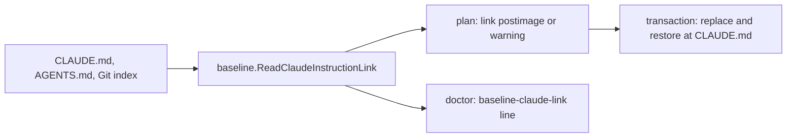

# CLAUDE.md is always a symbolic link to AGENTS.md — Technical Spec

## Executive Summary

One read-only reader in `internal/baseline` classifies the root `CLAUDE.md`: the link, absent, a regular file, a link elsewhere, an unlinked checkout, or beside an `AGENTS.md` that is not a regular file. It also lists the passages of its own that the file holds. Every Baseline plan consults it. Adoption writes `CLAUDE.md` as a link postimage with target `AGENTS.md`, and a managed refresh does so only when the reader finds nothing to lose; otherwise the plan warns and leaves the file. The file transaction learns to replace a regular file or a link at that one path with a link and to restore it on rollback. `roundfix doctor` turns the same reading into one `baseline-claude-link` line, and the Misplaced Repository Rule detector stops reporting the `@AGENTS.md` import line and the bytes of an unlinked checkout. The `agent-instructions.md` guide template states the rule.

The primary trade-off is in the managed refresh. Withholding the conversion keeps every adopter's update moving and loses nothing, but a repository that keeps rules in `CLAUDE.md` stays off the standard until a person moves them. Converting such a file with only a backup would reach the standard at once, but it would park the rules in a file no Agent reads (ADR-0432). A file with nothing of its own is converted with the Baseline's backup, as the maintainer chose. The second trade-off is that the managed refresh's preservation proof gains one narrow exception, at one path, proved on the bound preimage.

## Project Constraints

- Identifier strategy: not applicable — no persistent identifier is minted. The new names are the Doctor check `baseline-claude-link`, the codes `DR-BASELINE-CLAUDE-LINK`, `DR-BASELINE-CLAUDE-LINK-UNLINKED` and `DR-BASELINE-CLAUDE-LINK-UNREAD`, the warnings `baseline.root.claude-link.withheld` and `baseline.root.claude-link.unlinked-checkout`, and the managed entry `root.claude-instruction-link`, all public CLI contract under `docs/agents/cli.md`. Source: `docs/agents/domain.md`.
- Authentication and HTTP: not applicable — no endpoint, credential or network read. The reader reads local files and runs one read-only Git command. Source: `docs/agents/cli.md`, `docs/agents/agent-instructions.md`.
- Active ADR obligations: applicable — ADR-0432 and ADR-0433 (new) decide the design; it amends ADR-0100 and ADR-0411 and keeps ADR-0070, ADR-0071, ADR-0203, ADR-0220, ADR-0285 and ADR-0341; ADR-0074, ADR-0078, ADR-0173, ADR-0250, ADR-0254, ADR-0399 and ADR-0421 are listed only to record why they do not apply. ADR Alternatives relates each one. Source: `docs/agents/domain.md`, `docs/agents/specific-repository.md`.
- Tooling authority: applicable — express maintainer authorization: "Mesmas do BE (Recommended)" (2026-11-18), quoted in the record. It covers the Baseline module, template and profile pin, their formatter golden, this repository's managed guide and Setup Manifest, and the Roundfix and `setup-context-driven` skill files listed below. It grants no Makefile, workflow, Go module, lint or formatter change. Source: `docs/agents/agent-instructions.md`, `docs/agents/spec-routing.md`; Spec-contained authorization record: `docs/specs/0406-claude-md-is-always-a-link-to-agents-md/_authorization.md`; bounded files: `.agents/skills/roundfix/SKILL.md`, `.agents/skills/roundfix/references/baseline.md`, `.agents/skills/roundfix/references/modes.md`, `.agents/skills/roundfix/references/setup.md`, `.agents/skills/setup-context-driven/SKILL.md`, `docs/agents/agent-instructions.md`, `docs/agents/setup-context.json`, `internal/baseline/assets/formatter-fixtures/standard-typescript-monorepo/golden/docs/agents/agent-instructions.md`, `internal/baseline/assets/modules/core.json`, `internal/baseline/assets/profiles/standard-typescript-monorepo.json`, `internal/baseline/assets/templates/guides/agent-instructions.md`, `internal/baseline/assets/templates/index.json`, `skills/roundfix/SKILL.md`, `skills/setup-context-driven/SKILL.md`.

## System Architecture

No package, layer or directory is new. The design adds one file to `internal/baseline` and extends four seams.

### Claude Instruction Link reader

A new file `internal/baseline/claude_link.go` holds `ReadClaudeInstructionLink`. It reads the root with `os.Lstat` and `os.Readlink`, reads `AGENTS.md`, and computes passages with the functions the Misplaced Repository Rule detector already uses, `partitionRootSource` and `misplacedUnmarkedPassages`. It runs `git ls-files -s -- CLAUDE.md` through a `GitRunner` only when the file's bytes are exactly `AGENTS.md`.

### Plan and apply

In `internal/baseline/plan.go`, `assemblePostimages` asks the reader for the shape and, per ADR-0432, adds one link postimage for `CLAUDE.md` and its managed entry, or a warning. `validateManagedRefreshPreservation` accepts the link at `CLAUDE.md` when the reader, run on the preimage bytes, finds no passage. In `internal/baseline/apply.go`, `preimageMatchesPostimage` compares a link postimage with the link on disk. In `internal/baseline/transaction.go`, the journal validation, `captureTransactionEntries`, `validateTransactionPostimages`, `replacePostimage` and `restoreTransactionPreimage` accept a link postimage over a regular file or a link at `CLAUDE.md` only.

### Detector

In `internal/baseline/misplaced_rules.go`, the regular root `CLAUDE.md` is skipped when its bytes are exactly `AGENTS.md`, and its unmarked passage is dropped when its trimmed text is exactly `@AGENTS.md`.

### Command surfaces

`roundfix baseline update` already prints every plan warning as `Warning: <code>: <path>: <message>` and carries it in the JSON `warnings`, so it needs no code. `runDoctorCommand` in `internal/cli/doctor.go` appends `doctorClaudeLinkResult(repositoryRoot)` right after the `baseline-rules` line.



## Implementation Design

### Interfaces

```go
// internal/baseline/claude_link.go
const ClaudeInstructionLinkPath, ClaudeInstructionLinkTarget = "CLAUDE.md", "AGENTS.md"

type ClaudeInstructionLinkShape string // "link", "absent", "file", "link-elsewhere",
                                       // "unlinked-checkout", "agents-not-regular"
type ClaudeInstructionLink struct {
	Shape    ClaudeInstructionLinkShape
	Target   string                    // the link's target, for "link" and "link-elsewhere"
	Passages []MisplacedRepositoryRule // for "file" and "link-elsewhere"
}

func (link ClaudeInstructionLink) Convertible() bool
func ReadClaudeInstructionLink(ctx context.Context, root string, git GitRunner) (ClaudeInstructionLink, error)
```

```go
// internal/cli
const HealthCheckClaudeLink = "baseline-claude-link"
func doctorClaudeLinkResult(ctx context.Context, repositoryRoot string) CheckResult
```

Numbered invariants:

1. The reader writes nothing. It reads only the root `CLAUDE.md`, the root `AGENTS.md`, a link's in-repository target, and the Setup Manifest when one exists. The one Git command it may run, `git ls-files -s -- CLAUDE.md`, reads the index.
2. The shape is decided in this order. `agents-not-regular` applies when `AGENTS.md` is missing or not a regular file and `CLAUDE.md` is not already `link`. `link` is a symbolic link whose target, cleaned with `path.Clean`, is `AGENTS.md`. `absent` means no entry. `unlinked-checkout` is a regular file whose bytes are exactly `AGENTS.md` that Git records with mode `120000`. `file` is any other regular file. `link-elsewhere` is a link to another in-repository regular file. An unsafe link, a directory or a special file returns an error; the inventory's `baseline.inventory.unsafe-alias` and special-carrier blocks still decide planning.
3. A passage of a `file` is a Misplaced Repository Rule the detector reports for a regular root `CLAUDE.md` with this Spec's narrowing. That is an unmarked passage, or, when the Setup Manifest lists `CLAUDE.md`, an Unrecorded Managed Region with a digest mismatch. A passage of a `link-elsewhere` is an unmarked passage of the target's bytes, reported at the target's path. Bytes identical to `AGENTS.md` hold no passage.
4. `Convertible` is true for `absent`, and for `file` and `link-elsewhere` with no passage.
5. An adoption plan (`greenfield` or `preservation`) writes the link whenever it writes `AGENTS.md` as a regular file and the shape is neither `link` nor `unlinked-checkout`, passages or not; an `AGENTS.md` that adoption is about to create therefore does not stop it. A managed refresh writes it only when `Convertible`, and then, for a replaced regular file, also the root backup `CLAUDE.<digest>.md` through the backup path adoption uses (ADR-0070); a link elsewhere needs none. The postimage is `{Path: "CLAUDE.md", Kind: "symlink", Mode: 0, Content: "AGENTS.md"}` with no content identity. One managed entry, `root.claude-instruction-link` of kind `link`, accounts for it. `link` and `unlinked-checkout` add no postimage.
6. Otherwise the plan adds one warning and no postimage: `withheld` for a managed refresh of a non-convertible `file` or `link-elsewhere`, and for `agents-not-regular`; `unlinked-checkout` for that shape. A warning never changes the state, the exit code or a Managed Region.
7. The link's preimage is bound into the Plan Digest like every preimage (ADR-0071). An apply whose `CLAUDE.md` changed since the plan is refused as stale.
8. The transaction writes the link to a temporary name and renames it over `CLAUDE.md`. On rollback it removes the link only when it is still the planned one and restores the regular bytes and mode, or the previous link's target. Every other path keeps the rule that a link postimage needs a missing preimage.
9. The Doctor line reads through the same reader and never changes Doctor's exit code.

### Data Models

No stored format changes. The Plan Document already carries link postimages (`kind: "symlink"`, `content` the base64 of the target) for `baseline skills restore`; full plans now carry one for `CLAUDE.md`. The Setup Manifest is unchanged.

### API Contracts

1. API Contract: Baseline plans (`roundfix baseline`, `baseline plan` and `apply`, `baseline update`). A plan that writes the link lists `create CLAUDE.md` for an absent file or `update CLAUDE.md` for a replaced one in `fileChanges` and in the text `File changes:` lines, with the managed entry `root.claude-instruction-link`; a replaced regular file adds `create CLAUDE.<digest>.md` with its `backup:CLAUDE.md` entry, in a managed refresh as at adoption. After the apply, `CLAUDE.md` is a symbolic link with target `AGENTS.md`, and a second `roundfix baseline update` reports `current`.
2. API Contract: plan warnings, in the existing `Warning: <code>: <path>: <message>` text form and the JSON `warnings` array:
   - `baseline.root.claude-link.withheld` at `CLAUDE.md`: `CLAUDE.md holds <n> passage[s] of its own (<path>:<start>-<end>[, ...]); move each into docs/agents/specific-repository.md, then run roundfix baseline update to replace it with a symbolic link to AGENTS.md`. For a link elsewhere the message begins `CLAUDE.md links to <target>, which holds`. For `agents-not-regular` it reads `AGENTS.md is not a regular file, so CLAUDE.md cannot link to it; make AGENTS.md the root instruction file, then run roundfix baseline update`.
   - `baseline.root.claude-link.unlinked-checkout` at `CLAUDE.md`: `this checkout holds the symbolic link CLAUDE.md -> AGENTS.md as a regular file; run git config core.symlinks true, then check CLAUDE.md out again`.
3. API Contract: `roundfix doctor`, one line after `baseline-rules:` and before the residue lines, exit codes unchanged:
   - `baseline-claude-link: ok (CLAUDE.md is a symbolic link to AGENTS.md)`
   - `baseline-claude-link: warn (DR-BASELINE-CLAUDE-LINK: CLAUDE.md is absent; next: run roundfix baseline update to create the symbolic link to AGENTS.md)`
   - `baseline-claude-link: warn (DR-BASELINE-CLAUDE-LINK: CLAUDE.md is a regular file; next: run roundfix baseline update to replace it with a symbolic link to AGENTS.md)`, and the same with `is a symbolic link to <target>` for a link elsewhere
   - `baseline-claude-link: warn (DR-BASELINE-CLAUDE-LINK: CLAUDE.md is a regular file with <n> passage[s] of its own: <path>:<start>-<end>[, ...]; next: move each passage into docs/agents/specific-repository.md, then run roundfix baseline update)`, and the same with `is a symbolic link to <target> with` for a link elsewhere
   - `baseline-claude-link: warn (DR-BASELINE-CLAUDE-LINK: AGENTS.md is not a regular file; next: make AGENTS.md the root instruction file, then run roundfix baseline update)`
   - `baseline-claude-link: warn (DR-BASELINE-CLAUDE-LINK-UNLINKED: CLAUDE.md is the symbolic link to AGENTS.md checked out as a regular file; next: run git config core.symlinks true, then check CLAUDE.md out again)`
   - `baseline-claude-link: warn (DR-BASELINE-CLAUDE-LINK-UNREAD: <error>; next: re-run roundfix doctor after fixing CLAUDE.md)`
   - `baseline-claude-link: skipped (no Setup Manifest at docs/agents/setup-context.json)`
4. API Contract: Baseline text. In `templates/guides/agent-instructions.md`, after the sentence that ends "never in this guide or in a root instruction file.", the intro gains: "The root instruction file is `AGENTS.md`; `CLAUDE.md` is a symbolic link to it, which `roundfix baseline` creates and keeps, never a file of its own." The template's version, the guide `guide.agent-instructions` version in `core.json` and, through the record command, the `core` module version rise by one. No clause changes, so no Source Baseline row or Setup Snapshot changes.
5. API Contract: skills and guides. The `--update` Skill Mode in `references/modes.md` asks first, in its existing question, when a file change replaces `CLAUDE.md` (action `update` on that path): apply the whole plan or stop. The `baseline` reference, the `setup-context-driven` skill and the user guide page for `baseline` state the rule, the two warnings and that the conversion waits for the passages to move. The `setup` reference and the user guide page for `doctor` state the line and its codes.

### Surface Transcripts

1. Surface Transcript: in this repository, after Task 2's managed refresh, the update is current and plans nothing for `CLAUDE.md`.

   ```transcript
   $ roundfix baseline update --repo . --no-skills --no-history --format text
   stdout:
   Baseline update: current
   Result: the repository already matches the current Baseline catalog
   Prior catalog: sha256:<digest>
   Current catalog: sha256:<digest>
   File changes: 0
   Misplaced repository rules: 0
   Retention evidence: 0
   Declared decisions: 0
   ...
   stderr:
   exit: 0
   ```

No transcript is given for `roundfix doctor`: its other lines depend on the host's runtimes, forge access and disk. Its new line is asserted through the `doctorDependencies` seam.

## Coverage Map

- Goal 1 (adoption) → Plan and apply, invariants 5, 7 and 8, API Contract 1, Task 2.
- Goal 2 (managed refresh) → Claude Instruction Link reader and Plan and apply, invariants 3 to 6, API Contracts 1 and 2, Tasks 1 and 2.
- Goal 3 (Doctor line) → Command surfaces, API Contract 3, Task 3.
- Goal 4 (unlinked checkout) → reader invariant 2, API Contracts 2 and 3, ADR-0433, Tasks 1 to 3.
- Goal 5 (text) → API Contracts 4 and 5, Tasks 2 and 3.
- Core Feature 1 → Task 1. Core Feature 2 → Task 2. Core Feature 3 → Task 1. Core Feature 4 → Task 3. Core Feature 5 → Tasks 2 and 3, with the glossary in Task 1.
- Success Metrics 1, 2 and 5 → Task 2 tests. Success Metric 3 → Tasks 1 and 2 tests. Success Metric 4 → Task 3 tests. Success Metric 6 → QA gate.

Deviations from the PRD: None.

## Absence Evidence

1. The reader `ReadClaudeInstructionLink` and its type — command: `rtk proxy grep -rnE "ClaudeInstructionLink|claude-instruction-link|baseline-claude-link|DR-BASELINE-CLAUDE|baseline\.root\.claude-link" internal cmd docs/user-guide .agents/skills CONTEXT.md`; result: no match. `internal/baseline/plan.go` (`assemblePostimages`) writes only regular postimages and deletions; `repository.go` reads `CLAUDE.md` as a carrier or alias and never decides its shape. The names `assertClaudeLink` and `keepClaudeLinks` in `internal/baseline` tests belong to the Claude Skill Links, so the new tests use other helper names.
2. Recognition of an unlinked checkout — command: `rtk proxy grep -rnE "ls-files.*\"-s\"|core\.symlinks|120000" internal/baseline internal/cli --include=*.go`; result: no match outside tests. Nothing reads Git's recorded mode of a root carrier.
3. Treatment of the `@AGENTS.md` import line — command: `rtk proxy grep -rn "@AGENTS.md" internal --include=*.go`; result: no match. The detector reports it as a passage.
4. Glossary term **Claude Instruction Link** — command: `rtk proxy grep -n "Claude Instruction Link" CONTEXT.md`; result: no match. The nearest entry, **Claude Skill Link**, names the per-skill links under `.claude/skills`.

## ADR Alternatives

- ADR-0432: the design is its decision. It rejects converting with a backup, refusing the whole update, a repository option, a copy where links do not work, and writing the root blocks into a regular `CLAUDE.md`.
- ADR-0433: the design is its decision. It rejects converting an unlinked checkout, keeping a copy, and ignoring it silently.
- ADR-0100: amended. A managed refresh still proves preservation mechanically and takes no backup of any other carrier. The one exception, the link at `CLAUDE.md`, is proved on the bound preimage by the reader instead of by unchanged non-managed bytes, and the replaced regular file gets the one root backup the maintainer asked for; the rejected per-refresh backup of every carrier stays rejected.
- ADR-0411: amended. Passages are still named and never moved; only the import line and an unlinked checkout's bytes are no longer reported. Refusing the update, which it rejected, stays rejected.
- ADR-0070: kept. Adoption backs up every safe root carrier it rewrites, and the backup is what lets adoption replace a regular `CLAUDE.md` with the link.
- ADR-0071: kept. The `CLAUDE.md` preimage is bound like every other, so a stale `CLAUDE.md` refuses the apply.
- ADR-0203: kept. `docs/agents/specific-repository.md` stays the repository's, and the design writes nothing there; it only sends passages to it.
- ADR-0220: kept. The Doctor line warns and never fails, because a deviation an update repairs is not a definite failure.
- ADR-0285: kept. The new tests create links with `os.Symlink`, which compiles for Windows, and reproduce the unlinked checkout with `core.symlinks=false` on any host.
- ADR-0341: kept. The Claude Skill Links are still created only where they already exist; the root link differs because the standard leaves no copy alternative.

- ADR-0074: not applicable — the ownership of repository rules between semantic guides is unchanged; the design moves no rule and sends passages only to `docs/agents/specific-repository.md`.
- ADR-0078: not applicable — confirmed root rules still move to their semantic owners at adoption; the link changes where Claude Code reads, not where a rule lives.
- ADR-0173: not applicable — no History Relocation is planned or reported differently; the link is a root postimage, not a history move.
- ADR-0250: not applicable — the `core` module version is chosen by its record command as before, and the coverage record is untouched.
- ADR-0254: not applicable — the managed refresh's Pending History handling is unchanged.
- ADR-0399: not applicable — nested carriers stay out; the reader reads only the root `CLAUDE.md`.
- ADR-0421: not applicable — no phase entry or corrections record is touched.

## Integration Points

- Adopted repositories, read on disk and through `git ls-files -s` for one path, without the network.
- The release reaches adopters through the binary, which carries the catalog, the reader, the plan and the Doctor line, and through `roundfix skills install`, which carries the Roundfix and `setup-context-driven` skills.

## Testing Approach

- **Task 1, reader and detector.** One table test in `internal/baseline/claude_link_test.go` builds temporary Git repositories with `t.TempDir()`, each with a Setup Manifest and a root `AGENTS.md`. Its cases cover every shape:
  - the link, and a `./AGENTS.md` target;
  - absent;
  - an empty file, an `@AGENTS.md` file and a copy of `AGENTS.md`;
  - a file with only Managed Regions, a file with a heading and a bullet, and a listed file with a digest-mismatch region;
  - a link to a file with and without a passage;
  - an unlinked checkout reproduced with `git -c core.symlinks=false checkout`, and a regular file with the bytes `AGENTS.md` that Git records as `100644`;
  - `AGENTS.md` missing and `AGENTS.md` a link;
  - an absolute link, which is an error.

  Each case asserts the whole `ClaudeInstructionLink` and `Convertible`, and that the fixture's bytes and modes are unchanged. Detector cases in `misplaced_rules_test.go` add the import line and the unlinked checkout; the existing cases stay. Sabotage: dropping the Git check, the import-line exception or the copy rule fails a named case.
- **Task 2, plan and apply.** `internal/baseline/claude_link_plan_test.go` adopts fixtures in `greenfield` and `preservation` for each shape of Success Metric 1, and refreshes adopted fixtures for each shape of Success Metric 2. Each test asserts the postimage, the managed entry, the warning, the backup, the link on disk after the apply and `current` on the next plan. A rollback test injects a fault after the replace phase and asserts the original bytes and mode. `assertAppliedPostimage` in `apply_test.go` learns to compare a link postimage. `make baseline-digests` regenerates the four plan goldens, which gain the link. Sabotage: removing the preservation exception makes the `@AGENTS.md` refresh fail.
- **Task 3, surfaces.** `internal/cli/doctor_claude_link_test.go` drives `runDoctorCommand` with stubbed dependencies on temporary repositories for every line of API Contract 3, its position and the exit code. `internal/cli/baseline_update_claude_link_test.go` runs the update on adopted fixtures for the withheld and unlinked-checkout warnings in text and JSON, and runs Surface Transcript 1 whole. `internal/cli/doctor_test.go` gains the new line in its counts, names and expected outputs. The docs contract tests and the Behavior Surface Record cover the guides and skills.

## Build Order

1. The reader `baseline.ReadClaudeInstructionLink`, the detector's narrowing, their tests, the glossary term **Claude Instruction Link** and the change to **Misplaced Repository Rule** in `CONTEXT.md` through `domain-modeling`, and the "Amended by ADR-0432" paragraph of ADR-0411 (no dependency).
2. The plan, apply and transaction changes, their tests, the `apply_test.go` helper, the guide sentence with its version raises, the module record, `make baseline-digests`, the managed refresh of this repository with the sanctioned command, the change to **Managed Refresh** in `CONTEXT.md`, and the "Amended by ADR-0432" paragraph of ADR-0100 (depends on: 1, for the reader).
3. The Doctor line and its tests, the update tests and Surface Transcript 1, the `doctor` usage text in `internal/cli/cli.go`, the user guide pages for `baseline` and `doctor`, the Roundfix skill's `baseline`, `modes` and `setup` references, the `setup-context-driven` skill, the owned-skill version records and the Behavior Surface Record (depends on: 1, for the reader; 2, for the plan behaviour the update tests and the transcript need).
4. QA gate: the PRD's metrics, the transcript and the read-only re-read of the adopters (depends on: 1, 2, 3).

`requires`: Spec 0405, whose root statement and Managed Refresh of this repository land first, and Spec 0399, merged.

## Risks & Considerations

- **Derived churn after Spec 0405.** Spec 0405 changes the `spec-workflow` module and regenerates the same catalog records, plan goldens, Standard TypeScript profile pin and Setup Manifest. Task 2 runs after it merges and regenerates from that tree; the derived set was measured on `eb888135` and is declared by path.
- **Doctor tests that count lines.** Two table tests of `internal/cli/doctor_test.go` count sixteen lines today and list each check name; five expected outputs hold the `baseline-rules: skipped` line. Each gains `baseline-claude-link: skipped (...)`. If Spec 0405 adds a line first, Task 3 adds one to the count it finds.
- **Fleet impact.** Every adopted checkout on the host already keeps the link, so the release changes no adopter file there. A repository elsewhere with a `CLAUDE.md` of its own sees the withheld warning until its passages move.
- **A host that cannot create links.** The apply fails while it writes the link's temporary name, before any destination is replaced, and rolls back. The error names the path.
- **An `AGENTS.md` that is a link.** Its handling is unchanged; the reader reports `agents-not-regular`, so no plan writes a link to it.
- **Declared break.** A managed refresh used to leave every byte outside Managed Regions untouched. It now replaces `CLAUDE.md` when the file holds nothing of its own (ADR-0432 amends ADR-0100).

## Glossary

- adds: **Claude Instruction Link**
- changes: **Managed Refresh**
- changes: **Misplaced Repository Rule**

## Decisions

- Withhold, and never refuse the update, when `CLAUDE.md` holds a passage of its own; convert with the root backup when it holds none ("Só depois de mover (Recommended)", 2026-11-18). See ADR-0432.
- Leave an unlinked checkout and report it. See ADR-0433.
- One reader feeds the plan and Doctor, so both decide the same shape.
- No update code: the plan's warnings already reach the update's text and JSON.
- The rule is template prose, not a clause, so no Source Baseline row is needed.
- The Release Ceiling is `minor`: Doctor gains a line and the update gains two warnings.
