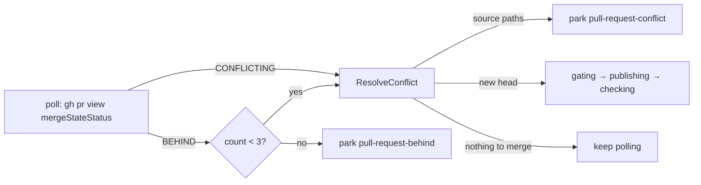

# The Delivery Queue brings a Pull Request that fell behind its base branch up to date — Technical Spec

## Executive Summary

The checking stage of the Delivery Engine learns one merge state, `BEHIND`. Read at a poll, it stops the Check Wait, and the Queue Owner makes a Base Update through the merge of the default branch it already makes for a conflict confined to derived paths (`ConflictResolver.ResolveConflict`). The merged head becomes the item's newest candidate and the item returns to `gating`, so the repository gate, the push and the Head Check Set of the new head follow, as after a derived merge today. An in-memory count bounds the Base Updates of one item to three per Queue Owner, and a new blocker, `pull-request-behind`, names the park that ends a fourth. No new package, interface, forge call or stored field is added.

The primary trade-off is the update mechanism. A local merge in the item worktree keeps the item branch the owner's and lets the repository gate see the merged tree, at the cost of one gate per move of the base branch. GitHub's update-branch endpoint would save the gate but leave the owner behind its own remote, with a head it did not make (ADR-0435). The second trade-off is the signal: acting only on `BEHIND` leaves loose repositories untouched, but a required check pending or failing on the behind head shows `BLOCKED` first, so the update usually follows one CI round that could not merge.

## Project Constraints

- Identifier strategy: not applicable — no persistent identifier is minted. The new names are the blocker `pull-request-behind`, the exported constants `BlockerPullRequestBehind` and `BaseUpdateLimit`, and the owner log line `roundfix: base update: …`, all public CLI contract under `docs/agents/cli.md`. Source: `docs/agents/domain.md`.
- Authentication and HTTP: not applicable — no endpoint, credential or new forge call. The merge state comes from the `gh pr view --json … mergeStateStatus` read the owner already makes, and the Base Update uses the `git fetch`, `git merge`, commit and push of the derived merge. Source: `docs/agents/cli.md`, `docs/agents/agent-instructions.md`.
- Active ADR obligations: applicable — ADR-0435 (new) decides the design; it keeps ADR-0192, ADR-0369, ADR-0311, ADR-0366, ADR-0422, ADR-0302, ADR-0236 and ADR-0398, and amends none; ADR-0115, ADR-0116, ADR-0197, ADR-0233, ADR-0250, ADR-0256, ADR-0282, ADR-0286, ADR-0309, ADR-0345, ADR-0352, ADR-0365 and ADR-0391 are listed only to record why they do not apply. ADR Alternatives relates each one. Source: `docs/agents/domain.md`, `docs/agents/specific-repository.md`.
- Tooling authority: applicable — express maintainer authorization: "Mesmas do BE" (2026-11-18), quoted in the record. It covers the Roundfix skill's canonical `deliver` reference and the two `SKILL.md` files whose version fields rise. It grants no Makefile, workflow, Go module, lint or formatter change. Source: `docs/agents/agent-instructions.md`, `docs/agents/spec-routing.md`; Spec-contained authorization record: `docs/specs/0408-the-delivery-queue-brings-a-behind-pull-request-up-to-date/_authorization.md`; bounded files: `.agents/skills/roundfix/SKILL.md`, `.agents/skills/roundfix/references/deliver.md`, `skills/roundfix/SKILL.md`.

## System Architecture

No package, layer, directory or interface is new. The design changes two files of `internal/delivery` and documents the behavior.

### Checking stage

In `internal/delivery/engine.go`, `checkCandidate` reads each poll's `CheckReport`. Right after the `CONFLICTING` test and before the checks are classified, a report whose `MergeState` is `BEHIND` takes the Base Update path:

1. When the Engine has no `ConflictResolver`, or the item already had `BaseUpdateLimit` Base Updates from this Engine, the item parks `pull-request-behind`.
2. Otherwise the Engine calls `ResolveConflict(ctx, workDir, item.SpecSlug, head)`. An error is returned wrapped as `bring pull request up to date: %w`, which the Engine's step error handling parks as `delivery-error`. Source paths park `pull-request-conflict: <path>, …`. A new head, different from the candidate, is counted, logged, appended to `CandidateCommits`, and the item moves to `gating`.
3. An empty head, or the candidate itself, means the item branch already holds the fetched default branch: the poll counts as pending, and the Check Wait goes on.

`BEHIND` joins `BLOCKED` and `UNKNOWN` as an awaited merge state in the end-of-poll test and in `checksTimeoutBlocker`.

### The count

`Engine` gains `baseUpdates map[string]int`, keyed by Spec slug, beside `policyRefusals`. `Engine.park` deletes the item's key before it writes the park, so every park, whatever its cause, starts the count over.

### Park Class

`ClassifyPark` in `internal/delivery/park_class.go` gives `pull-request-behind` the class `environment` and its next action.

### What the command engine already provides

`commandDeliveryWorkflow.ResolveConflict` in `internal/cli/deliver_workflow.go` fetches the default branch from the push remote, merges it with `--no-ff --no-commit`, resolves derived conflicts, aborts on a source conflict, commits a merge with `chore: merge default branch and regenerate derived paths` and the trailer `Roundfix-Delivery: derived-merge`, and returns an empty head when nothing is left to merge. The characterization reference proves each case on a branch that is only behind. `newCommandDeliveryEngine` already wires it as `Conflicts`. No `internal/cli` source changes.



## Implementation Design

### Interfaces

```go
// internal/delivery/engine.go
const BlockerPullRequestBehind = "pull-request-behind"

// BaseUpdateLimit bounds the Base Updates one Engine makes for one item.
const BaseUpdateLimit = 3

type Engine struct {
	// …
	policyRefusals map[string]bool
	baseUpdates    map[string]int // Spec slug → Base Updates; dropped by park
}
```

Numbered invariants:

1. A report whose `MergeState` is `BEHIND` never moves an item to `merging`, and no merge is attempted at a head GitHub reported `BEHIND` in the same poll.
2. `CONFLICTING` keeps its precedence: a report that is both `CONFLICTING` and `BEHIND` takes the conflict path unchanged.
3. The Base Update calls the Engine's `ConflictResolver` with the item worktree and the candidate head, exactly as the conflict path does, and records only a head the resolver returns that differs from the candidate.
4. Only a recorded new head counts toward `BaseUpdateLimit`. The fourth `BEHIND` read after three counted Base Updates parks before calling the resolver.
5. `Engine.park` drops the item's count, so the next `BEHIND` after any park, and after the Delivery Retry that resumes the item at `checking`, makes a Base Update.
6. `checksTimeoutBlocker` appends `; merge state BEHIND` when the pending list is empty and the awaited state is `BEHIND`, as it does for `BLOCKED` and `UNKNOWN`.
7. A merge refused by the branch policy keeps `policyRefusals` unchanged: one return to `checking` per head, and a second refusal at the same head parks `delivery-error`.

### Data Models

No stored format changes. `CandidateCommits` gains the Base Update head as it gains a derived merge head today. The count lives only in the Engine's memory.

### API Contracts

1. API Contract: owner log. A Base Update writes one line to the owner log:
   `roundfix: base update: Delivery Queue item <slug>: pull request #<n> was behind its base branch; merged the default branch at <head>`.
   The existing `roundfix: checks: Delivery Queue item <slug>: merge state BEHIND` line precedes it, as for every merge state.
2. API Contract: blockers and park.
   - After three Base Updates: `pull-request-behind: pull request #<n> is still behind its base branch after 3 Base Updates`.
   - Without a `ConflictResolver`: `pull-request-behind: pull request #<n> is behind its base branch`.
   - Park Class `environment`; next action, as `deliver status` prints after `Park: <slug> environment: ` and the Pending Question shows: `run roundfix deliver retry <slug> once the base branch stops moving; the retry resumes at checking, which merges the default branch into the item branch again`.
   - The timeout of a Check Wait that awaited only `BEHIND`: `checks-timeout: current-head checks not settled within delivery.check_timeout <duration>; merge state BEHIND`.
   - A source conflict in a Base Update: `pull-request-conflict: <path>, …`, unchanged.
3. API Contract: documentation, in `.agents/skills/roundfix/references/deliver.md` (its mirror through `make skills-sync`) and `docs/user-guide/commands/deliver.md`:
   - In the paragraph that begins "During `checking`", the clause "GitHub reports the merge state as neither `BLOCKED` nor `UNKNOWN`" becomes "GitHub reports the merge state as none of `BLOCKED`, `UNKNOWN` and `BEHIND`".
   - A new paragraph right before that one: "GitHub reports the merge state `BEHIND` when the base branch requires branches to be up to date and the item branch lacks one of its commits. A `BEHIND` merge state stops the check wait on its first read, and the owner makes a Base Update: it merges the refreshed default branch into the item branch by the same merge, commits a merge without conflict with the `Roundfix-Delivery: derived-merge` trailer, and returns the item to `gating`. The repository gate, push and current-head checks run again; the pre-PR review, the QA gate and the Run do not, because the item's own change does not move. A conflicted merge follows the two paragraphs above. When the item branch already holds the fetched default branch, the check wait goes on. One Queue Owner makes at most three Base Updates for an item, counting them in its memory and starting over when the item parks; behind a fourth time, the item parks `pull-request-behind: pull request #<n> is still behind its base branch after 3 Base Updates`. The owner log names each Base Update:", followed by a `text` block holding the line of API Contract 1 with `<slug>`, `<n>` and `<head>`.
   - In the paragraph that begins "At the end of the Check Wait", the sentence "Roundfix returns to `checking` once for that head." becomes "Roundfix returns to `checking` once for that head, where a `BEHIND` merge state makes a Base Update."
   - In each Park Class table, the `environment` row lists `pull-request-behind` right after `checks-timeout`.
   - After the sentence of the `numbered-file-collision` park, one sentence: "A `pull-request-behind` park's next action is `run roundfix deliver retry <slug> once the base branch stops moving; the retry resumes at checking, which merges the default branch into the item branch again`."
4. API Contract: glossary, in `CONTEXT.md` through `domain-modeling`:
   - adds **Base Update**: the Queue Owner's merge of the refreshed default branch into an item branch whose pull request GitHub reports `BEHIND`, made by the same merge as a derived merge and followed by the repository gate, the push and the current-head checks, never by the pre-PR review, the QA gate or the Run; at most three per item and Queue Owner before the item parks `pull-request-behind` (ADR-0435). `_Avoid_: Branch update, rebase`.
   - changes **Check Wait**: a `BEHIND` merge state ends it in a Base Update (ADR-0435).

### Surface Transcripts

None. No command's standard output changes on a fixed input: the Base Update shows in the owner log, which interleaves Run and check lines by timing, and in the blocker text `deliver status` already prints verbatim. API Contracts 1 and 2 give their exact lines, and the tests assert them.

## Coverage Map

- Goal 1 (never merged while behind; merged head gated, pushed, checked) → Checking stage, invariants 1 and 3, API Contract 1, Task 1.
- Goal 2 (a merge, the owner's, with the known trailer) → What the command engine already provides, Task 1 end-to-end test.
- Goal 3 (no review, QA gate or Run again) → Checking stage step 2 (`gating`), ADR-0435, Task 1.
- Goal 4 (conflict parks; nothing to merge keeps polling) → Checking stage steps 2 and 3, invariant 6, API Contract 2, Task 1.
- Goal 5 (bound and park) → The count, Park Class, invariants 4 and 5, API Contract 2, Task 1.
- Goal 6 (loose repositories unchanged) → invariant 1 limited to `BEHIND`, ADR-0435, Task 1's existing-test runs.
- Core Feature 1 → Task 1. Core Feature 2 → Task 1. Core Feature 3 → Task 2.
- Success Metrics 1, 3, 4 and 5 → Task 1 `internal/delivery` tests. Success Metric 2 → Task 1 `internal/cli` test. Success Metric 6 → QA gate, from the characterization reference.

Deviations from the PRD: None.

## Absence Evidence

1. The Base Update path at `checking` — command: `rtk proxy grep -rnE "BEHIND|baseUpdates|BaseUpdate|pull-request-behind|base update" internal --include=*.go`; result: no match. `checkCandidate` in `internal/delivery/engine.go` waits only on `BLOCKED` and `UNKNOWN`, and its only call of `ResolveConflict` follows `report.Mergeable == "CONFLICTING"`.
2. The blocker `pull-request-behind` and its Park Class — command: `rtk proxy grep -rn "pull-request-behind" internal docs/user-guide .agents/skills CONTEXT.md`; result: no match.
3. Glossary term **Base Update** — command: `rtk proxy grep -n "Base Update" CONTEXT.md`; result: no match. The nearest entries, **Check Wait** and **Derived Path Declaration**, name the wait and the regeneration of a conflict.

## ADR Alternatives

- ADR-0435: the design is its decision. It rejects GitHub's update-branch endpoint, a rebase, detection by the compare API's `behind_by`, a second pre-PR review, skipping the repository gate, an unbounded loop and a persisted count.
- ADR-0192: kept. The Base Update is its merge, triggered by a second merge state; it still never rebases or force-pushes, still parks a source conflict, and still skips the pre-PR review for a merge that adds only the default branch's commits. Its rejected rebase stays rejected.
- ADR-0369: kept. The Head Check Set, its conclusions and its parks are unchanged; `BEHIND` is one more merge state that never merges. Its rejected reading of `UNSTABLE` stays rejected: the design reads `BEHIND` only.
- ADR-0311: kept. The Check Wait keeps its key, default, bounds and restart rule; its timeout blocker gains `BEHIND` as an awaited state.
- ADR-0366: kept. A conflict-free merge of the default branch keeps the Reviewer Lineage, which is why the Base Update needs no review; a later correction's review measures the item's change as a delta.
- ADR-0422: kept. The Base Update commit carries `Roundfix-Delivery: derived-merge` and merges the default branch, so it is never a Correction Sign; no new mark is introduced.
- ADR-0302: kept. A hook that refuses the Base Update commit parks `delivery-error` with the hand merge that recovers it, as for the derived merge.
- ADR-0236: kept. A failed check is still judged against the default branch tip it tested; a Base Update gives CI a head that already holds that tip, and its stale re-run rule is unchanged.
- ADR-0398: kept. A Delivery Retry of an archived item at its unchanged candidate with a recorded pull request resumes at `checking`, which is how a `pull-request-behind` park comes back; `review-stale` still parks a head the queue did not record.

- ADR-0115: not applicable — the adopted Backlog Entry cites the quaestor repository's own ADR-0115; this repository's ADR-0115, on discarding a superseded Run Branch, is untouched.
- ADR-0116: not applicable — the adopted Backlog Entry cites the quaestor repository's own ADR-0116; this repository's ADR-0116, on checking a citation against what it cites, is untouched.
- ADR-0197: not applicable — no review runs after a Base Update, so the Reviewer Lineage and its two-round bound are unchanged.
- ADR-0233: not applicable — a Base Update regenerates derived paths only when its merge conflicts on them, exactly as the derived merge does, so the version-raise regeneration at merge is unchanged.
- ADR-0250: not applicable — no Baseline module version and no coverage record changes.
- ADR-0256: not applicable — the release still waits for the skills that describe a changed surface; Task 2 updates the `deliver` reference that describes this one.
- ADR-0282: not applicable — no history cleanup or review segmentation changes.
- ADR-0286: not applicable — the Correction Review of a round-2 finding is unchanged.
- ADR-0309: not applicable — the queue's archive subject and Pull Request title are unchanged.
- ADR-0345: not applicable — no derived-record writer changes; Task 2 runs the existing record commands as declared.
- ADR-0352: not applicable — the pre-PR review's omitted and data paths are unchanged.
- ADR-0365: not applicable — the review capacity and the status turn lines are unchanged.
- ADR-0391: not applicable — a Base Update that conflicts on source parks for a hand resolution, whose review delta from the Conflicted Carry is unchanged.

## Integration Points

- GitHub, through the `gh pr view` read of `mergeStateStatus` the owner already makes, and the push remote, through the fetch and push the derived merge already makes. The tests replace both with fakes or a temporary bare repository and a local `gh` script; nothing reaches the network.
- The release reaches adopters through the binary and through `roundfix skills install`, which carries the Roundfix skill's `deliver` reference.

## Testing Approach

- **Task 1, Delivery Engine.** A new file `internal/delivery/base_update_test.go` drives `checkCandidate` and `Engine.Run` with the existing fakes (`fakePullRequestBoundary`, `fakeDeliveryClock`, the `newMergeStateFixture` pattern, and a resolver fake of its own that returns a sequence of heads or source paths; it does not reuse `fakeConflictResolver`, whose target check is fixed). It covers the Base Update to `gating`, a whole run that merges at the updated head with no merge attempted at the behind head, the source conflict, nothing to merge both ways, the bound and its restart after a park, the missing resolver, a policy refusal that comes back as `BEHIND`, and `CONFLICTING` precedence. `park_class_test.go` gains the new blocker in its class table. Sabotage: dropping the `BEHIND` path, the count, the reset in `park` or the timeout state makes a named test fail.
- **Task 1, command engine.** A new file `internal/cli/deliver_base_update_test.go` copies the child-process pattern of `TestCommandDeliveryEngineRecordsThePullRequest`: a temporary bare origin, a local `gh` script on the child's `PATH`, `Defaults.Verification` set to `true`. The script is strict: it reports `BEHIND` while `main` is not an ancestor of the head, refuses the merge with "the base branch policy prohibits the merge" while behind and records each refusal. The test moves `main` after the item branch is cut and asserts the item merges at a head that has the moved `main` as a parent, the merge commit holds the moved file, the owner output names the Base Update, and no refusal was recorded. The characterization reference proves the same scenario parks `delivery-error` today.
- **Task 2, documentation.** `TestTheParkActionsAreDocumentedAsTheQueueClassifiesThem` in `internal/docscontract/command_documentation_test.go` adds `pull-request-behind` to the blockers whose action sentence must appear exactly once in each of the three documents. The glossary, skill version, mirror and Behavior Surface Record tests cover the rest.

## Build Order

1. The `BEHIND` path of `checkCandidate`, the count and its reset in `park`, the timeout state, `BlockerPullRequestBehind` and `BaseUpdateLimit`, the Park Class and next action, the `internal/delivery` tests, the class-table case and the command-engine test with the strict local forge (no dependency).
2. The `deliver` reference of the Roundfix skill and its mirror, the user guide page for `deliver`, the park-action contract test, the glossary entries **Base Update** and **Check Wait** through `domain-modeling`, the Roundfix skill's version raise and record, and the Behavior Surface Record as the last edit (depends on: 1, for `delivery.BlockerPullRequestBehind` and the next action the contract test reads through `ClassifyPark`).
3. QA gate: the PRD's metrics, the published evidence and the sabotages (depends on: 1, 2).

No `requires`: no Verification of this Spec depends on another active Spec. Spec 0407 delivers first and may change `CONTEXT.md`, `docs/references/behavior-surfaces.json`, `skills/testdata/owned-skill-versions.json` and the Roundfix skill's version fields; step 2 edits them narrowly and re-records the derived files on the tree it runs on.

## Risks & Considerations

- **A busy base branch.** Each Base Update costs a repository gate and a CI round. Three bound the cost per owner; the park says to retry once the base branch is quiet.
- **GitHub's merge state lags.** Right after a push, GitHub may still report `BEHIND` for a head that holds the base branch. The resolver then finds nothing to merge, the poll counts as pending, and no Base Update is counted; each such poll fetches the default branch once.
- **`BLOCKED` masks `BEHIND`.** While a required check of the behind head is pending or failing, GitHub reports `BLOCKED`, so the update comes after that CI round. A failed check on the behind head goes through today's rules: a failure whose tested base lacks the default branch tip is stale and re-run (ADR-0236), and any other failure parks `checks-failed`.
- **A hook on the item worktree.** The Base Update commit goes through the repository's hooks like the derived merge; a refusal parks `delivery-error` with the hand merge (ADR-0302).
- **Declared break.** An item whose Pull Request GitHub reports `BEHIND` used to move to `merging` and park `delivery-error` after two refusals; it now goes back through `gating`. No existing test asserts a `BEHIND` merge state; the whole `internal/delivery` package passed on the prototype.

## Glossary

- adds: **Base Update**
- changes: **Check Wait**

## Decisions

- The Base Update is the queue's existing merge of the default branch, never GitHub's update-branch endpoint or a rebase. See ADR-0435.
- After a Base Update the repository gate, the push and the checks run; the pre-PR review, the QA gate and the Run do not. See ADR-0435 and ADR-0192.
- `BEHIND` alone triggers it, so a repository whose base does not require up-to-date branches keeps its behavior. See ADR-0435.
- Three Base Updates per item and Queue Owner, counted in memory and dropped on park; a fourth parks `pull-request-behind` of Park Class `environment`. See ADR-0435.
- The Base Update commit keeps the derived merge's subject and trailer, so ADR-0422's Correction Sign rule and ADR-0302's hook recovery need no change.
- No `internal/cli` source change: the command engine already wires the merge.
