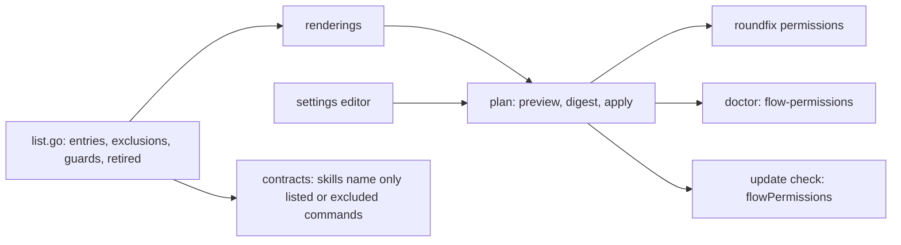

# A session runs the flow's own commands without a permission prompt — Technical Spec

## Executive Summary

One new package holds the Flow Command List as data, renders it for each harness and edits the two files it may write. One new command, `roundfix permissions`, previews a plan for a harness and writes it only against the digest that preview printed. The Doctor Command and the Update Check read the same plan and report its state, and the governed set gains one pattern for the project permission files of the three harnesses. The primary trade-off is in the Claude Code file: the command edits it in place by byte position, which costs a small editor of its own, because decoding and encoding the file would change bytes the product promises to keep. The second trade-off is the maintainer's: every Git and GitHub read the skills name is on the list, with Guard Entries where Claude Code can express them and none in Codex, where a rule cannot see an option. No Project Config key, no Baseline module and no existing command surface changes.

## Project Constraints

- Identifier strategy: not applicable — no identifier is minted for a product entity; an entry is identified by its text and a preview by its digest, which ADR-0446 defines. Source: `docs/agents/domain.md`.
- Authentication and HTTP: not applicable — no endpoint, credential or network call is added; every read and write is a file of the repository, and no test runs a harness or reaches the network. Source: `docs/agents/cli.md`, `docs/agents/agent-instructions.md`.
- Active ADR obligations: applicable — ADR-0444 decides when a harness's file is written (ADR-0444: "a person ran the command that shows the closed Flow Command List for that harness, and then confirmed that exact preview"), ADR-0445 what the list holds (ADR-0445: "A subcommand is on the list or off it."), and ADR-0446 (new) how the confirmation and the entries are recognized (ADR-0446: "An entry is known by its text."). The refusal to merge into a harness's project file as the Baseline's own mechanism stands (ADR-0371: "which is tooling configuration the core clauses forbid changing without express authorization"). The user's runtime files stay untouched (ADR-0011: "not by editing the user's runtime configuration files"; ADR-0293: "Editing `~/.codex/config.toml` was rejected again"). The governed set only grows (ADR-0130: "The universal clause defines the governed class by kind"). The skill's one question follows the question contract (ADR-0320: "Up to three, independent, in one pending call."). The skill and the guides ship with the surface (ADR-0256: "A release waits for the skills that describe a changed surface"), the authorization record carries the Release Ceiling (ADR-0349: "A Spec's Release Ceiling answers the release plan's approval"), and each new ADR carries its mark (ADR-0439: "The author marks a new ADR"). ADR-0386, ADR-0405, ADR-0401, ADR-0402, ADR-0166, ADR-0179, ADR-0314, ADR-0338, ADR-0375, ADR-0412, ADR-0416 and ADR-0438 are listed only to record why they do not apply (ADR-0386: "None of them writes to those directories."; ADR-0402: "from a set that holds no shell and no file-writing tool"); `## ADR Alternatives` relates each one. No accepted ADR is superseded or amended. Source: `docs/agents/domain.md`, `docs/agents/docs-layout.md`.
- Tooling authority: applicable — express maintainer authorization: his answer of 2026-11-19, "Mesmas do BE para as duas (Recommended)", which the authorization record quotes with its provenance. It grants no Makefile, workflow, Go module, lint or formatter change except for a correction that requires one, and the design needs none. `.roundfixrc.yml` is not granted. It is not a confirmation of the Flow Command List for this repository: no Task writes a harness permission file here. Source: `docs/agents/agent-instructions.md`, `docs/agents/spec-routing.md`; Spec-contained authorization record: `docs/specs/0413-a-session-runs-the-flows-own-commands-without-a-permission-prompt/_authorization.md`; bounded files: `.agents/skills/roundfix/SKILL.md`, `.agents/skills/roundfix/references/modes.md`, `.agents/skills/roundfix/references/setup.md`, `internal/speccheck/governed.go`, `internal/speccheck/governed_repocontract_test.go`, `skills/roundfix/SKILL.md`.

## System Architecture

The design adds one package, `internal/flowpermissions`, and three places in `internal/cli` that use it. The Daemon, the Delivery Queue, the Baseline, skill installation and `roundfix setup` do not import the new package, and a test proves that for the packages that write files of a harness directory today.

### The list and its renderings

The entries, the Named Exclusions with their reasons, the Guard Entries, the words that are no command and the retired set are Go data in one file of the new package. Nothing computes the list at run time, so the list a person confirms is the list the binary shipped. Three renderings turn it into what a harness reads: for Claude Code one allow rule per entry and one ask rule per Guard Entry; for Codex the whole text of one rules file; for OpenCode the entries in plain words. A rendering never holds a rule for a Named Exclusion, for a shell, an interpreter, a package manager or a build tool, or with a wildcard in the place of a command, and a test of the package fails when one does. Every preview prints the Named Exclusions and the sentence that the list is not a security boundary.

### The settings editor

It reads the allow and ask lists of a Claude Code settings file with their byte positions and returns new bytes with string elements inserted or deleted. Every other byte of the file is copied as it was. `internal/baseline/owned_skills_lock.go` already reads a JSON file by decoder offsets; this editor uses the same decoder and writes spans, where that one rewrites the file it owns. Before it returns, the editor decodes its own result and compares the two lists with the ones it meant to produce.

### The plan and its digest

For a repository, a harness and an action, which is apply or remove, the plan reads the target file and returns the state, what would be added and removed, and a digest of all of it. A preview prints the plan and writes nothing. A write is given a digest, computes the plan again, and writes only when the two digests are equal, so nothing reaches a harness's file that a preview did not show for the same list and the same file. The removal is the same mechanism with the other action: it deletes exactly the rules of the list the file holds, or the Codex rules file of Roundfix's own, and nothing else.

### The command

`internal/cli/permissions.go` holds `roundfix permissions`: its flags, the text and JSON forms of a plan and the exit codes. `internal/cli/cli.go` gains the dispatch case, the root usage line, the row of the command table and the help text.

### The two reports

`internal/cli/doctor_flow_permissions.go` adds the check `flow-permissions` to the Doctor Command, after the Baseline checks and before `residue`; `internal/cli/health.go` and `internal/cli/doctor.go` gain its name and its place. `internal/cli/update_check.go` gains the optional `flowPermissions` part. Both read the plan of each harness, print its state and the command to run, and never write. A project whose applied list fell behind the installed one is told so by both.

### The contracts over the list

One test of the documentation contracts reads every owned skill and fails when a skill names a `roundfix` subcommand, or a Git or GitHub command, that is neither an entry nor a Named Exclusion. It is what keeps the list equal to what the skills ask for when a later Spec adds a command or a skill names a new read.

### The governed set

`internal/speccheck/governed.go` gains one entry for the project permission files of the three harnesses. The Roundfix skill, the user guide and `CONTEXT.md` change with the surfaces they describe.



## Implementation Design

### Interfaces

```go
package flowpermissions

type Entry struct{ Words []string }                // {"roundfix","spec"}, {"git","show"}, {"gh","pr","view"}
type Exclusion struct{ Words []string; Reason string }
type Guard struct{ Entry Entry; Option, ClaudeRule string }

func Entries() []Entry          // roundfix first, then git, then gh; each group sorted
func Exclusions() []Exclusion
func Guards() []Guard
func NotCommands() []string     // words after git or gh in a code span that are no command
func Retired() (entries, claudeRules []string) // empty in the first release; never shrinks
```

```go
type Harness string // "claude", "codex", "opencode"
type Action string  // "apply", "remove"
type State string   // "current", "behind", "not_applied", "not_needed", "own_rules", "unreadable"

type Plan struct {
	Harness    Harness
	Action     Action
	File       string   // repository-relative, empty for opencode
	FileExists bool
	State      State
	Add        []string // rules or plain entries to add
	AddGuards  []string // Claude Code only
	Remove     []string
	Reason     string   // why unreadable, or which OpenCode file holds rules
	Digest     string   // empty when the plan has nothing to write
}

func Present(repoRoot string) []Harness
func Preview(repoRoot string, harness Harness, action Action) (Plan, error)
func Apply(repoRoot string, harness Harness, action Action, digest string) (Plan, error) // ErrPreviewChanged
```

```go
// Settings editor. data is the file as read; nil means the file is absent.
func ReadClaudeSettings(data []byte) (allow, ask []string, err error) // ErrNotStrictJSON, ErrUnexpectedShape
func EditClaudeSettings(data []byte, addAllow, addAsk, remove []string) ([]byte, error)

func ClaudeRule(entry Entry) string            // "Bash(roundfix spec *)"
func RenderCodexRules() []byte
func ReadCodexRules(data []byte) (entries []string, ok bool)
func ReadOpenCode(repoRoot string) (state State, file string)
```

Invariants:

```text
1. Preview and the two reports never write. Apply writes at most one file.
2. Apply writes only when the digest it was given equals the digest of the plan it computes then.
3. EditClaudeSettings changes no byte outside the string elements it inserts or deletes, their separators, and a list, a key or a file it has to create.
4. EditClaudeSettings adds no rule a list already holds; applying twice returns the same bytes.
5. A removal after an apply returns the first bytes when both lists existed and held no rule of the list.
6. No rendering holds a rule for a Named Exclusion, for a shell, an interpreter, a package manager or a build tool, or with a wildcard in the place of a command or subcommand.
7. Every entry of the list is a rule in the Claude Code rendering and is allowed by the Codex rendering.
8. The target is inside the repository: neither the file nor a directory on its path is a link that resolves outside it.
9. The retired set holds every entry a released list held and the current list no longer holds.
10. No file under the user's home directory is opened.
```

### Data Models

**The list at the authoring base.** The Task that writes it derives it again on its own tree by the two rules of Core Features 2 and 3, and the contract of API Contract 6 decides.

| Group | On the list | Named Exclusions, with the reason shown |
| --- | --- | --- |
| `roundfix` | `archive`, `attach`, `cancel`, `corrections`, `deliver`, `doctor`, `events`, `fetch`, `follow-up`, `gc`, `history`, `implement`, `init`, `migrate`, `phase`, `qa-report`, `reconcile`, `reopen`, `resolve`, `review`, `runs`, `settle`, `setup`, `spec`, `stop`, `storage`, `supersede`, `update`, `upgrade`, `watch`, `window` | `permissions`: "the command that applies this list". `baseline`, `profiles`, `release`, `skills`: "the Roundfix skill tells a session to ask you first" |
| Git | `archive`, `cat-file`, `check-ignore`, `diff`, `diff-tree`, `grep`, `ls-files`, `merge-tree`, `rev-list`, `rev-parse`, `show`, `status` | `config`, `init`, `merge`, `mv`, `push`, `remote`, `repack`, `switch`, `worktree`: "they change the repository or its configuration" |
| GitHub | `gh api`, `gh pr view` | `gh auth`: "it changes your credentials" |

The words that are no command, at the authoring base: `failed` and `has`, which follow `gh` inside quoted diagnostics.

`help` and `version` are registered and no owned skill names them inside a code span, so they are on neither side. The sentences that exclude the four `roundfix` subcommands are in the Roundfix skill: the `update` Skill Mode asks before it applies a Baseline plan that deletes files; a user-level skill copy is removed or refreshed "only when the user asks"; a profile recommendation is applied only with the user's answer; and a release starts "When the user asks".

**Guard Entries.** Each is one Claude Code ask rule. A long option takes the form `Bash(<command> *<option>*)` and a short option `Bash(<command>* <option>*)`, so that each matches the option right after the command and after other arguments.

| Entry | Options | Rules |
| --- | --- | --- |
| `git diff`, `git diff-tree`, `git show` | `--output`, `--ext-diff` | `Bash(git diff *--output*)`, `Bash(git diff *--ext-diff*)`, and the same two for `git diff-tree` and for `git show` |
| `git grep` | `--open-files-in-pager`, `-O` | `Bash(git grep *--open-files-in-pager*)`, `Bash(git grep* -O*)` |
| `git archive` | `--output`, `-o`, `--remote`, `--exec` | `Bash(git archive *--output*)`, `Bash(git archive* -o*)`, `Bash(git archive *--remote*)`, `Bash(git archive *--exec*)` |
| `gh api` | `--method`, `-X`, `--field`, `-F`, `--raw-field`, `-f`, `--input` | `Bash(gh api *--method*)`, `Bash(gh api* -X*)`, `Bash(gh api *--field*)`, `Bash(gh api* -F*)`, `Bash(gh api *--raw-field*)`, `Bash(gh api* -f*)`, `Bash(gh api *--input*)` |

That is 45 allow rules and 19 ask rules at the authoring base.

**The Claude Code file.** Target `.claude/settings.json`. Rules go under `permissions.allow` and Guard Entries under `permissions.ask`, appended after the elements a list already holds, in list order. A new element copies the separator and indentation of the element before it. A list, the `permissions` object or the file that is missing is created with two-space indentation, and a created file ends with a newline. The file is not strict JSON, or `permissions`, `allow` or `ask` has another type, or a key appears twice: the state is `unreadable` and nothing is written. A removal deletes each element with its separator and writes a list it empties as `[]`; it removes no key and no file.

**The Codex file.** Target `.codex/rules/roundfix-flow.rules`, written whole:

```text
# Roundfix Flow Command List for Codex. Written by roundfix permissions; do not edit.
# To remove it: roundfix permissions --harness codex --remove
prefix_rule(
    pattern = ["roundfix", ["archive", "attach", "cancel"]],
    decision = "allow",
    justification = "Roundfix Flow Command List: a roundfix command of the flow",
)
prefix_rule(
    pattern = ["git", ["archive", "cat-file", "check-ignore"]],
    decision = "allow",
    justification = "Roundfix Flow Command List: a Git read the skills name",
)
prefix_rule(
    pattern = ["gh", "api"],
    decision = "allow",
    justification = "Roundfix Flow Command List: a GitHub read the skills name",
)
prefix_rule(
    pattern = ["gh", "pr", "view"],
    decision = "allow",
    justification = "Roundfix Flow Command List: a GitHub read the skills name",
)
```

The block shows three alternatives per list for brevity; the file holds them all, sorted. The author measured with Codex's offline rule checker that a list in one position names alternatives and that such a rule allows the listed subcommand and matches no other. `ReadCodexRules` reads the entries back from the `pattern` lines of this form and reports `ok` false for any other content.

**States.**

| Harness | State | When |
| --- | --- | --- |
| Claude Code | `not_applied` | the file is absent or holds no `roundfix` rule, current or retired |
| Claude Code | `current` | it holds every current rule and Guard Entry and no retired one |
| Claude Code | `behind` | it holds a `roundfix` rule and lacks a current rule or holds a retired one |
| Codex | `not_applied`, `current`, `behind` | the file is absent; its bytes equal the rendering; anything else |
| OpenCode | `not_needed` | no `opencode.json` or `opencode.jsonc` at the repository root, or neither holds a rule that asks about or denies a shell command |
| OpenCode | `own_rules` | one of them does: an entry of a `permissions` list whose action is `shell` or `*` and whose effect is `ask` or `deny`, or a `permission` value, or its `bash` value, that is or holds `ask` or `deny` |
| any | `unreadable` | the file cannot be read in the form the harness documents |

A harness is present when the repository root holds `.claude`, `.codex`, or one of `opencode.json`, `opencode.jsonc` and `.opencode`. The OpenCode files are read after comments and trailing commas are dropped outside strings.

**The digest.** The first twelve hexadecimal characters of the SHA-256 of these lines: the harness, the action, the target path, the SHA-256 of the target's bytes or `absent`, then each rule to add, each Guard Entry to add and each rule to remove, sorted within its group and prefixed `+`, `?` and `-`.

**The governed set.** One entry, kind `harness permission file`, with the tooling-authority clause and this pattern:

```text
(^|/)\.claude/settings(\.local)?\.json$|(^|/)\.codex/(rules/.*|config\.toml)$|(^|/)opencode\.jsonc?$
```

### API Contracts

1. API Contract: `roundfix permissions`. Flags: `--harness <claude|codex|opencode>`, `--remove`, `--apply <digest>`, `--format <text|json>`. With no `--apply` it previews: for the named harness, or for every present harness, or, when none is present and none is named, it prints `No harness files in this repository. Name one with --harness.` and exits `0`. `--apply` requires `--harness` and refuses `opencode`. Exit codes: `0` a preview was printed, the plan was written or there was nothing to write; `1` the target could not be written or is `unreadable` on a write; `2` invalid input, or the command ran outside a Git repository; `3` the digest does not match the plan. Refusals go to standard error. The help text is:

   ```text
   Usage:
     roundfix permissions [--harness <claude|codex|opencode>] [--remove] [--apply <digest>] [--format <text|json>]

   Shows the Flow Command List in the rule syntax of an Agent harness and writes
   it into this repository's permission file for that harness only when it is
   given the digest a preview printed. The list holds the roundfix subcommands
   the owned skills name and the Git and GitHub reads they name. It is not a
   security boundary. With no --harness it previews every harness whose files
   this repository holds. Nothing under your home directory is read or written.

   Options:
     --harness  The harness: claude, codex or opencode (reported, never written)
     --remove   Preview, and with --apply perform, the removal of what Roundfix wrote
     --apply    Write exactly what the preview with this digest showed
     --format   Output format: text (default) or json

   Exit codes:
     0  a preview was printed, or the plan was written, or nothing needed writing
     1  the permission file could not be read as the harness documents it, or not written
     2  invalid input
     3  the preview changed since the digest was printed; nothing was written
   ```

   The command table of the root help gains `  permissions  Show or apply the Flow Command List for an Agent harness`.

2. API Contract: the text of a preview. The fixed lines, in order, where `<Harness>` is `Claude Code`, `Codex` or `OpenCode`:
   - `Flow Command List for <Harness>, from Roundfix <version>`
   - `File: <path>` or `File: <path> (absent, it would be created)`
   - `State: not applied`, `State: current`, `State: behind, <a> to add, <r> to remove`, `State: not readable: <reason>`, `State: not needed` or `State: own rules`
   - Claude Code: `Would add under permissions.allow (<n>):`, then the rules indented two spaces; `Would add under permissions.ask, to keep these options asked about (<n>):`, the rules, and `  These ask in every permission mode, a session that skips prompts included.`
   - Codex: `Would allow (<n>):`, then each entry in plain words, and `No option of a listed read can be kept asked about in Codex.`
   - `Would remove, no longer on the list (<n>):` with the rules, only when there are any
   - `Left out, and still asked about:`, then one line per reason: `  roundfix permissions: the command that applies this list`, `  roundfix baseline, profiles, release, skills: the Roundfix skill tells a session to ask you first`, `  git config, init, merge, mv, push, remote, repack, switch, worktree: they change the repository or its configuration`, `  gh auth: it changes your credentials`, and `  A commit, a push, a merge and a Pull Request stay asked about, and a delivery's push and merge stay behind the Spec's authorization.`
   - `What this does not do:`, then `  It is not a security boundary: a roundfix command runs what this repository declares.` and, for Claude Code, `  A listed read accepts any option; only the options listed above stay asked about.` and `  The rules apply only after you trust this folder in Claude Code.`; for Codex, `  In Codex an allowed command runs outside the sandbox with nobody asked.`, `  Codex rules match the start of a command, so a listed read runs with any option: git show --output=<file> would write that file.` and `  The rules apply only after you trust this project in Codex.`
   - `Nothing was written. To write exactly this: roundfix permissions --harness <name> --apply <digest>`, or `Nothing to write: the file holds the installed list.` when the state is current.
   - OpenCode prints the first line, its state and then `OpenCode's base policy allows every shell command, and this repository holds no OpenCode configuration that asks about or denies one.` or `This repository's OpenCode configuration (<file>) holds rules that ask about or deny shell commands. Compare them with the list:` followed by the entries in plain words, and always `Roundfix writes nothing for OpenCode.`
   - A removal preview prints the first two lines, `Would remove (<n>):` with the rules, `An entry with the same text that you wrote yourself is removed with them.` and `Nothing was written. To remove exactly this: roundfix permissions --harness <name> --remove --apply <digest>`, or `Nothing to remove: the file holds no entry of the list.` For Codex the removal names the file it deletes.

3. API Contract: the result of a write. Apply prints `Wrote <n> entries and <m> Guard Entries to <path>.` for Claude Code and `Wrote <path> with <n> entries.` for Codex, then the trust line of that harness and `To remove them: roundfix permissions --harness <name> --remove`. A removal prints `Removed <n> entries from <path>.` or `Deleted <path>.` A digest that does not match prints on standard error `The preview changed since digest <digest> was printed. Nothing was written.` and `Run the preview again: roundfix permissions --harness <name>`, with `--remove` added to that command for a removal. An unreadable target on a write prints `<path> cannot be read as <Harness> documents it: <reason>. Nothing was written.`

4. API Contract: the JSON of a preview, schema `roundfix/flow-permissions/v1`:

   ```json
   {
     "schemaVersion": "roundfix/flow-permissions/v1",
     "roundfix": "<version>",
     "harnesses": [
       {
         "harness": "claude",
         "action": "apply",
         "file": ".claude/settings.json",
         "fileExists": false,
         "state": "not_applied",
         "add": ["Bash(roundfix archive *)"],
         "addGuards": ["Bash(git archive *--exec*)"],
         "remove": [],
         "exclusions": [{"command": "roundfix permissions", "reason": "the command that applies this list"}],
         "digest": "3f2a9c1e84d0",
         "next": "roundfix permissions --harness claude --apply 3f2a9c1e84d0"
       }
     ]
   }
   ```

   `digest` and `next` are empty strings when nothing would be written. A write prints the same object for its one harness with `"written": true`.

5. API Contract: the two reports.
   - The Doctor Command prints one line, `flow-permissions`. Its detail joins one part per present harness with `; `: `<name>: current`, `<name>: behind, <a> to add, <r> to remove`, `<name>: not applied`, `<name>: not readable`, `opencode: not needed` or `opencode: own rules`. With no present harness the detail is `no harness files in this repository` and the status `skipped`. The status is `warn` when a part is behind or not readable, with the detail prefixed `DR-FLOW-PERMISSIONS-BEHIND: ` or, when no part is behind, `DR-FLOW-PERMISSIONS-UNREADABLE: `, and the next action `roundfix permissions --harness <name>` for the first such harness. Otherwise it is `ok` when a part is current, not needed or own rules, and `skipped` when every part is not applied; in that case the detail ends `; to see the list: roundfix permissions`. The check never returns `failed`.
   - The Update Check gains `flowPermissions`, left out when empty: one object per harness whose state is `current`, `behind` or `unreadable`, with `harness`, `state`, `add`, `remove` as counts and `next`, the preview command, empty when current. The text report prints one line per object: `Flow permissions: <name> current`, `Flow permissions: <name> behind, <a> to add, <r> to remove — roundfix permissions --harness <name>` or `Flow permissions: <name> not readable — roundfix permissions --harness <name>`. The report's `next` field and its exit code do not change.

6. API Contract: the contracts over the list.
   - In the documentation contracts, one test reads every Markdown file of every owned skill and collects, inside inline code spans and fenced blocks, each `roundfix <word>` whose word is a registered top-level command, each `git <word>` and each `gh <word>` with a second word when the first is `pr` or `auth`. It fails, naming the file and the command, when one is not an entry, not a Named Exclusion and not among the words that are no command.
   - In the new package, one test renders the list for each harness and fails on a rule that breaks invariant 6, with a table of forbidden first words that holds at least `bash`, `sh`, `zsh`, `python`, `python3`, `node`, `go`, `make`, `npm`, `bun` and `npx`.
   - One test applies each Guard Entry's rule, with `*` read as any text, to its option written right after the command, after another argument and with an equals sign, and expects a match each time.

7. API Contract: the skill and guide texts.
   - The Roundfix skill's `SKILL.md` names `roundfix permissions` and adds `permissions` to the row of the `setup` reference in its reference index.
   - The `setup` reference gains the section `## Flow permissions`, which holds these sentences: "Run `roundfix permissions` to see the Flow Command List for each harness this repository holds; it writes nothing." "Before applying, show the preview and put one question to the user; apply only on that answer, with `--apply <digest>`, in every permission mode." "Never apply or remove the list on your own, and never from a Run." "A recommendation, silence or a missing answer is never that yes." "When a listed command is still asked about, tell the user that a harness applies a project's allow rules only after the folder is trusted there." "The list is not a security boundary."
   - The `modes` reference adds to the report step of the `update` Skill Mode: "When `flowPermissions` names a harness that is `behind` or `unreadable`, name its `next` command, and never apply it unasked."
   - `docs/user-guide/commands/permissions.md` is new and holds the surface of API Contracts 1 to 4, what each harness does with the entries, the trust rule, the Guard Entries and the measured limit in Codex. The command index and the usage guide gain its row; the Doctor, update and configuration guides gain their parts.
   - `CONTEXT.md` defines the four terms and revises Governed Path to name the permission files of an Agent harness.

### Surface Transcripts

Each transcript runs in a new Git repository with one commit and no harness file, with a temporary home directory.

1. Surface Transcript: the help of the new command.

   ```transcript
   $ roundfix permissions --help
   stdout:
   Usage:
     roundfix permissions [--harness <claude|codex|opencode>] [--remove] [--apply <digest>] [--format <text|json>]
   ...
   Exit codes:
     0  a preview was printed, or the plan was written, or nothing needed writing
     1  the permission file could not be read as the harness documents it, or not written
     2  invalid input
     3  the preview changed since the digest was printed; nothing was written
   stderr:
   exit: 0
   ```

2. Surface Transcript: the preview for Claude Code.

   ```transcript
   $ roundfix permissions --harness claude
   stdout:
   Flow Command List for Claude Code, from Roundfix <version>
   File: .claude/settings.json (absent, it would be created)
   State: not applied
   ...
     Bash(roundfix archive *)
   ...
     Bash(gh pr view *)
   ...
     These ask in every permission mode, a session that skips prompts included.
   ...
   Left out, and still asked about:
     roundfix permissions: the command that applies this list
   ...
   What this does not do:
     It is not a security boundary: a roundfix command runs what this repository declares.
     A listed read accepts any option; only the options listed above stay asked about.
     The rules apply only after you trust this folder in Claude Code.

   Nothing was written. To write exactly this: roundfix permissions --harness claude --apply <digest>
   stderr:
   exit: 0
   ```

3. Surface Transcript: a write with a digest no preview printed.

   ```transcript
   $ roundfix permissions --harness claude --apply 000000000000
   stdout:
   stderr:
   The preview changed since digest 000000000000 was printed. Nothing was written.
   Run the preview again: roundfix permissions --harness claude
   exit: 3
   ```

4. Surface Transcript: the report for OpenCode.

   ```transcript
   $ roundfix permissions --harness opencode
   stdout:
   Flow Command List for OpenCode, from Roundfix <version>
   State: not needed
   OpenCode's base policy allows every shell command, and this repository holds no OpenCode configuration that asks about or denies one.
   Roundfix writes nothing for OpenCode.
   stderr:
   exit: 0
   ```

## Coverage Map

- Goal 1 → The list and its renderings, with the command that writes them
- Goal 2 → The plan and its digest, with the settings editor
- Goal 3 → The contracts over the list, with the two reports for a project that is behind
- Goal 4 → The plan and its digest, whose removal action deletes only the rules of the list
- Goal 5 → The list and its renderings, which hold no rule for a Named Exclusion and print that the list is no boundary
- Story 1 → the list, the renderings, `roundfix permissions`
- Story 2 → the preview of API Contract 2
- Story 3 → the Claude Code target of the plan
- Story 4 → the Named Exclusions and invariant 6
- Story 5 → the Guard Entries and their test
- Story 6 → the Codex preview text of API Contract 2
- Story 7 → `ReadOpenCode` and the OpenCode report
- Story 8 → the check `flow-permissions`, the Update Check's `flowPermissions`, the plan's states
- Story 9 → the removal action
- Story 10 → the governed set's new entry
- Story 11 → the `setup` reference section of API Contract 7
- Core Feature 1 → `Entries` and `ClaudeRule`
- Core Feature 2 → `Entries`, `Exclusions` and the first contract of API Contract 6
- Core Feature 3 → `Entries`, `Exclusions`, `NotCommands` and the first contract of API Contract 6
- Core Feature 4 → invariant 6 and the second contract of API Contract 6
- Core Feature 5 → `Guards`, the Claude Code rendering and the third contract of API Contract 6
- Core Feature 6 → `Preview`, `Present` and API Contracts 2 and 4
- Core Feature 7 → `Apply`, the digest and Surface Transcript 3
- Core Feature 8 → `EditClaudeSettings`, `RenderCodexRules` and invariants 3, 4, 8 and 10
- Core Feature 9 → `ReadOpenCode` and Surface Transcript 4
- Core Feature 10 → the removal action, `Retired` and invariant 5
- Core Feature 11 → the Named Exclusion `permissions`, the `setup` reference section, and the test that the Baseline, installation and setup packages do not import the new package
- Core Feature 12 → the check `flow-permissions`
- Core Feature 13 → the Update Check's `flowPermissions`, the `modes` reference sentence and the `behind` preview
- Core Feature 14 → API Contract 6
- Core Feature 15 → the governed set's new entry and its tests
- Core Feature 16 → API Contract 7, ADR-0444, ADR-0445 and ADR-0446
- Success Metric 1 → the first contract of API Contract 6 and its planted failures
- Success Metric 2 → the second contract of API Contract 6
- Success Metric 3 → the settings editor's table tests over invariants 3, 4 and 5
- Success Metric 4 → the command tests over `Preview` and `Apply`, and Surface Transcript 3
- Success Metric 5 → the rendering tests, the Codex golden text and `ReadCodexRules`
- Success Metric 6 → the Doctor and Update Check tests over every state
- Success Metric 7 → the import test, the command tests in temporary repositories and invariant 8
- Success Metric 8 → `TestGovernedPath` and `TestGovernedSetOnlyGrows`
- Success Metric 9 → the skill phrase test, the documentation contracts and the glossary contract
- Success Metric 10 → the repository Verification at each settlement and at the QA gate
- Success Metric 11 → the two walks of the PRD's Unreachable Acceptance
- Success Metric 12 → the count of the PRD's Unreachable Acceptance

Deviations from the PRD: None.

## Absence Evidence

1. The package `internal/flowpermissions`, the check `flow-permissions` and the report part `flowPermissions` — command: `grep -rnE "flowpermissions|flow-permissions|flowPermissions|FlowCommand" --include=*.go .`; result: no line.
2. The command `permissions` — command: `grep -rnE "\"permissions\"" --include=*.go internal/cli`; result: no line, and the dispatch of `internal/cli/cli.go` holds 37 command words with none of `permissions`, `allow`, `harness`, `session` or `trust` among them.
3. Any code that reads or writes a harness permission file — command: `grep -rnlE "settings\.json|settings\.local|\.codex/rules|opencode\.jsonc?|permissions\.allow|prefix_rule" --include=*.go .`; result: no file.
4. A governed pattern for a harness permission file — command: `grep -nE "claude|codex|opencode|harness" internal/speccheck/governed.go`; result: one line, the plugin-declaration pattern, which names `.codex-plugin/plugin.json` and no permission file; the probe recorded in the authorization record reports `.claude/settings.json`, `.claude/settings.local.json`, `.codex/rules/roundfix-flow.rules`, `.codex/config.toml`, `opencode.json` and `opencode.jsonc` as not governed.
5. An editor that changes a JSON file and keeps its other bytes — command: `grep -rn "InputOffset" --include=*.go . | grep -v _test`; result: two lines in `internal/baseline/owned_skills_lock.go`, which reads key positions of the skills lock and edits no other file.
6. A tracked harness permission file in this repository — command: `git ls-files .claude .codex opencode.json opencode.jsonc`; result: five Author Subagent files under `.claude/agents/` and the link `.claude/skills`.

## ADR Alternatives

- ADR-0444: the design takes its decision and none of its rejected options: nothing is printed for pasting only, nothing is written at installation or at a Baseline update, the user's own file is never opened, no hook is written and no Project Config key records the yes.
- ADR-0445: the design takes its decision: one entry per subcommand, no exclusion by flag, every named read with Guard Entries in Claude Code and none in Codex. Its rejected options stay rejected, the narrower Codex rendering included, which the PRD keeps as the maintainer's to choose.
- ADR-0446: the design takes its decision: the digest is the only way to write, entries are known by their text, the Claude Code file is edited in place and Codex gets a file of Roundfix's own. No flag writes without a digest, and no marker, side file or list version exists.
- ADR-0371: it rejected a hook merged into a harness's project file as the Baseline's own mechanism. The design merges no hook and the Baseline writes nothing; the entries are written by a command a person runs and confirms, which is the express authorization that decision found missing.
- ADR-0011: it rejected editing the user's runtime configuration to gain full access. The design writes only files of the repository and sets no mode.
- ADR-0293: it rejected again an edit of the user's Codex configuration. The design opens no file under the user's home directory, and the project's Codex configuration file is not written either.
- ADR-0130: it rejected judging every changed path as governed and keeps the set held to the record. The design adds one kind to the set, removes none, and bounds only paths that are governed.
- ADR-0386: not applicable — no user-level skill copy is read or reported. The two reports of this design only copy that report's form: they name a command and write nothing.
- ADR-0405: not applicable — no skill copy is removed. The write result names its removal command in the same way that report does.
- ADR-0401: not applicable — the Author Subagent, its generation and its brief are unchanged. The design relies only on a subagent taking the session's rules, which the harness documents and the author measured.
- ADR-0402: not applicable — the Research Subagent holds no shell, so no entry of the list gives it anything, and its tool list is not changed.
- ADR-0166: not applicable — the design changes which paths are governed and not how the Daemon records a path a Task changed without declaring it.
- ADR-0179: not applicable — this Spec's authorization record bounds six paths, so its list is not empty.
- ADR-0314: not applicable — no Run, tier or Agent Selection Profile is touched.
- ADR-0338: not applicable — no Skill Mode claims a handoff or a message differently; the question before applying is the skill's own.
- ADR-0375: not applicable — no Agent Session mode is selected or advertised.
- ADR-0412: not applicable — the release plan's classification of paths is not changed.
- ADR-0416: not applicable — the Update Check gains a part of its own, and the part that compares profiles is unchanged.
- ADR-0438: not applicable — no export list is read or written.
- ADR-0320: the skill's question before applying is one question in that contract's form, and no answer is assumed.
- ADR-0256: the skill and the guides that describe the command change in the same Tasks as the command.
- ADR-0349: the authorization record carries the Release Ceiling, `minor`, and no Task cuts the release.
- ADR-0439: each of the three new ADRs carries the Knowledge Mark; none is amended, so none carries an Amendment List.

## Integration Points

- Claude Code, through `.claude/settings.json` of the repository only. The boundary is the settings editor: it knows the two lists and nothing else of the file.
- Codex, through `.codex/rules/roundfix-flow.rules` of the repository only. The boundary is a rendered text; no rule of the project is read.
- OpenCode, through a read of `opencode.json` or `opencode.jsonc` at the repository root.
- No harness is started, and no file of a harness under the user's home directory is opened. The command needs a Git repository root and no Project Config, so an older or absent configuration does not stop it.

## Testing Approach

- `internal/flowpermissions`: table tests for the list and its renderings, for the settings editor over files with a user's rules, other keys, tabs, one-line lists, no final newline, Windows line ends and a missing list, and for the plan in temporary repositories. A golden text pins the Codex rules file. No test starts `codex`, `claude`, `opencode` or `gh`, and none reads the home directory.
- `internal/cli`: the command through the existing `runCLI` helper, in a temporary Git repository with a temporary home, for every exit code, both formats, both harnesses that write, the OpenCode report, a link that leaves the repository and a digest that went stale because the file changed between the two runs. The Doctor and Update Check tests cover every state. The tests that pin the Doctor Command's list of lines and the root usage move to the new output: every such test on the default branch when the Task runs.
- `internal/speccheck`: rows in `TestGovernedPath` for each new path and for a look-alike that stays ordinary, such as `docs/claude/settings.json.md`, and rows in `TestGovernedSetOnlyGrows`.
- `internal/docscontract`: the first contract of API Contract 6 goes into `command_documentation_test.go`, which already holds the contract that every command is named in the Roundfix skill; a helper proves it reports a planted unlisted command.
- `skills`: one test pins the sentences of API Contract 7 in both copies of the two references.
- No new seam is needed. The one new boundary a test crosses is the file system of a temporary repository.

## Build Order

1. The list and its files: `internal/flowpermissions` with the entries, the Named Exclusions, the Guard Entries, the retired set, the three renderings, the settings editor, the plan with its digest, and the three contracts of API Contract 6, the one in `internal/docscontract/command_documentation_test.go` included. No command exists yet, so the Named Exclusion `permissions` is data only.
2. The command (depends on: 1): `internal/cli/permissions.go` and its tests, the dispatch, the usage and the help in `internal/cli/cli.go`; `docs/user-guide/commands/permissions.md`, the rows in `docs/user-guide/commands.md` and `docs/user-guide/usage.md`; the Roundfix skill's `SKILL.md` and `setup` reference in both copies with the skill test; `docs/references/skill-coverage.json`; the definitions of Flow Command List, Named Exclusion and Guard Entry in `CONTEXT.md`; then the skill version and the Behavior Surface Record, recorded last.
3. The reports and the governed set (depends on: 1, 2): `internal/cli/doctor_flow_permissions.go`, `health.go`, `doctor.go`, `update_check.go` and their tests; `internal/speccheck/governed.go`, `governed_test.go` and `governed_repocontract_test.go`; the Doctor, update and configuration guides; the `modes` reference in both copies; the definition of Harness Permission File and the revision of Governed Path in `CONTEXT.md`; then the skill version and the Behavior Surface Record, recorded last.
4. The QA gate (depends on: 1, 2, 3).

Steps 2 and 3 share the Roundfix skill's version, the owned-skill version record, the Behavior Surface Record and `CONTEXT.md`, so they run in series. The author expects three implementation Tasks and the QA gate: each of the three changes product code with tests of its own and earns its verification cycle, and a fourth Task for the documents alone would not, because the documentation contracts already force each surface's documents into the Task that adds the surface.

The files this Spec shares with the Specs delivered before it are named in the PRD's Prerequisites. Each Task writes "the next version" of the skill and records it on its own tree.

## Risks & Considerations

- The settings editor is the part most likely to be wrong, and a wrong edit corrupts a file every session of the project reads. Its tests assert bytes, not decoded values, and the editor decodes its own result before it returns: a result that no longer parses, or whose two lists differ from the expected ones, is an error and nothing is written.
- A write is one rename of a temporary file in the target's directory. A directory the command creates, `.claude` or `.codex/rules`, is created only on a write.
- Lesson of the measurement: an ask rule stops the command in a session that skips prompts too. The preview line that says so is fixed text, and the guide repeats it.
- The author measured the long-option form of a Guard Entry in the harness and not the short-option form. The third contract of API Contract 6 proves both forms under the documented reading of `*` as any text, and the first walk of the PRD's Unreachable Acceptance is where a short option is tried in a real session.
- The Codex file name is not documented beyond the extension. The second walk of the PRD's Unreachable Acceptance is the proof that Codex loads it.
- The first contract can meet a word after `git` or `gh` that is no command. It then fails until the word is declared, which is the intended cost of a contract that misses nothing.
- From this release the governed set holds `.claude/settings.json`. The settlement check then refuses a Task of any Spec that changes a harness permission file without a grant, in this repository and in every adopter.
- The retired set is empty in the first release. The release that first drops an entry must add it there in the same change; a test compares the set with a recorded list of what earlier releases held, which the first release records as empty.
- Windows: the target paths are joined with the platform's separator and compared in repository-relative slash form; the editor keeps the file's own line ends.

## Glossary

None.

## Decisions

- The package is `internal/flowpermissions` and the command is `roundfix permissions`; neither name is taken.
- The command needs no Project Config and loads none, so a repository whose configuration an older binary refuses can still read its state.
- The Doctor Command's check is one line for all harnesses, placed after the Baseline checks; the codes are `DR-FLOW-PERMISSIONS-BEHIND` and `DR-FLOW-PERMISSIONS-UNREADABLE`.
- The Update Check's part is optional and left out when no harness has the list applied, so every pinned report of a repository without it stays as it is.
- A project applied the list for Claude Code when its file holds a `roundfix` rule. See ADR-0446.
- No Baseline module changes: the tooling-authority clause already names repository-tooling configuration, and only the code's governed set and the glossary catch up.
- The questions this phase settled by delegation are recorded in the PRD's Decisions with the phase `techspec`.
- This document names no concept beyond the four terms the PRD's Glossary adds and the one it revises.
