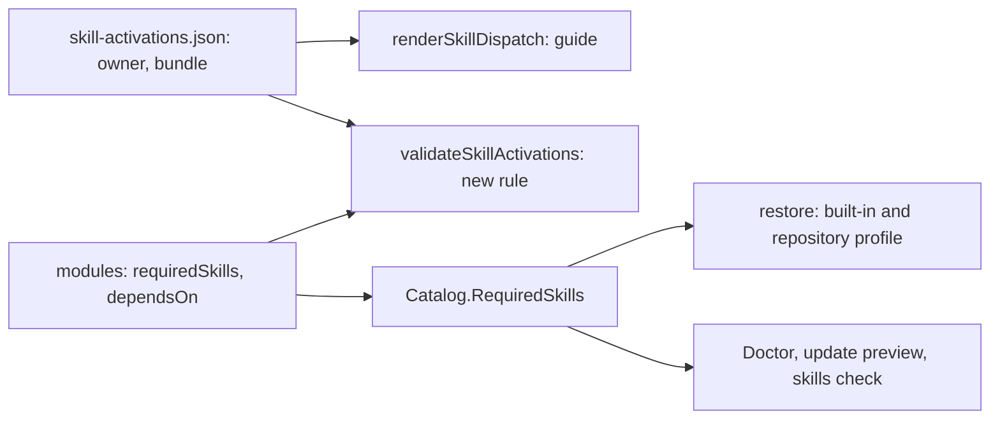

# A skill the skill dispatch names joins the Repository Skill Set — Technical Spec

## Executive Summary

The skill dispatch guide and the Repository Skill Set are computed from two parts of the embedded catalog that nothing ties together: the guide renders the bundle of every Skill Activation whose owner is selected, and the set is the union of the selected modules' `requiredSkills`. The `typescript` module owns the production-code activation and does not require `solid`, so a profile with `typescript` and without `frontend` renders a skill it never requires. The fix is in the catalog, where the defect is: `typescript` requires `solid`, and catalog validation refuses any activation whose bundle names a skill its owner does not require. The three hand-written unions become one function. The trade-off accepted is a declared list that a check keeps honest, instead of a set computed from the dispatch: it costs a Baseline module edit and its regeneration, and it keeps `requiredSkills` the whole declaration that every reader, guide and decision record already describes (ADR-0448).

## Project Constraints

- Identifier strategy: not applicable — no identifier is minted; the diagnostic carries the activation identifier and the skill name the catalog already holds. Source: `docs/agents/domain.md`.
- Authentication and HTTP: not applicable — no endpoint, credential or network call; validation and the readers read embedded assets, a repository profile file and the Setup Manifest. Source: `docs/agents/cli.md`, `docs/agents/agent-instructions.md`.
- Active ADR obligations: applicable — ADR-0448 (new); ADR-0067, ADR-0191, ADR-0222 and ADR-0241 bind the design; ADR-0074, ADR-0204, ADR-0206, ADR-0256, ADR-0257, ADR-0322, ADR-0346, ADR-0350, ADR-0360 and ADR-0364 listed only to record why they do not apply. Source: `docs/agents/domain.md`, `docs/agents/specific-repository.md`.
- Tooling authority: applicable — express maintainer authorization: the answer "Tudo, com patch v0.152.1" of 2026-11-20, quoted in the authorization record; it bounds one Baseline module edit and the Managed Refresh of this repository's Setup Manifest, grants a release at a `patch` Release Ceiling, and grants no Makefile, workflow, Go module, lint or formatter change. Source: `docs/agents/agent-instructions.md`, `docs/agents/spec-routing.md`, `docs/agents/specific-repository.md`; Spec-contained authorization record: `docs/specs/0415-a-skill-the-skill-dispatch-names-joins-the-repository-skill-set/_authorization.md`; bounded files: `docs/agents/setup-context.json`, `internal/baseline/assets/modules/typescript.json`.

## System Architecture

Three existing components change, all in the Baseline; nothing new is wired. File and line evidence is in `references/2026-11-20-request-and-characterization.md`, cited as "the characterization".

1. The embedded catalog. `internal/baseline/assets/modules/typescript.json` gains `solid` in `requiredSkills`. The `frontend` module keeps it, because it dispatches `solid` under its own trigger and a module requires what it dispatches. `skill-activations.json` does not change.
2. Catalog validation, `validateSkillActivations` in `internal/baseline/catalog_validate.go`. Today it checks that an activation's owner and bundle exist. It gains one rule: each skill of the bundle is required by the owner or by a module the owner reaches through `dependsOn`. It runs at every catalog load, after the module cycle check.
3. The readers of the required skills. `loadRestoreProfile` and `loadSkillSnapshotProfile` in `internal/baseline/skills_restore.go` and `resolveExternalSkillRequirement` in `internal/cli/doctor.go` each write the same union by hand. They call one new method of `Catalog` instead. Their callers, outputs and messages stay as they are.



The guide renderer `renderSkillDispatch` and `profileNamedSkills` do not change. The new rule, with the existing one that a module requires what it dispatches, makes what they name a subset of what `Catalog.RequiredSkills` returns, for every composition the catalog accepts: a built-in profile and a repository profile must both select each module's dependencies (`catalog.profile.dependency.missing`, `custom.profile.module.dependency.invalid`), and a repository profile composes only embedded modules, as ADR-0067 decides: "may compose only the modules, decisions, Repository Capabilities, and templates in the CLI's embedded catalog".

`roundfix baseline profile validate` needs no new check for that reason, and it reports the characterization's profile `valid` before and after.

## Implementation Design

### Interfaces

```go
// internal/baseline/catalog.go

// RequiredSkills returns, sorted and without repeats, the skills the given
// modules require: the union of their requiredSkills. It is the one reader
// of a composition's required skills.
func (catalog *Catalog) RequiredSkills(moduleIDs []string) ([]string, error)

// UnknownModuleError is what RequiredSkills returns for a module the catalog
// does not hold.
type UnknownModuleError struct{ ModuleID string }

func (err *UnknownModuleError) Error() string
```

```go
// internal/baseline/catalog_validate.go, inside validateSkillActivations,
// for an activation whose owner and bundle both exist:
//
//   required := catalog.RequiredSkills(owner and every module it reaches
//                                      through dependsOn, cycles tolerated)
//   for each skill of the bundle, in bundle order, that required lacks:
//       l.add("catalog.skill.activation.skill.unrequired", activationID, skill)
```

Invariants:

```text
1. For every Skill Activation of a loaded catalog, each skill of its bundle is
   in the requiredSkills of its owner or of a module the owner reaches through
   dependsOn.
2. For every module, each skill its skillDispatch names is in its own
   requiredSkills (existing, TestEveryModuleRequiresEverySkillItDispatches).
3. For every module taken with its dependencies, and for every built-in
   profile, each skill the rendered skill dispatch guide names is in
   Catalog.RequiredSkills of the same modules.
4. loadRestoreProfile, loadSkillSnapshotProfile and
   resolveExternalSkillRequirement take the required skills only from
   Catalog.RequiredSkills.
5. The required skills of the five built-in profiles are the names they were
   at 851024fa: 41, 105, 38, 34 and 95 of them.
```

### Data Models

No schema changes. The `typescript` module's `requiredSkills` list gains one string and its `version` rises to the next free version; the Module Version Record gains that version with its digest. A skill may now be in the `requiredSkills` of two modules; `catalog.module.requiredSkills.duplicate` looks inside one module only, and the union removes the repeat.

### API Contracts

1. API Contract: the catalog diagnostic. Code `catalog.skill.activation.skill.unrequired`; `Path` is the activation identifier; `Info` is the skill name. One diagnostic per skill of the bundle that neither the owner nor a module it reaches through `dependsOn` requires, in activation order and then bundle order. It joins the other diagnostics of the `*ValidationError` that `LoadCatalog` returns, so the catalog does not load. An activation whose owner or bundle is unknown reports only `catalog.skill.activation.owner.unknown` or `catalog.skill.activation.bundle.unknown`. A module the owner does not depend on never satisfies the rule.
2. API Contract: `Catalog.RequiredSkills`. Input: module identifiers in any order, repeats allowed. Output: the sorted union of their `requiredSkills`, each name once; an empty list for no modules. A module the catalog does not hold returns `*UnknownModuleError` naming it and no list. Each caller keeps the message it prints today: restore reports `restore.assets-invalid` with "Embedded Baseline Profile %q references a missing module.", and Doctor reports "resolve external skill requirement: Setup Manifest names unknown module %q". Doctor still removes the Roundfix-owned names after the call. The branch of `loadRestoreProfile` that reports an invalid module document goes away: the method reads the documents catalog loading already validated.
3. API Contract: the `typescript` module. `requiredSkills` gains `"solid"` after `"onioncry"`. The version line is written by the module record command, never by hand, and no other field changes. `make baseline-digests` then rewrites `internal/baseline/testdata/catalog.digest`, `internal/baseline/testdata/catalog.normalized.json` and the four goldens under `internal/baseline/testdata/plan-characterization/`, and the Managed Refresh rewrites `catalogDigest` and `roundfixVersion` in `docs/agents/setup-context.json` (the characterization, section 5).
4. API Contract: the glossary. The entry **Skill Activation** gains, after its first sentence and before its `_Avoid_` line, this sentence, word for word: "The module that owns it, or a module that owner depends on, requires every skill of the bundle, so a profile that selects the owner holds the whole bundle in its Repository Skill Set (ADR-0448)." There ADR-0448 is a link to `docs/adr/0448-the-owner-of-a-skill-activation-requires-every-skill-of-its-bundle.md`, written as the neighbouring entries write theirs.

### Surface Transcripts

None. No command, flag, output line, field or exit code is added or changed. `roundfix skills check`, the update preview and the restore command print the lines they print today; for a profile with `typescript` and without `frontend` they now include `solid`. The QA gate reproduces that through the built binary (`_prd.md` → Success Metric 4).

## Coverage Map

- Goal 1 → the `typescript` module edit (API Contract 3), read through `Catalog.RequiredSkills` by `loadSkillSnapshotProfile` and `resolveExternalSkillRequirement`.
- Goal 2 → the rule in `validateSkillActivations` (API Contract 1), invariants 1 to 3.
- Goal 3 → `Catalog.RequiredSkills` and its three callers (API Contract 2), invariant 4.
- Goal 4 → invariant 5; the union is unchanged for every built-in profile because each one that selects `typescript` selects `frontend`.
- Core Feature 1 → API Contract 3.
- Core Feature 2 → API Contract 1.
- Core Feature 3 → API Contract 2.
- Core Feature 4 → API Contract 4 and ADR-0448.
- Success Metric 1 → `TestARepositoryProfileWithoutFrontendRequiresSolid`.
- Success Metric 2 → `TestAnActivationOwnerRequiresEverySkillOfItsBundle`.
- Success Metric 3 → `TestTheRequiredSkillsCoverTheRenderedDispatch`.
- Success Metric 4 → the QA reproduction through `bin/roundfix skills check` and `bin/roundfix baseline skills restore`, on the temporary repository of the characterization, section 3.
- Success Metric 5 → `TestTheRequiredSkillsCoverTheRenderedDispatch`, subtest `the_built_in_profiles_keep_their_names`, with `TestSkillSnapshotProfileKeepsEveryBuiltInProfile` unchanged.
- Success Metric 6 → the rule of API Contract 1, read against the passage `_prd.md` → Acceptance evidence quotes.

Deviations from the PRD: None.

## Absence Evidence

1. `Catalog.RequiredSkills` and `UnknownModuleError` — command: `rg -n 'func \(catalog \*Catalog\) RequiredSkills|\.RequiredSkills\(|UnknownModuleError' internal skills`; result: no match; the union is written by hand at `internal/baseline/skills_restore.go:644` and `:809` and at `internal/cli/doctor.go:610`, which `rg -n 'requiredSkills"\]|json:"requiredSkills"' internal --glob '!*_test.go'` lists with the catalog's own setup check.
2. The diagnostic `catalog.skill.activation.skill.unrequired` — command: `rg -n 'skill\.unrequired' internal skills docs/user-guide CONTEXT.md`; result: no match; `validateSkillActivations` (`internal/baseline/catalog_validate.go:1405-1433`) reads `owner` and `bundle` and never `requiredSkills` or `dependsOn`.
3. The three tests and the fixture — command: `rg -n 'TestAnActivationOwnerRequiresEverySkillOfItsBundle|TestARepositoryProfileWithoutFrontendRequiresSolid|TestTheRequiredSkillsCoverTheRenderedDispatch|typescriptBackendProfileFixture' internal skills`; result: no match.
4. The glossary sentence — command: `rg -n -i 'owner' CONTEXT.md | rg -i 'activation|bundle'`; result: no match; the entry **Skill Activation** names no owner.

## ADR Alternatives

- ADR-0448: the design takes its decision; the rejected options (computing the set from the dispatch, moving the activation, removing `solid` from the bundle, a test in place of a diagnostic) stay rejected.
- ADR-0191: kept and extended, not amended. Its rule stands as written, "a module requires every skill it dispatches", and the new rule is its counterpart for an activation's bundle; the setup check it decided is untouched.
- ADR-0222: kept. It gives the production-code activation to `typescript` because "A Skill Activation belongs to a module that only profiles whose setups install every skill of its bundle select"; the design keeps that owner and takes neither rejected option: no trigger is removed and no activation moves to `core`.
- ADR-0241: kept as written. "A repository profile requires the skills its own modules require" stays true, because the fix changes what a module requires, not how a profile's set is derived. Neither rejected option is taken: no binding to a built-in profile and no `setup` field.
- ADR-0067: kept. A repository profile still composes only embedded modules, which is why a catalog rule covers it and `profile validate` gains no check.
- ADR-0074: not applicable — no repository-rule carrier and no clause ownership changes; it cites ADR-0067 for the carrier, which this Spec does not touch.
- ADR-0204: not applicable — no setup is composed or changed; the composed Setup Snapshot already lists `solid`.
- ADR-0206: not applicable — no setup is renamed and no skill is removed from a snapshot.
- ADR-0256: not applicable — no Behavior Surface changes: no command help, configuration key, exit code or user-guide page.
- ADR-0257: not applicable — no Baseline clause is added, reworded or replaced; the module edit changes `requiredSkills` only.
- ADR-0322: not applicable — the Python setup and profile are untouched, and their required skills keep their 38 names.
- ADR-0346: not applicable — the Task prompt, the Loaded Skill List and the guide a Run Agent reads do not change; the fix makes the skills that guide names installable.
- ADR-0350: not applicable — `solid` is not a Retired Skill, and no retired name joins a module or a bundle.
- ADR-0360: not applicable — no Vendored Skill, lock entry or Setup Snapshot is written; the Catalog Skill Bump is not run.
- ADR-0364: not applicable — a required external skill is still checked only for presence; the fix changes which skills are required for one composition, not how one is checked.

## Integration Points

None external. Catalog validation and the readers read embedded assets and local files. The approved update and the restore command reach the skills' upstream repository exactly as today; this Spec's tests and QA rows stop before that, at the selection.

## Testing Approach

All tests attach to existing seams: `cloneEmbeddedAssets`, `LoadCatalog` and `catalogDiagnosticByCode` for a mutated catalog; `InitCustomProfile`, `ResolveProfile`, `loadSkillSnapshotProfile` and `RestoreSkills` for a repository profile; `renderSkillDispatch` for the guide. No new seam.

- `TestAnActivationOwnerRequiresEverySkillOfItsBundle`, in a new `internal/baseline/catalog_activation_requirement_test.go`. Subtests: `the_embedded_catalog_loads`; `a_sibling_module_does_not_satisfy_the_owner`, which removes `solid` from the copied `typescript` module and expects exactly one diagnostic with path `trigger.production-code` and info `solid`, although `frontend` still requires it; `a_dependency_satisfies_the_owner`, which removes `systematic-debugging` from the copied `core` module and expects the diagnostic with path `trigger.debugging` and info `systematic-debugging`, proving that the owner was satisfied through `core`; `an_unknown_owner_reports_only_the_owner`.
- `TestARepositoryProfileWithoutFrontendRequiresSolid`, in `internal/baseline/skills_snapshot_profile_test.go`, on a new helper `typescriptBackendProfileFixture`: `InitCustomProfile` from `standard-typescript-monorepo`, then the profile file's `modules` cut to the eight of the characterization. It asserts that `RequiredSkills` holds `solid`, that its contract equals the one the `typescript` Setup Snapshot pins, and that `RestoreSkills` selecting `solid` with an absent source directory reports `restore.source-dir-invalid`.
- `TestTheRequiredSkillsCoverTheRenderedDispatch`, in the same new file. For every module with its dependencies, and for every built-in profile, it renders the guide and reads the skill names from the text an Agent reads: each backticked token after the colon of a line that begins with two spaces and ``- `bundle.``, and the token of each line that is exactly ``- `<name>`:``. Each must be in `Catalog.RequiredSkills`. The subtest `the_built_in_profiles_keep_their_names` asserts the five counts of invariant 5 and that `solid` is in the two TypeScript profiles and in none of the other three.
- Existing tests that stay unchanged and keep passing: `TestSkillSnapshotProfileKeepsEveryBuiltInProfile`, `TestSkillSnapshotProfileResolvesARepositoryProfile`, `TestEveryModuleRequiresEverySkillItDispatches`, the Doctor tests that inject `resolveExternal`, including the unknown-module case, and `TestBaselineUpdateSurfaceTranscriptThisRepositoryIsCurrent`, which passes only after the Managed Refresh.
- The QA gate's sabotages: remove `solid` from the `typescript` module (the catalog must not load); delete the new rule (`a_sibling_module_does_not_satisfy_the_owner` must fail); make `Catalog.RequiredSkills` skip one module (`TestTheRequiredSkillsCoverTheRenderedDispatch` must fail).
- No test reads the network, the real home, another repository or the clock.

## Build Order

1. The catalog requires what its activations name, in this order inside one change, because each part breaks the tree without the next:
   - `Catalog.RequiredSkills` and `UnknownModuleError` (API Contract 2), with the three readers moved onto it;
   - the rule in `validateSkillActivations` (API Contract 1) together with `solid` in the `typescript` module (API Contract 3): the rule alone makes the embedded catalog fail to load;
   - the module record command, `make baseline-digests` and the Managed Refresh, in that order;
   - the three tests and the fixture;
   - the glossary sentence (API Contract 4).
2. The QA gate (depends on: 1).

Step 1 is one context and one Task-sized change. Moving the readers has no Verification that fails before it on its own, since the agreement of the three unions holds on both sides of the move, so it does not stand as a separate Task. No Verification of this Spec depends on another Spec. A separate Spec about the knowledge-base search, waiting on a decision, is expected to edit another Baseline module; whichever delivers second regenerates the digests, the goldens and the Setup Manifest on its own tree, and this Spec writes "the next version", never a number.

## Risks & Considerations

- The new rule fails every command that loads the catalog when the catalog breaks it. That is the intent, and it is reachable only through a source change that the tests also report.
- An adopter whose profile selects `typescript` without `frontend` sees `solid` as a Missing Required Skill on its first update after the release; `--yes` restores it from the commit the Setup Snapshot pins, which needs the network.
- Every adopter's Setup Manifest records a new `catalogDigest` on its next update, as after any module change.
- `loadRestoreProfile` loses a branch that reported an invalid module document. Catalog loading validates the documents first, so the branch was unreachable for the embedded catalog.
- The rule checks the catalog, not an installed repository. A skill that is required and absent is still found only by the update preview, `skills check` and Doctor; a Run does not check it (`_prd.md` → Decisions).

## Glossary

- changes: **Skill Activation**

## Decisions

- Declare and check, not compute: the owner of a Skill Activation requires every skill of its bundle, and catalog validation refuses anything else. See ADR-0448.
- A dependency of the owner satisfies the rule; a module beside it does not. See ADR-0448.
- The rule is a catalog diagnostic at load, next to the owner and bundle checks, not a test only. See ADR-0448.
- One `Catalog` method reads the required skills; a typed error names an unknown module so each caller keeps its message.
- `solid` stays in `frontend` as well: it dispatches the skill under its own trigger.
- `roundfix baseline profile validate` gains no check; the catalog rule covers every repository profile.
- The guide renderer and `profileNamedSkills` are not merged with the new rule; the coverage test reads the rendered text so that it stays an independent witness.
- Released at a `patch` Release Ceiling, by the maintainer's answer of 2026-11-20 (`_prd.md` → Decisions).
- Delegated Decision of 2026-11-20: Does this fix add a check at Run start that refuses or warns when a required skill is not installed?
- Delegated Decision of 2026-11-20: Does Doctor's next action for a missing external skill change from the catalog install command to the restore command?
